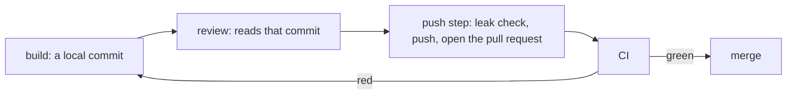

# 0392: Pushing the branch and opening the pull request is its own step, run by the parent between review and merge, and a red CI sends the work back to build and review again

**What this decides:** where the push and the pull request open sit in a lane, and what a red CI
does.

## Context

From [nothing is pushed before review](../docs/direction/push-after-review.md#still-open): the
order and the red CI rule were decided 2026-10-24, and who pushes was answered 2026-10-27, a small
push program between review and merge.

## Decision

**The push is a step of its own after review, and the parent does it.**

- After review passes, the push step pushes the branch and opens the pull request. The push and the
  open are tool calls the parent checks and runs, with the key it holds
  ([0028](0028-the-parent-holds-every-right.md)).
- A red CI goes back to build. The new commit is reviewed again before the next push.

## Consequences

- Today's hand-run lanes land this way: `land.ts run`, in the lead session, pushes, opens the pull
  request and merges after the review said merge-ready
  ([0056](0056-lead-runs-a-refused-step-itself.md)).
- The leak check before every push is [0048](0048-leak-check-reads-each-commit.md)'s.
- Not decided here: whether anything at all may reach the code host before review. The note says
  build pushes nothing; today's hand-run steps push a `-wip` backup branch after each step.
