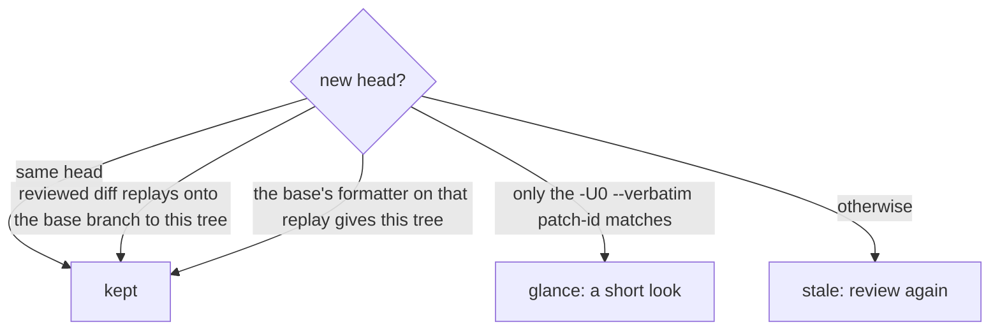

# 0394: A kept yes carries to a new head by one rule, carry, answering kept, glance or stale, never by the sha alone, and the checks always run again at the final head



```ts
// From today's packages/pipeline/src/stages/pipeline/carry.ts.
export const Kept = Schema.Literals(["same_head", "replayed", "formatted"]);
// carry(given, now): kept("same_head") | kept("replayed") | kept("formatted")
//   | { _tag: "glance", range } | { _tag: "stale" }
```

**What this decides:** when a review's verdict, a person's yes or the lane's stand-in yes still
holds after the head moves.

## Context

From [a yes binds to the diff](../docs/direction/a-yes-binds-to-the-diff.md#what-was-decided),
decided by the owner 2026-11-02 from experiment 165, for both versions. Built in today's version
(`carry.ts`). On all 13 real force pushes here the sha changed, and the meaning had not.

## Decision

**One rule, `carry`, decides whether a yes moves to a new head.**

- `kept` only for the same head; a clean replay of the reviewed diff onto the pull request's base
  branch as it is now (`git merge-tree`) that gives exactly the new tree; or the base's formatter,
  run on that replay, giving exactly the new tree.
- A match of `git diff -U0 base head | git patch-id --verbatim` alone earns a `glance` at the few
  moved lines, never a silent yes.
- Anything else is `stale`: review again, or ask the person again.
- Patch-id is always `--verbatim`, never whitespace-blind `--stable`.
- Every diff is read against the pull request's base branch, never main, so a stacked child reads
  its parent's branch.
- The checks always run again at the final head. No `carry` answer stands in for them.

## Consequences

- Each push to a reviewed pull request costs one `merge-tree`, one patch-id and one range-diff, and
  sometimes a formatter run.
- Not decided here: who gives a glance and how. The note's two leans (the review step's short mode,
  at 65%, and the person's own look, at 80%) are not decided.
