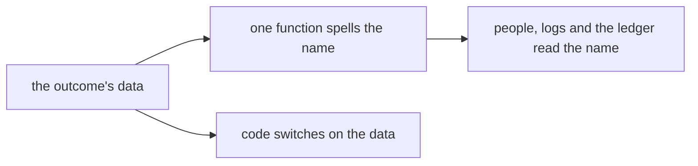

# 0396: Every step ends in one of five verbs, done, send, ask, skip or stuck, spelled verb:to:reason when it passes the work on and verb:reason when it ends, by one function



```ts
// In next/, Effect Schema writes the _tag. Today's code says `kind` and `why`.
{ _tag: "send", to: "builder", reason: "checks_red" } // "send:builder:checks_red"
{ _tag: "ask", to: "owner", for: "approval" }        // "ask:owner:approval"
{ _tag: "stuck", reason: "read_failed" }             // "stuck:read_failed"
```

**What this decides:** how every step reports how it ended, and how that outcome is named.

## Context

From [outcome names](../docs/direction/outcome-names.md#what-was-decided), decided 2026-10-11; every
step of today's pipeline is built on it. The `reason` key is the owner's of 2026-11-09, and the
ask's `to` is [0081](0081-no-question-word-names.md)'s.

## Decision

**A step hands back one outcome, in one of five verbs.**

- `done`: finished. `send`: another step must act. `ask`: a person must decide or act. `skip`:
  nothing here for this step. `stuck`: something could not be read; stop, never guess.
- A name is `verb:to:reason` when it passes the work on (`send`, `ask`) and `verb:reason` when it
  ends here (`done`, `skip`, `stuck`). The second part of a passing-on name is always who gets it.
- Parts are joined with `:`, and words inside a part with `_`.
- Code switches on the outcome's data. One function spells its name, and the name's pattern is a
  type, so no name is written by hand.
- A new step defines only its own `to` and `reason` words. Each is a short everyday word that never
  repeats the verb or the step.
- A step that seems to need a sixth verb is a finding first, written down before any verb is added.

## Consequences

- A parent is written once: it reacts to five verbs, not to each step's own endings.
- Not decided here: whether `stuck` covers a write that failed and a wait that ran out, as today's
  ship uses it.
