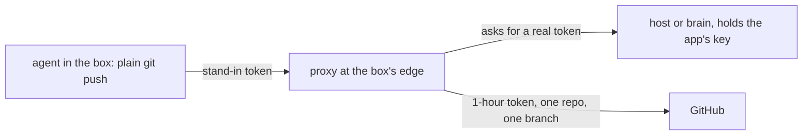

# 0403: In the box, git and gh see a stand-in token that a proxy at the box's network edge swaps for a real 1-hour token limited to one repo and one branch

**What this decides:** how an agent in a box pushes without holding a real credential.

## Context

From [agents commit as a bot](../docs/direction/agents-commit-as-a-bot.md), decided by the owner
2026-11-06. It fills in [0028](0028-the-parent-holds-every-right.md)'s git-proxy lean: the box
holds no right but its own model login.

## Decision

**The box holds a fake token; the real one exists only at its network edge.**

- The app's key stays with the host (in `next/`, the brain), outside every box.
- In the box, `git` and `gh` see a stand-in token. A proxy at the box's network edge swaps it for a
  real token that lasts one hour and is limited to one repo and one branch.
- Agents keep plain `git push` and `gh`, so a person's agent skills that use them move over without
  change.

## Consequences

- Not decided here: how the edge reaches a brain on Cloudflare and proves which agent asks.
