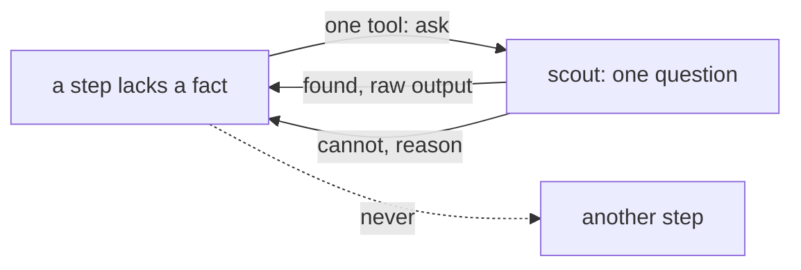

# 0416: A step that lacks a fact calls a helper, never another step, and the first helper is a scout that answers found with what it saw or cannot with its reason, never pass or fail

**What this decides:** how a step gets a fact it cannot read itself.

## Context

From the note "helpers, and one supervisor", since removed,
decided 2026-10-12. A reviewer with no shell could not see a line that needed a command, and the
first idea, sending it back to the builder, would have started a loop between two agents.

## Decision

**Getting a fact is a helper's job, never another step's.**

- A step that lacks a fact calls a helper. Fixing code goes to the builder because that is building;
  getting a fact never does.
- The first helper is a scout, a small child machine built from the same primitives. One question
  in, one fact out: `found` with the raw output it saw, or `cannot` with its reason. It never says
  pass or fail.
- A "run this one command" question needs no scout: it is a plain Gather.
- An agent may ask for a helper at any moment, through one tool. Whether to ask stays the agent's.
- There are no shell allow-lists. Our typed reads become tools an agent calls; anything nobody
  foresaw goes to a scout. A scout whose answer was one command is the proof for a new typed read.
- Asks are counted per run. Since 2026-10-24 the app counts them at the box's wall.

## Consequences

- Not decided here: what other kinds of helper exist, and what keeps the scout from becoming a
  catch-all.
