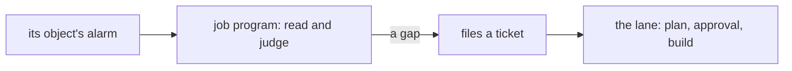

# 0422: In next/, a scheduled job is a program that listens to the clock on its own Durable Object alarm, never a second scheduler or Cron Triggers, and it never changes code



```ts
// A sketch, from the note, not built.
const tlaDrift = scheduled("tla_drift", { every: days(1) }, function* () {
  const specs = yield* gather(readSpecs);
  const drifted = yield* check(fitsRealRuns, specs);
  for (const spec of drifted) yield* act(fileTicket, { title: `The TLA+ spec ${spec.name} no longer fits its code` });
});
```

**What this decides:** how a scheduled job runs in `next/`, and what it may change.

## Context

From [scheduled jobs run on the host's alarms](../docs/direction/scheduled-jobs-on-the-host.md),
whose shape the owner decided 2026-11-01. Cron Triggers do not run in local development; an alarm
fires the same on a laptop and on Cloudflare.

## Decision

**A scheduled job is a program on the host, waiting on the clock as Elm's `Time.every` does.**

- It runs on Durable Object alarms, never Cron Triggers, and needs no second scheduler.
- Each job is its own program with its own alarm.
- A job never changes code. It files a ticket, and the ticket shows who filed it. Everything after
  goes through the lane, the plan's approval included.

## Consequences

- The object wakes and sleeps as [0105](0105-a-durable-object-never-stays-awake-on-its-own.md) says.
- This is the product. This repo's own scheduled jobs, the laptop cleaner and the mutation run, run
  on an OS timer and on GitHub's schedule ([0101](0101-box-cleanup-runs-on-a-timer.md),
  [0108](0108-a-job-lives-in-a-lane-a-queue-or-a-scheduled-job.md),
  [0123](0123-githubs-schedule-starts-the-mutation-run.md)).
