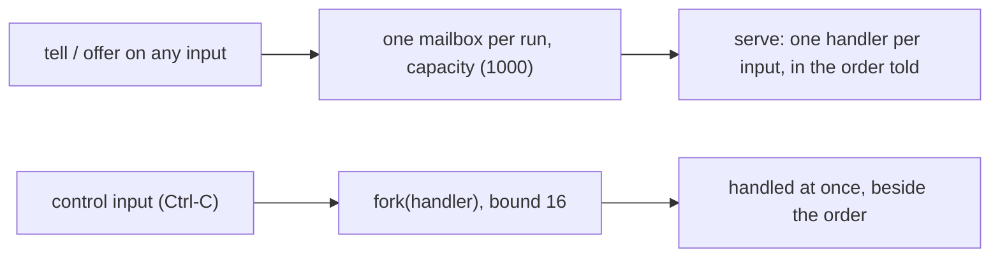

# 0433: In today's version, a program run has one mailbox served in the order told, bounded by its capacity, with control inputs handled beside the order under their own bound of 16



```ts
yield* serve({ line: (text) => run(text), signal: fork((s) => interrupt(s)) },
  { until: ["line"] }); // stop once these have closed; left out, once every input has
```

**What this decides:** how a run of a program takes what it is told, in today's `defineProgram`.

## Context

The bound was per input first, then per run (shape B of experiment 164,
[#166](https://github.com/usirin/tea-fabrika/pull/166)). From
[tea-program](../docs/direction/tea-program.md#parts-already-decided). Today's code:
`packages/fabrika/src/program/program.ts`. In `next/`, programs mail each other by name
([0103](0103-a-program-may-mail-another-by-name.md)).

## Decision

**Every value told to any input goes into the run's one mailbox, and `main` serves it in the order
told.**

- `main` calls `serve(handlers, {until?})`, with one handler per input. Every input needs one, a name
  that is no input does not compile, and each value's type comes from its input's schema.
- `until` lists input names: serving stops once all of them have closed; left out, once every
  input has.
- One bound per run, the program's `capacity`: 1000 when left out, a program fact, never a host
  setting. It must be a whole number, 1 or more, checked when the program is defined.
- A `tell` past the bound never waits and fails the tagged `MailboxFull`, with the input and the
  bound. `offer` waits for room.
- A control input is handled at once with `fork(handler)`, beside the order, and has its own bound
  of 16, so Ctrl-C is never stuck behind a full mailbox.
- `workQueue` takes only inputs that ack, by type (2026-10-18).

## Consequences

- A flood keeps memory flat, and a full mailbox shows in the caller's type.
- No dropping or sliding mailbox yet.
