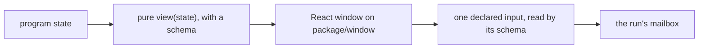

# 0439: In today's version, a program's view belongs to the host, typed both ways, and reaches the program only through its declared inputs, never a dispatch of a raw Msg



```ts
// A program says it has a window with a pure view of one machine (packages/fabrika/src/program/program.ts).
view: { machine: "count", data: Schema.Struct({ n: Schema.Int }), of: (s) => ({ n: s.n }) }
```

**What this decides:** who owns a program's window, and the only way that window talks back.

## Context

A view belonging to the host was decided 2026-10-18, no `dispatch` on 2026-10-19, and the pure
`view(state)` on 2026-10-22; the Electron note of 2026-10-24 carried all of it over. From
[tea-program](../docs/direction/tea-program.md#parts-already-decided) and
[the GUI is an Electron app first](../docs/direction/the-gui-is-electron-first.md#what-was-decided).

## Decision

**A view is the host's; the program holds no renderer and no React.**

- A program may declare a pure `view(state)` that picks its data with a schema. Its window is a
  React component in the same package, on `<package>/window`.
- A view or a host reaches a program only through its declared inputs. There is no
  `dispatch(machine, msg)` on the run handle: a raw Msg would skip the input's schema, the
  mailbox's bound and `MailboxFull` ([0433](0433-a-run-has-one-bounded-mailbox.md)).
- The host decodes every message from a window with that input's schema before `update` sees it.
- React holds only drafts.

## Consequences

- A window that answers a permission prompt tells the program's `permission` input.
- Each raw Msg a window would send becomes a declared input.
