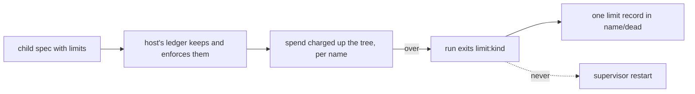

# 0441: In today's version, a run's limits are declared with it and the host enforces them, nested like cgroups, and a limit exit is never restarted



```ts
export type LimitReason = "limit:usd" | "limit:tokens" | "limit:wall"; // packages/fabrika/src/host/rules.ts
```

**What this decides:** who says no when a run spends too much, in today's version.

## Context

A container's `resources.limits` and the cgroup that enforces them, for tea programs. From
[tea-program](../docs/direction/tea-program.md#what-is-proposed), a bullet decided 2026-10-20
inside a proposed section; its sub-bullets are part of it. Built in experiment 102
(`packages/fabrika/src/host/ledger.ts`, `supervisor.ts`). In `next/`, programs get hard walls
([0020](0020-programs-get-hard-walls.md)).

## Decision

**A run carries its limits and the host enforces them; going over ends the run, like `OOMKilled`.**

- Limits cover dollars or tokens, wall time (Kubernetes' `activeDeadlineSeconds`) and how many
  children run at once (OTP's `max_children`).
- Limits nest like cgroups: a parent's limit caps itself and every child under it.
- Spend is kept in the ledger, per name. A restart does not reset it, so a crash loop cannot spend
  without end.
- Going over ends the run with reason `limit:<kind>`. Its supervisor never restarts a limit exit;
  it goes to the dead-letter stream, so the desk shows it to raise or drop.
- The numbers are settings ([0069](0069-choices-are-settings.md)). No `fabrika.toml` key holds
  them in today's code yet.

## Consequences

- This replaces fabrika's own supervisor as the one that says no.
- Soft limits (a warning before the end) are open.
