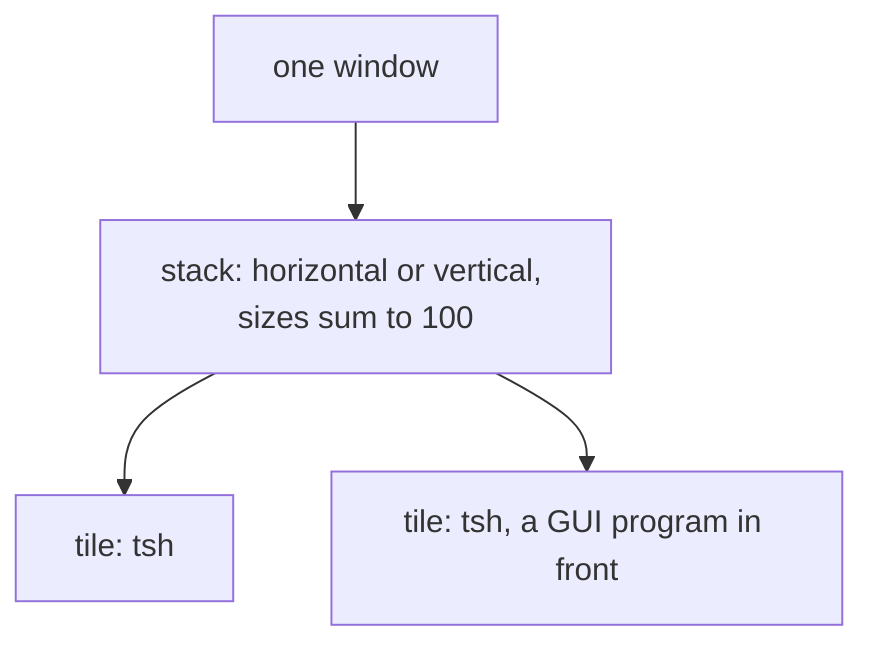

# 0443: In today's version, the app's window is tiled like tmux and Tuval, every new tile runs tsh, and a program with a GUI runs inside its tile, never a window of its own



```ts
// A sketch. The layout is a pure tree, from Tuval's: tiles and stacks of tiles.
type Layout = TileNode | StackNode;
type StackNode = { tag: "stack"; orientation: "horizontal" | "vertical"; children: ReadonlyArray<Layout>; sizes: ReadonlyArray<number> };
```

**What this decides:** the shape of today's app window and what runs in each part of it.

## Context

Tuval's tiling was used every day, and its keys are tmux's. From
[tiles, like tmux](../docs/direction/the-gui-is-electron-first.md#decided-2026-10-25-tiles-like-tmux)
and, the same day,
[Tuval and tmux decide](../docs/direction/the-gui-is-electron-first.md#decided-2026-10-25-later-tuval-and-tmux-decide-the-host-runs-apart).
It replaced the proposed window per program.

## Decision

**Tuval and tmux are the default: where they agree, we follow them, and where they clash, the owner
picks.**

- One window, tiled with Tuval's layout tree (split, close, focus by direction, resize, zoom,
  workspaces) and tmux's Ctrl-B table, which Tuval shared.
- Every new tile runs tsh, as every new tmux pane runs a shell.
- A program with a GUI runs inside its tile, as vim runs in a tmux pane. In the foreground it
  covers its tile and tsh waits; Ctrl-C stops it and tsh is back. The other tiles stay as they were.
- Ctrl-B never reaches tsh or a program; Ctrl-B twice sends one Ctrl-B on, as tmux's
  `send-prefix` does.

## Consequences

- A tile gets its size from the layout, so no program needs a window size of its own.
- The jobs a tile's tsh starts are the host's, not the tile's
  ([0448](0448-the-host-keeps-terminals-and-jobs.md)).
