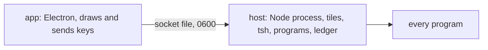

# 0444: In today's version, the host runs apart from the app as tmux's server does, so closing the window or quitting the app stops nothing, and after a host stop every program comes back running



```text
open the app        attach to the host, or start one first if none runs
close the window    nothing stops; the dock brings the window back, on the same desk
quit the app        Cmd-Q: the window goes, the host goes on
the host stops      at its next start, every program comes back running
```

**What this decides:** which process owns the running work, and what each way of closing stops.

## Context

A lane runs for hours, and closing a window should not end it. From
[Tuval and tmux decide; the host runs apart](../docs/direction/the-gui-is-electron-first.md#decided-2026-10-25-later-tuval-and-tmux-decide-the-host-runs-apart),
which changed the note's first decision: the app no longer runs the host. Today's code:
`apps/fabrika/src/attach.ts` and `host/`.

## Decision

**The host is a process of its own, and the app attaches to it.**

- The app finds the host on its socket file, or starts it, and attaches. Closing the window or
  quitting the app stops nothing.
- macOS's own rules hold: the close button closes the window only, Cmd-Q quits the app, and closing
  the last tile closes the window, as closing the last tab does in Terminal.
- What the app keeps (the layout and every tile's jobs) goes on the host's one ledger, never a
  `desk.json` or a folder per tile.
- When the host starts again, every program comes back running, Tuval's way. One that cannot shows
  "gone" in its tile.

## Consequences

- Not built yet: today's host keeps the desk in `desk.json` and the jobs in its storage folder, and
  after a host stop the jobs come back detached, for `attach`, not running (the app's README, ticket
  3).
- An agent halfway through a call when the host stops needs its own way back before the restore is
  built, so a paid call or a comment is not sent twice.
- Costs a second process, its memory while the window is closed, and a trip to the host for each
  Ctrl-B.
