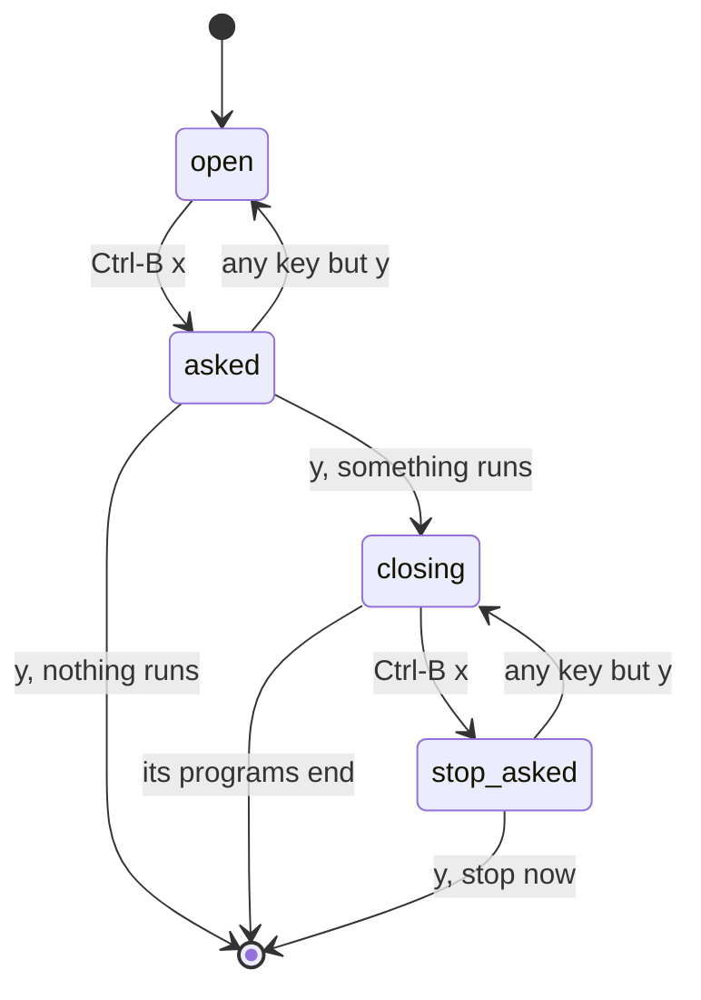

# 0446: In today's version, closing a tile is tmux's, Ctrl-B x always asks and ends inputs before it stops anything, and & starts a background job as in bash, brought in by attach

**What this decides:** what closing a tile ends, and how a job goes to the background and back.

## Context

A tile owns its tsh, as a pane owns its shell, so Tuval's close, which only let go of a view, does
not fit. From [Tuval and tmux decide](../docs/direction/the-gui-is-electron-first.md#decided-2026-10-25-later-tuval-and-tmux-decide-the-host-runs-apart).
It replaced the earlier lean that `&` opens a tile beside. Today's code: `apps/fabrika/src/desk/desk.ts`.

## Decision

**Ctrl-B x always asks y or n, and only y says yes.**

- y gives the tile's tsh and the programs it started the end of their inputs. The tile shows
  "closing" until they end, then goes. There is no timer.
- Ctrl-B x on a closing tile asks to stop them now.
- Runs shown in other tiles are left alone.
- `&` starts a job in the background, as in bash, and nothing opens. `attach %n` brings it into the
  tile, as `fg` does.

## Consequences

- A program that ignores the end of its inputs (`sleep`) keeps its tile closing until the second
  question.
