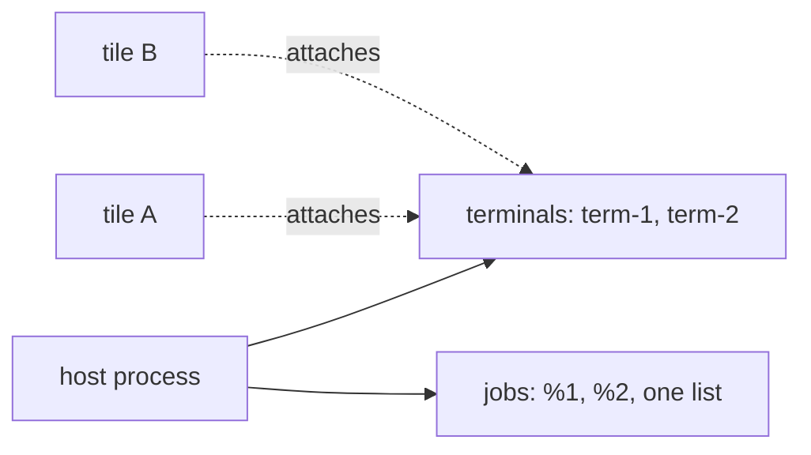

# 0448: In today's version, the host keeps every terminal and one job list per host process, with ids that only count up, and a tile attaches to one, as WezTerm's mux does



```ts
// A sketch. The host keeps this, one per host process.
type Host = { terminals: Terminal[]; jobs: Job[] }; // ids count up, never reused
type Terminal = { id: "term-3"; shell: RunId; front: JobId | null; screen: Bytes };
```

**What this decides:** what the host keeps for each tile, and what a tile only shows.

## Context

Attaching from anywhere needs the host to keep a terminal under an id of its own, apart from where
it is shown. From
[the host keeps terminals and jobs](../docs/direction/the-host-keeps-terminals-and-jobs.md#what-was-decided).
It replaced "each tile has its own tsh, with its own jobs" from 2026-10-25. In `next/`, the brain
keeps these ([the desktop layer](../docs/direction/the-desktop-layer.md)).

## Decision

**The host keeps terminals and jobs; a tile attaches to one.**

- A terminal is one tsh, its front job and what is on its screen: WezTerm's pane, kept in the mux
  server, never the window.
- Jobs are one list per host process, never one per tile or per tsh. Every tile sees the same `%n`,
  and tsh keeps no job table of its own.
- Terminal and job ids count up and are never reused, as WezTerm's and tmux's are.
- A tile shows one terminal, or one job's window. Two tiles, in one window or two, may show the
  same one.
- The front job is the terminal's, so every tile showing that terminal shares it, and a key typed
  in any of them goes to the same tsh.
- A job's trace id stays its JobRecord's key, and a child run joins its leader's trace.

## Consequences

- Built: one job table for the whole host (`storage/jobs/`). Not built yet: a terminal id apart
  from its tile, and attaching a tile to an existing terminal.
- Many tiles on one terminal means many people's keys into one prompt, as WezTerm and tmux allow.
- Who owns the layout, the host or the app, is not decided here.
