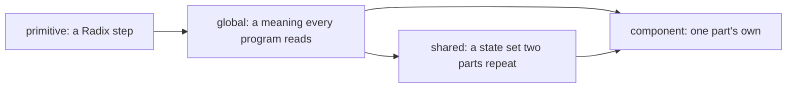

# 0451: Tokens take four tier words and one naming grammar, with an owner field the lint reads, no code reaching a primitive, and every rename in one pull request



```text
background-surface-high                    global:    category-subcategory-item
tile-titlebar-background-selected-hover    component: part-piece-variant-category-state-interaction
```

**What this decides:** how a token is tiered, named and owned, in `@kampus/fabrika-design`, which
both versions share.

## Context

Tokens had 12 aliases and names with no grammar. From
[design language](../docs/direction/design-language.md#the-owners-calls), calls 3 and 6.

## Decision

**A token has one of four tiers, a name built from fixed slot words, and an owner its data names.**

- The tiers are **primitive** (a Radix step, which no program reads), **global** (a meaning every
  program reads), **shared** (a state set two or more parts repeat, added only when they do) and
  **component** (a part's own tokens).
- A global token is named `category-subcategory-item`, as `background-surface-high` or
  `text-muted`. A part's token is named `part-piece-variant-category-state-interaction`.
- The slot words are fixed: `background` (with `base` and `surface` under it), `text`, `icon`,
  `border`; `subtle`, `muted`, `strong`; `hover`, `active`, `focus`; the ladders `low`, `lower`,
  `lowest` and `high`, `higher`, `highest`.
- Each token's data names its `owner`. The lint rule reads that field, never the name's prefix.
- Code never reaches a primitive. A `no-restricted-imports` lint rule holds it, with one exception
  for the token build, which alone imports `@radix-ui/colors`. It is lint, never a test.
- The renames land in one pull request, with no deprecation step, once the names are settled.

## Consequences

- Today's token files still carry the old names (`turn-fg`, `tile-edge-on`); the rename pull
  request moves them all at once.
- The token files' format is [0453](0453-every-token-is-toml-data.md).
