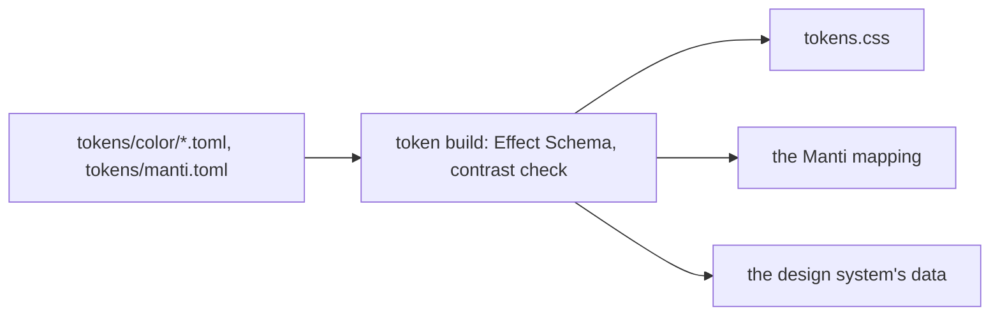

# 0453: Every token is TOML data, one file per color token with its steps, what it sits on and its contrast floor, checked by an Effect Schema at build, never YAML or one TypeScript file



```toml
# tokens/color/focus.toml, as built
type = "border"
tier = "global"
owner = "design"
description = "the one focus token: every keyboard ring and the focused tile's edge"
on = ["surface", "surface-raised"]
floor = 3

[colors]
dark = { step = "slate.a9", bend = "a solid step used as a line: a8 reads 2.82 on a selected row" }
light = { step = "slate.a9", bend = "a solid step used as a line: a8 reads 1.90 on the desk" }
```

**What this decides:** where token values live and how they are checked, in the design package
both versions share.

## Context

Colors lived in CSS and TypeScript with their contrast checked by hand. From
[design language](../docs/direction/design-language.md#the-owners-calls), calls 3 and 5, and
[one design package](../docs/direction/fabrika-design-package.md), changed 2026-11-08.

## Decision

**Token values are TOML files, and one build reads, checks and writes them.**

- Each semantic color token is one TOML file, as `tokens/color/text-muted.toml`. It names its step
  per look, what it sits on, and the contrast it must reach there.
- A token file's keys are `type` (`background`, `text`, `icon` or `border`), `tier`, `owner`,
  `description`, `[colors]` with `dark` and `light` (or `extends`, or a Radix `scale`), and `on`,
  `floor`, `aim` and `carries`.
- An Effect Schema checks every file at build. The build writes `tokens.css`, the Manti mapping and
  the design system's data, and `pnpm lint` fails when one has drifted.
- TOML, as the themes already are. Never YAML, never one TypeScript file.
- Every token is TOML data, not only the colors: type sizes, fonts, spacing, radius, row heights
  and motion too, with the same build, schema and drift check (owner, 2026-11-08).

## Consequences

- Built for colors and the Manti mapping (`packages/fabrika-design/src/build/`). The other kinds
  start after typography's first pull request merges.
- The six pipe blocks are a kept doubt: nobody has tried them in one data file.
