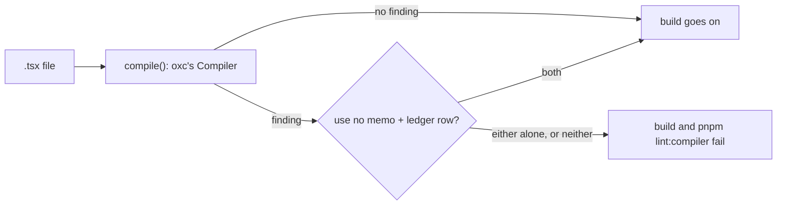

# 0464: Every React Compiler and React rule finding fails the build in every repo, always, and the only exit is use no memo plus an owner-approved row in a ledger that only shrinks

**What this decides:** how strict the Compiler and React's rules are, from `next/`'s first window.

## Context

A false alarm made advice is a rule nobody reads. From
[React Compiler from day one](../docs/direction/react-compiler.md#c5-the-compiler-skips-nothing-that-is-not-named-and-the-build-owns-the-check),
C5 and [which rules are on](../docs/direction/react-compiler.md#which-rules-are-on).

## Decision

**A Compiler finding is an error, with no setting and no advice level.**

- Every finding the Compiler, its checks or the React rules give fails the build, in every repo,
  always. A false alarm is a bug to fix in the rule or the code. For these rules this replaces the
  path to advice that AGENTS.md's block bar gives other checks.
- The one exit is `"use no memo"` in the function plus a row in `compiler-ledger.json`. Adding a
  row is the owner's call, in a change of its own. The ledger starts empty and only shrinks.
- The build owns the check. `pnpm lint:compiler` runs the same step, and fails on a directive with
  no row and on a row with no directive.
- Production builds fail on a finding too, never React's recommended `panicThreshold: "none"`.
- The React rules on are `react/refs`, `react/immutability`, `react/display-name`, `react/purity`
  and ours, `fabrika/one-store-hook` and `fabrika/no-clock-in-view`, all blocking. The note had
  `react/purity` off; `.oxlintrc.json` turned it on with `no-clock-in-view`, which refuses a clock
  read in a handler too (owner, 2026-11-05). A rule that is off is off, never advice; turning one
  on is a change of its own.
- The rules cover `next/**/*.tsx`, and today's window and program `.tsx` files, with tests left out.

## Consequences

- Built in `next/`: `compiler-ledger.json` is empty, and `.oxlintrc.json` sets the rules for
  `next/**/*.tsx`. Today's app does not have the override yet.
- A ledger row names the file, the function and the `reason`.
