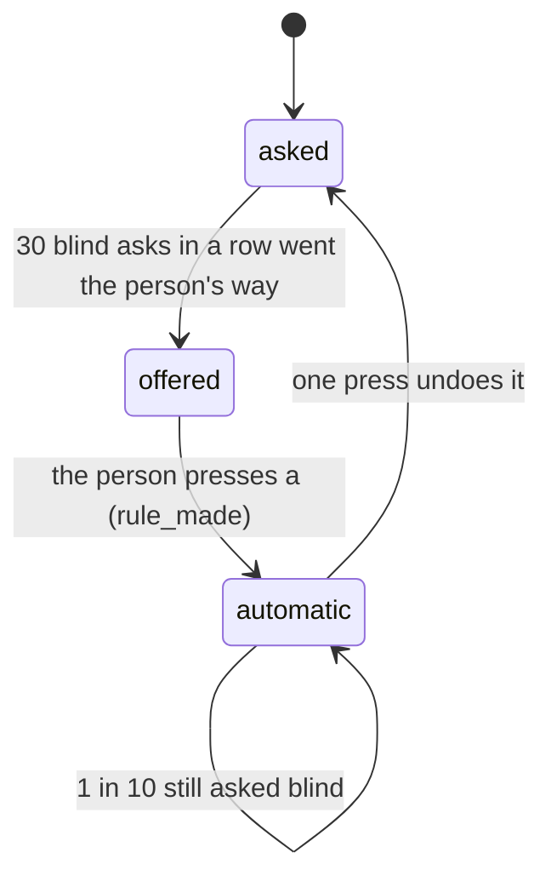

# 0487: A kind of ask goes automatic only by a person's one press after 30 blind agreements in a row, one press undoes it, 1 in 10 is still asked blind, and exam, spend and security asks never go automatic

**What this decides:** how a kind of ask earns automation, in both versions.

## Context

The desk should learn from the answers, without a person's trust drifting unseen. From
[the ask desk](../docs/direction/ask-desk.md#a5-autonomy-is-offered-per-narrow-kind-after-blind-agreement-and-undone-with-one-press),
A5 and calls 2, 3 and 5.

## Decision

**Autonomy is offered per narrow kind, after blind agreement, and undone with one press.**

- 1 in 5 asks is blind, by a seeded draw: the rec is hidden until the person picks, and still
  sealed on `asked`. Only blind asks count.
- A kind is its `for`, its step, the rec's pick and the repository. After 30 blind asks of a kind in
  a row that matched, the desk offers one press, `a`, which writes `rule_made`, a person's fact.
- From then on code takes the rec and writes `auto`; the ask is still written. One press undoes it.
- 1 in 10 of an automatic kind is still asked, blind.
- Exam, spend and security asks never go automatic, and the type says so.

## Consequences

- One number for every kind may be wrong; per-kind numbers come once the first offer does.
