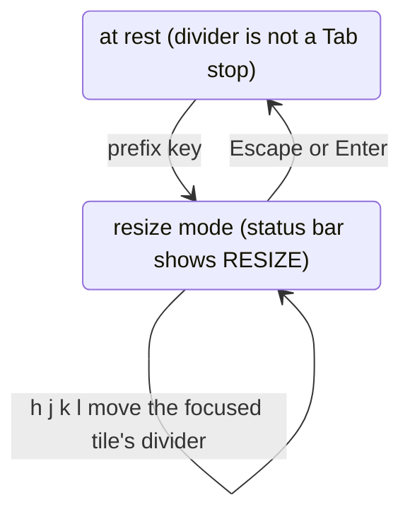

# 0492: The 4px between open tiles is the divider, never a gap or a border, no Tab stop at rest, and a prefix key enters an i3-style resize mode where h j k l move it

**What this decides:** the name of the space between tiles and how the keyboard moves it. The mode
is new work in Tier 2.

## Context

The 4px was `.border` in code, "resize gap" in the tile guidelines, and "gap" in a lean. From
[the frame](../docs/direction/the-frame.md#10-the-divider-between-tiles-and-the-tiles-edge),
clash 10.

## Decision

**It is the divider, Apple's word (`NSSplitView`).**

- Never "gap" (it has two tile edges, not empty space) and never "border". The code's `.border`
  becomes `divider`. The tile's own outline is its edge.
- At rest the divider is not a Tab stop.
- A prefix key enters an i3-style resize mode: the status bar shows RESIZE, a screen reader hears
  "Resize mode on", `h j k l` move the focused tile's divider as a focused `role="separator"`, and
  Escape or Enter leave.
- This changes the tile guidelines' "no focusable separators" to "focusable only in resize mode".
- Not APG's "window splitter", which promises its keys at rest.

## Consequences

- It needs a Manti `Splitter` option so the trigger is no Tab stop at rest: a `pnpm patch` first,
  then a Manti pull request with the owner's yes.
