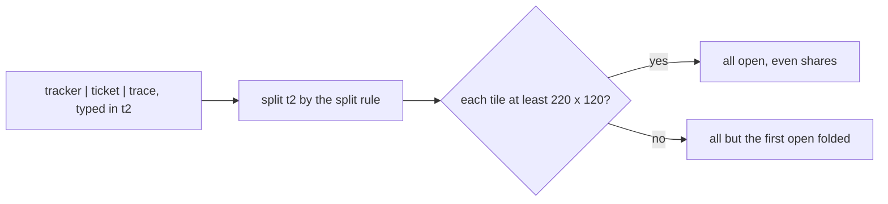

# 0507: A line with several programs opens its tiles in the tile it was typed in, folding all but the first under 220 by 120, and its shares stay inside the line

**What this decides:** where a tsh line's programs show, in today's version.

## Context

A line is one thing the person asked for, so it lands where they asked. From
[fold, not tabs](../docs/direction/fold-not-tabs.md#a-line-opens-in-place).

## Decision

**A line opens in place.**

- A line with several programs that draw opens its tiles in the tile it was typed in, by the split
  rule. They share that tile's space evenly.
- When a tile would be under 220 by 120, all but the first open folded.
- A line's shares stay inside the line. Unfolding or closing one of its tiles never resizes a tile
  outside it.
- When a line's run ends, its tiles go and the typed-in tile goes back to its tsh. A desk read back
  after a restart holds no line tiles.

## Consequences

- The line's tint is replaced by pipe colors ([0477](0477-a-pipe-is-marked-by-a-wash.md)).
- 220 by 120 comes from the prototype; a desk on a laptop screen shows whether it folds too much.
