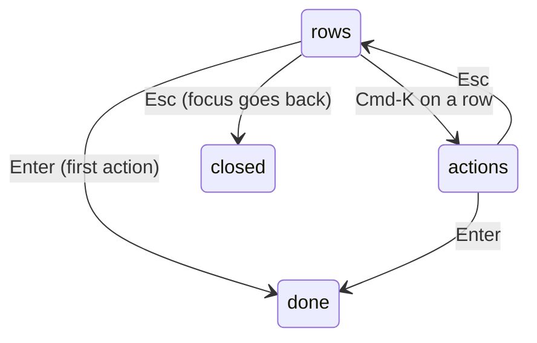

# 0515: In the picker Enter does a row's first action, Cmd-K in the box shows its actions in the same box and Esc pops one level, on one APG combobox that says its count once

**What this decides:** the picker's keys and its accessibility floor, in `next/`.

## Context

A press must visibly do something, and every source should get one tested combobox for free. From
[pickers](../docs/direction/picker-guidelines.md#q8-enter-acts-cmd-k-shows-the-rest-esc-goes-back-one),
Q8, Q10 and smaller call 3.

## Decision

**Enter acts, Cmd-K shows the rest, Esc goes back one.**

- Enter does a row's first action: `open program location` for a thing, the command for a command.
  Cmd-Enter does the second.
- Cmd-K inside the box swaps the list to the row's actions, in the same box, even when it has one.
- Esc pops one level, until the box closes and focus goes back.
- The floor is one APG combobox, done once: the input keeps DOM focus, rows are options in a
  listbox grouped with names, and `aria-activedescendant` names the selected row. Never inside
  `aria-hidden`.
- The count is a polite status, said once, 500 ms after typing stops.

## Consequences

- A VoiceOver and NVDA run comes before it ships; 500 ms is a guess that run sets.
