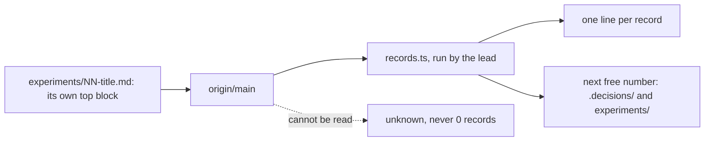

# 0522: No folder keeps a committed index table, each record carries its own summary at its top, and a lead command lists a folder and gives its next free number from origin/main



```text
# a sketch of the output
$ node .agents/skills/lead/scripts/records.ts list experiments
286  Can a program, with no person typing, start a Claude cloud session?: Yes only from ...
287  Can a Claude cloud session use an MCP server at a public HTTPS address?: ...
next 288
```

**What this decides:** `experiments/`, `.patterns/` and `docs/direction/` stop keeping an index
table in their README, each record says what it is at its own top, and one lead command prints the
list, and for `.decisions/` and `experiments/` the next free number, read from `origin/main`.

## Context

Two open pull requests that each add a row to the same README table always conflict on the same
line, because both append after the last row. It happened three times on 2026-11-13, with
experiments 285, 286 and 287. `.decisions/` already has no index
([0008](0008-decision-discovery-is-the-agents-md-contract.md)), and field rows are already one file
each for the same reason ([0090](0090-each-field-row-is-a-file.md)).

Phoenix works this way: its `fabrika adr next` reads the decision folder at the fetched base ref,
prints the next id, and when it cannot read that ref it refuses with a nonzero exit and says the
set is unknown, never "0 records"
([its guide](https://github.com/kamp-us/phoenix/blob/main/packages/fabrika-cli/docs/running-fabrika-in-a-repo.md)).

This amends 0008 in part: 0008 ruled out a compact-map command, and this decision adds one. 0008's
other rules (no committed index, no startup hook, discovery by listing the folder and reading
frontmatter) still hold.

## Decision

**No folder keeps a committed index table: each record carries its own summary at its top, and a
lead command lists the folder.**

- **No index table** in `experiments/README.md`, `.patterns/README.md` or `docs/direction/README.md`,
  nor in any new folder of records. A README keeps only how its folder works, plus one line that
  names the command.
- **Each record's summary is at its own top.** What a table row said (the one-line answer, the
  state, when to read it) moves into the file it describes, so adding a record touches no shared
  file.
- **The command** is lead tooling in `.agents/skills/lead/scripts/`, in TypeScript (0113, 0033). It
  covers four folders:

  | Folder | Prints |
  |---|---|
  | `.decisions/` | the list, and the next free number |
  | `experiments/` | the list, and the next free number |
  | `.patterns/` | the list |
  | `docs/direction/` | the list |

- **It reads `origin/main` through git, never the working tree,** so a file that is only local or
  only on an unmerged branch never takes a number or a line.
- **When `origin/main` cannot be read, it says unknown** and exits nonzero. It never prints
  "0 records" or a next number of 1 for a read that failed.

**Binding constraints:**

- A skill, check or plan that tells an agent to add an index row is changed to the new way in the
  pull request that removes the tables.
- The next free number from the command is the number on `origin/main`. An open pull request can
  still hold the same number; the adr skill's check of open pull requests stays until a later
  decision changes it.

## Consequences

- Two pull requests that each add a record no longer touch the same line, so they no longer
  conflict for that reason.
- Lost: the one-page skim on GitHub. A reader on the website no longer sees every experiment or note
  in one table. The command prints that list instead, on a clone, and the folder listing on GitHub
  still shows every file name.
- Each record grows a small top block, and its summary must stand alone, since the command prints
  only that.
- Not decided here: whether the command also counts numbers held by open pull requests, as
  phoenix's does, and whether a check fails a record whose top block is missing.
