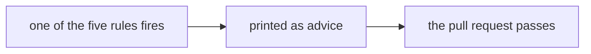
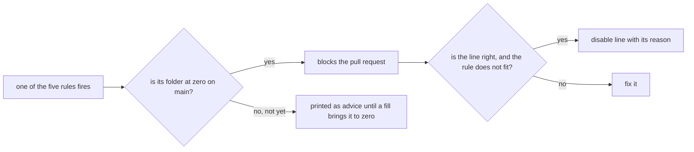

# 0523: A lint rule blocks wherever its code is clean, so the five advice rules block in every folder at zero, and a false alarm takes a reasoned disable line

**Before:**



**After:**



```ts
// before: passes, printed as "Advice, does not block"
const text = yield* Effect.promise(() => file.text());

// after, in a folder at zero: blocks; fixed with a typed failure
const text = yield* Effect.tryPromise({ try: () => file.text(), catch: (cause) => new ReadFailed({ cause }) });

// after, a real false alarm: one line, its reason in plain words, seen in review
// oxlint-disable-next-line fabrika/no-raw-try-catch -- the platform's own handler must not throw
```

**What this decides:** five lint rules that only advised now block, in every folder whose code
has no hits, and the docs rule turns on the same way.

## Context

- Five rules printed their fires and never failed `pnpm lint`: `fabrika/law-shape`,
  `fabrika/no-effect-promise`, `fabrika/no-raw-try-catch`, `fabrika/prefer-schema-arbitrary` and
  oxlint's `no-restricted-properties`, set to refuse a bare `JSON.parse` in `next/`. The reason
  was experiment 125, which found the first two mostly wrong when they were first written, and
  the rule in [`AGENTS.md`](../AGENTS.md#checks) that a check needs its false alarms measured
  before it blocks.
- Advice was ignored. On `origin/main` at `7ae7cea0f` the five fire 922 times: `next/` holds 332
  `Effect.promise` calls, and one open pull request alone added 88.
- The owner ruled on 2026-11-13 that the five block. A rule that exists for a reason and that
  nobody has to follow makes the code built on it a foundation that lies.
- [0168](0168-old-lint-breaks-are-fixed.md) decided the same day that no list file takes new
  entries, and that a new rule turns on folder by folder as each folder reaches zero. This
  decision builds it for these rules: the old hits are fixed, never listed, and 0168 stands
  unchanged.
- The comment fills of 2026-11-13 brought ten `libfabrika` folders to zero for the docs rule,
  `fabrika/jsdocs`, which was on for only a few folders.

This amends [0093](0093-laws-walk-plants-run-once.md) and
[0411](0411-property-data-comes-from-schemas.md), each of which said its rule only advises. It
replaces the "rules only advise" paragraph of
[`oxlint-plugins/README.md`](../oxlint-plugins/README.md) and the "advise until their false
alarms are counted" line it gives the `JSON.parse` guard.

## Decision

**A lint rule blocks wherever its code is clean. The five advice rules leave the advice set and
block in every folder with zero hits on main, and a false alarm is answered on its own line with
a reason (owner, 2026-11-13).**

- **The five block.** They leave the advice set in `pnpm lint`. Their messages stop saying
  "Advice, does not block".
- **Where a folder still has hits, 0168 holds.** No list-file row is added. A folder with hits on
  main is fixed by a fill pull request, and the rule blocks there the moment it reaches zero.
  Until then its fires are printed as advice in that folder only.
- **The folder is as small as the code allows.** A rule blocks in each source folder that is at
  zero, measured by running it there, so one dirty folder does not hold back its clean siblings.
- **A false alarm takes a disable line:** `// oxlint-disable-next-line <rule> -- <plain reason>`,
  on the one line, which a reviewer reads. Never a disable comment in bulk to make a folder pass.
- **The docs rule follows the same rule.** `fabrika/jsdocs` turns on for every folder at zero on
  main. A folder that is not at zero stays off until its fill lands.
- **The false-alarm measure is not a gate for these.** The `AGENTS.md` rule that a blocking check
  needs its false alarms measured first does not hold this ruling back. Each pull request that
  makes a folder block reports, per rule, the hits it met, the ones it fixed and each disable line
  with its reason, so a rule that needs a narrower scope shows in the numbers.

**Binding constraints**

- A folder that blocks never goes back to advice to let a pull request pass.
- A fill fixes the code; it does not narrow a rule's paths or weaken its check.
- No row is added to `next-ledger.json` or `agents-ledger.json` for these rules.

## Consequences

- New code in a clean folder can no longer add an `Effect.promise`, a raw `try`, a bare
  `JSON.parse`, an unlabeled law or hand-written property data.
- **The cost:** the 922 hits are fixed folder by folder before each folder blocks. Until then a
  dirty folder still only advises, and a pull request can add hits there.
- `oxlint-plugins/README.md`, the five rules' messages and laws, and every skill or doc that says
  these rules only advise change with the lint change, tracker ticket 930.
- Not decided here:
  - `fabrika/service-id`, the sixth advice rule, which its own pull request makes block.
  - Whether `AGENTS.md`'s false-alarm rule changes for other new rules.
