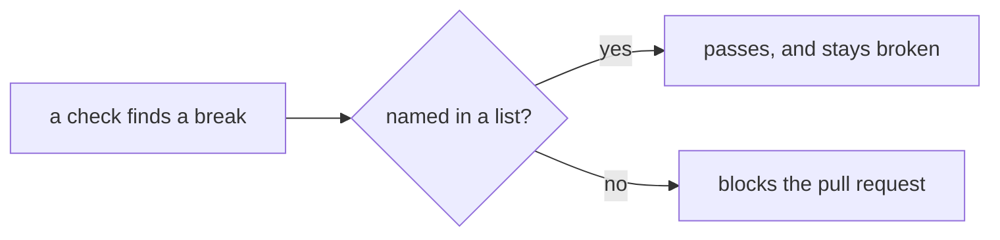
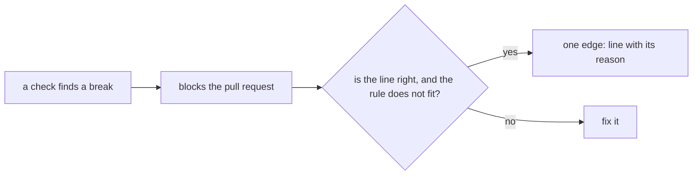

# 0524: No check reads a list that lets broken code pass, in either version, and a code-graph file stays only where no entry can hide a finding

**Before:**



**After:**



```ts
// before: a row in unreachable-ledger.json, written by `code-graph --accept-dead`, hides a dead export
{ "id": "apps/fabrika/src/editor/grid.ts:gridOf", "kind": "only-called-from-tests", "scope": "." }

// after: the file does not exist, and a law keeps it absent
expect(existsSync("unreachable-ledger.json")).toBe(false);
```

**What this decides:** 0168 holds in every folder and every check, in both versions: every list
that lets a check pass on broken code is emptied by fixing the code, then deleted with the code that
reads it, and checks keep a new one out.

## Context

- [0168](0168-old-lint-breaks-are-fixed.md) fixed old lint breaks, named `next-ledger.json` and
  `agents-ledger.json`, and kept code-graph's list.
- An inventory on `origin/main` at `7ae7cea0f` found more lists than 0168 named:
  `layer-rules.json`'s `allowed` key (40 rows), stylelint's `known` lists (54), seven per-file "off"
  overrides, five overrides that dropped import bans by repeating a list, a disable line marked
  "until PR 8", and the lint tests' `elsewhere` array (31). The plan is
  [no list lets broken code pass](../docs/plan/no-waiver-lists.md).
- `unreachable-ledger.json` can wave dead code through: `code-graph --accept-dead` fills it in one
  command, and CI only checks that the pruned file was committed.

This builds 0168 and replaces its "code-graph's list stays" line. It amends
[0006](0006-no-unused-exports.md), whose ledger entry was the owner's call: no entry is added now.
It amends [0464](0464-every-compiler-finding-fails-the-build.md): its one exit becomes
`"use no memo"` with an `edge:` line, which still comes to the owner, in place of a ledger row.

## Decision

**0168 holds in every folder and every check. An old break is fixed, never kept in a list, and a
code-graph file stays only where no entry can hide a finding (owner, 2026-11-13).**

- **What counts as a list:** any file or config place a check reads to pass named broken code: a
  `*-ledger.json`, a baseline, an allowlist, a `known` option, an `allowed` key, an override that
  turns a rule off or down for named product files, and an advice level.
- **Each is emptied by fixing the code,** then deleted with its reader.
- **No list grows.** From now on no pull request adds an entry to any of them. A check holds that
  for the list files until they go.
- **What stays:** an override for a class of files where the rule does not apply (tests, test
  support, shared suites, tool-loaded configs), a rule's one named home, and one inline `edge:`
  line with its reason for a line that is right where the rule does not fit.
- **Code-graph files stay only where no entry can hide a finding.** `layer-rules.json` keeps its
  layer rows and loses `allowed`. `node-kinds.json` stays while a law proves each name it lists is
  bound by that name. `unreachable-ledger.json` is deleted and a law keeps it absent; code-graph
  reads a missing file as empty.

**Binding constraints**

- Checks hold this, not prose: no list file, no `allowed` key, no `known` option, no override off
  or down outside the fixed class set, no narrower import ban that drops a wider one's entry, no
  `"warn"` level, no disable reason that names a PR or ticket as a deadline.
- A fix does not weaken a rule, narrow its paths or switch it off (0168).
- A list file is an exam path until it is deleted, so a build step cannot change it.

## Consequences

- Every check that is on holds everywhere it is on. A reader sees each exception on its own line.
- **The cost:** about 300 entries fixed before the gate closes, plus the 922 advice fires under
  [0523](0523-advice-rules-block-where-clean.md). The plan cuts it into 13 slices.
- The fixing pull requests are fast-tracked under 0168.
- `AGENTS.md`'s line that an entry in `unreachable-ledger.json` is the owner's call changes now.
  Its lines about a list that only shrinks go when the files go.
- Not decided here:
  - the 34 old-pipeline layer rows in `layer-rules.json` (the plan's open question 1);
  - whether the seven per-file "off" overrides for secrets and settings move to `edge:` lines, which
    would change a line of [secrets are Redacted](../docs/direction/secrets-are-redacted.md) (the
    plan's open question 2);
  - whether the ARIA step in CI blocks (the plan's open question 3).
