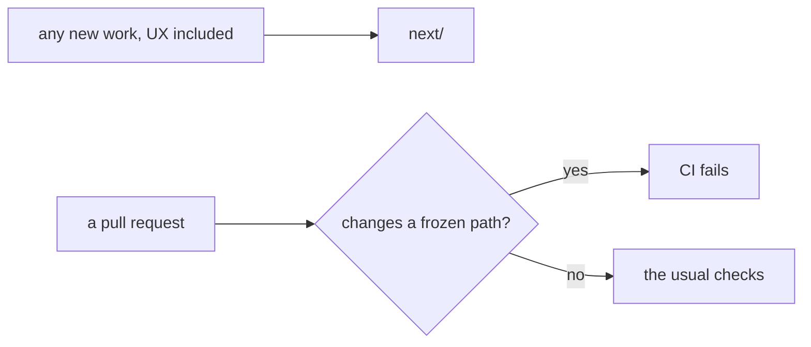

# 0525: Today's version is frozen, so nothing builds on it, no test or CI job runs on it, its tests are removed, and all new work, UX work included, goes into next/

**What this decides:** what may still happen to today's version (its product and pipeline code)
while `next/` grows, and where new work goes.



```ts
// A sketch: the frozen paths, named once in code by the lane that builds the guard.
const frozen = ["apps/", "programs/", "packages/", "bin/"];
const shared = ["packages/fabrika-design/"]; // 0456: both versions use it, so it stays live
```

## Context

[0217](0217-next-grows-beside-today.md) let today's version take fixes that daily use or CI needs,
the UX work the owner picks ([0063](0063-todays-app-lanes-share-the-slots.md)) and tryouts.
`AGENTS.md` added that a product foundation decided in a walk starts on today's app at once. On
2026-11-13 the owner ruled the other way: the old pipeline does not work, building more on it is
wasted work, and running tests on code that nobody changes is waste too.

## Decision

**Today's version is frozen. Nothing builds on it, nothing tests it, and all new work goes into
`next/`.**

- **Frozen means unchanged, not stopped.** Today's app, its tracker and its tools for agents keep
  running for daily use until `next/` has its own tracker and the tickets move with a checked copy
  ([0159](0159-fabsh-pipes-summon-join-first.md), [0219](0219-tracker-switch-needs-checked-copy.md)).
  Nothing in this decision, the freeze guard included, may stop it from running.

- **What is frozen:** the product and pipeline code outside `next/`. On main today that is `apps/`
  (today's app, `@kampus/fabrika-app-old`), `programs/`, `packages/` (`@kampus/fabrika-old`,
  `@kampus/pipeline`, `@kampus/promises`, `packages/ledger-server`) and `bin/` (the `tsh` launcher
  into `packages/pipeline`).
- **Not frozen:** `packages/fabrika-design/`, the design package both versions share
  ([0456](0456-one-design-package-both-versions.md)), and the repo's tooling: `next/`, `.agents/`,
  `.github/`, `oxlint-plugins/`, `scripts/`, `fixtures/` and the docs.
- **No edit.** A pull request whose diff adds or changes a file under a frozen path fails CI. The
  check names the frozen paths in one place in code. Removing a file there is allowed, so today's
  tests can go now and the code can go later.
- **No test.** Today's version's test files and their test-only support are removed: the files
  under the frozen paths, the `fixtures/` folders only those tests read, and the promise records
  in `promises/` that check today's pipeline.
- **No CI job and no lint for it.** No job, step, shard or vitest project runs only for frozen
  code. Lint and typecheck leave the frozen paths out, so their old findings stop counting. A ledger
  or list row that waives a finding in a frozen file goes with it, since that code is no longer
  checked.
- **All new work goes into `next/`,** the owner's picked UX work and product foundations included.
  A tryout on today's app is no longer a route.

**Binding constraints:**

- The frozen code itself is not deleted by this decision. Deleting it is a later call.
- `ci-required` keeps its name. A job named in it or in a branch ruleset changes only with the
  owner's yes.

## Consequences

- **What is lost:** a bug in today's app gets no fix until `next/` replaces the part it is in. The
  owner keeps using today's app, its tracker included, as it is.
- What today's tests proved is no longer checked, so a frozen file that changes by accident (a
  dependency bump, a root config) can break without a red test. The freeze guard stops a direct
  edit; a shared dependency is not guarded.
- Amended in part:
  - [0217](0217-next-grows-beside-today.md): today's version takes no fixes, no picked UX work
    and no tryouts. Its build-beside rule and the rule that `next/` imports nothing from today's
    version still hold.
  - [0063](0063-todays-app-lanes-share-the-slots.md): there are no more today's-app lanes, so no
    slot goes to one.
  - [0003](0003-a-clean-repo-kept-clean-by-code.md): "today's app passes its tests" is no longer
    a goal, since its tests are removed.
  - [0175](0175-every-run-follows-its-paths.md): today's own checks (its tests, e2e, the promises
    gate and the build) have nothing left to start for.
  - [0454](0454-an-aria-snapshot-per-story.md), [0463](0463-react-compiler-from-day-one.md),
    [0465](0465-render-is-pure.md), [0469](0469-a-ui-check-reads-data-first.md) and
    [0481](0481-a-tile-opened-with-content.md): the parts that start on today's app first, or keep
    a tryout there, now start in `next/`.
  - `AGENTS.md`'s lines that send work to today's version ("fixes that daily use or CI needs, the
    UX work the owner picks", "a product foundation decided in a walk starts on today's app at
    once", and the look step for "a screen being built in today's app") change in the lane that
    builds the guard.
- Decisions titled "in today's version" or "in today's pipeline" stay as the record of how frozen
  code works. They take no new work.
- **Not decided here:** today's lead scripts and the mutation skill still import or run frozen
  packages (`@kampus/fabrika-old`, `@kampus/pipeline`, the tracker's CLI in `apps/fabrika`, Stryker
  installed under `packages/pipeline`). How that tooling moves off frozen code is its own call.
