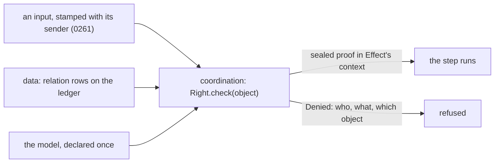

# 0526: In next/, every permission is one ReBAC system on Zanzibar's model, with relation rows on the ledger, one model declared once, and a typed right that gives a sealed proof, and it replaces the four separate lists

**What this decides:** how `next/` answers every "may this member do this?" question, for people,
agents, keys, programs and packs alike.



```ts
// A sketch, not the API. One row shape holds every permission fact.
{ _tag: "related", subject: "key:k7", relation: "under", object: "key:k1" }            // the grant tree today
{ _tag: "related", subject: "pack:tracker", relation: "may_start", object: "program:ticket" } // a StartGrant today
{ _tag: "related", subject: "person:berk", relation: "view", object: "window:w1" }

// The model, declared once; a name not in it does not compile.
const Model = Rebac.make("fabrika").type("window", {
  relations: { view: ["person", "agent"], write: ["person", "agent"], drive: ["person"] },
  permissions: { write: (p) => p.union("write", "drive"), view: (p) => p.union("view", "write") },
});

// A right is a class; the check gives a sealed proof; a step that needs it does not compile without it.
class DriveWindow extends Rebac.Permission<DriveWindow>()("access/DriveWindow", {
  model: Model, on: "window", permission: "drive", error: Denied,
}) {}
const grant = yield* DriveWindow.check(Model.ref("window", "w1"));
yield* moveFocus(tile).pipe(Rebac.provide(grant));
```

## Context

Decided by the owner on 2026-11-14, in a design talk about who may act in a window when a second
person or an agent is there. It started from experiment 289 (a desk key moves first) and decision
0277 (one focus per workspace).

What `next/` has today, read in `next/packages/libfabrika/src/`:

- **Admission at the door.** `access/Access.ts` folds membership events into a tree of keys, each
  key `under` the key that let it in, and `admitted` (line 716) says whether a key may dial. A
  `Grant`'s `as` is a kind of key (`window`, `agent`, `hands`), never a right over a thing.
- **Three more lists, each its own check:** `StartGrant` (which program may start which,
  `processes/Children.ts:33`, checked at `processes/ChildrenLedger.ts:85`), the mail grants (which
  name may reach which, `processes/ProgramMailLedger.ts`), and `personOnly` (input names only a
  person may send, `gateway/Gateway.ts:304`, checked at `runtime/Runner.ts:1997`).
- [0170](0170-a-start-is-checked-against-its-sender.md) decided a start is checked against its
  sender, and it is not built: the start still checks only program to program.

The known way:

- **Google's Zanzibar** (Pang et al., USENIX ATC 2019) is one relation-based (ReBAC) system behind
  Drive, YouTube, Calendar and Cloud: rows of `(subject, relation, object)`, a schema that says how
  relations combine ("an editor is also a viewer"), and one check. SpiceDB and OpenFGA are its
  open copies. AWS IAM is also one system, but it is policy-based, not relation-based.
- **Phoenix's [ADR 0107](https://github.com/kamp-us/phoenix/blob/main/.decisions/0107-capability-authz-framework.md)**
  built this in Effect: each right is a class, a check gives a sealed `Grant` proof that only the
  check can make, the proof rides in Effect's context so a missing check is a compile error, and an
  agent's authority is never more than its person's (`AgentAuthority`). The code is
  `packages/authz` in kamp-us/phoenix.
- **Effect's own pattern:** a security middleware checks, then provides a typed value into context
  (`HttpApiMiddleware`, `RpcMiddleware`), and a whole API is declared once as a value
  (`HttpApi.make(...).add(...)`), in Effect-TS/effect. Effect has no permission package of its own.

## Decision

**Every permission in `next/` is one ReBAC system on Zanzibar's model.**

- **One row shape.** Every permission fact is a relation row `(subject, relation, object)` written to
  the ledger, so who related whom, when and why is kept like any write. A grant is one such row.
- **One model, declared once,** in the Effect way: each object type, its relations, and how they
  combine (Zanzibar's rewrites, such as `drive` includes `write`, and `write` includes `view`).
  Every relation name and object type is checked against the model when it compiles; no
  permission is named by a free string.
- **A right is a typed class,** as in phoenix's 0107. Its check gives a sealed proof tied to the one
  object it checked, the proof goes into Effect's context, and a step that needs it does not compile
  without it. A refusal is a tagged error that carries who, what and which object.
- **The check runs in coordination,** where the brain knows the sender (0261), the target and the
  input. Transport only says who is talking, the data layer only holds the rows, the app declares
  the rights its inputs need, and the desktop only shows the result.
- **Agents and people use the same system.** An agent's rights are capped by its person's, as
  phoenix's `AgentAuthority` does it. It covers agent talk (`@name`), agent control (`fg`,
  `dismiss`), rooms (`join`), window modes, starts, mail and keys.
- **It replaces the four lists:** the key tree's `under`, `StartGrant`, the mail grants and
  `personOnly` each become relation rows plus rules in the model.
- **Window modes are view, write and drive,** and a person connected to someone else's project
  window starts read only (view). More modes and a handover come with the second person, in Tier 3.

**Binding constraints**

- No second permission system, no list beside it, and no check on a free string.
- No outside permission server (no SpiceDB or OpenFGA process): the rows live on the ledger and the
  check runs in the brain.
- A limit (spend, quota, CPU, [0020](0020-programs-get-hard-walls.md)) is a wall, not a permission,
  and stays out of this system.

## Consequences

- **First slice:** the core (rows, the declared model, a typed right, the check, a memory layer for
  tests) with 0170's start check as its first real use. Ticketed with 0170's build.
- The four lists move onto it one at a time, each in its own pull request, with its laws unchanged
  in what they check.
- Every check reads relation rows, sometimes a chain of them. That is cheap at our size. A deep,
  changing tree (for example nested organizations) is phoenix's named trigger to reconsider an
  outside engine.
- **Not decided here:**
  - The API's exact shape and package name. A plan reads Effect's `HttpApi` security and phoenix's
    `packages/authz` first.
  - Conditions on a relation, such as "view for one hour" or a spend cap (Zanzibar's caveats). They
    wait for a real case.
  - Which rule judges a start with no member behind it (a supervisor's restart, a scheduled job, a
    boot start), left open by 0170.
  - The roles of [0290](0290-one-owner-admins-and-members.md) (owner, admins, members) are written as
    relations on the fabrika object; finer roles still wait for Tier 7.

## Records

- `.glossary/TERMS.md`: the rows `relation` and `ReBAC`, and the `grant` and `permission` rows
  updated.
