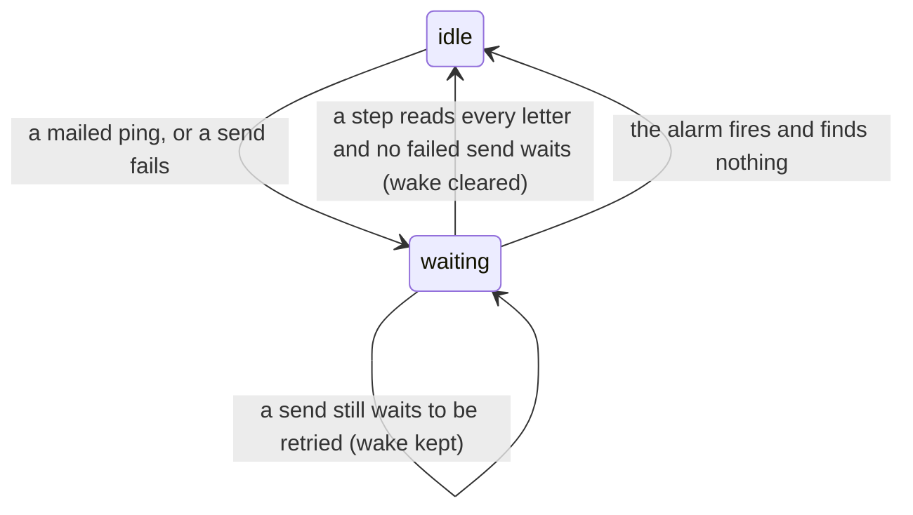

# 0528: A process's mail wake clears once a step has read every letter and no failed send waits, as OTP drops a retry timer when its state ends

**What this decides:** in `next/`, the runner's mail wake is cleared as soon as nothing is left
behind it, never kept until it fires.



```ts
// next/packages/libfabrika/src/runtime/Runner.ts, catch-up (sketch)
if (readEveryLetter && noFailedSendWaits) mailRetry = null; // nothing behind the wake
```

## Context

Ticket 966. The runner keeps one mail wake, `mailRetry` (`Runner.ts:420`). Two things set it: a
`mailed` ping that says a letter arrived (`:1767`), and a failed send that must be tried again
(`:1689`). Only an alarm cleared it (`:1861`). Law S2 holds that no alarm is left after the last
answer, while law M2's model kept a mail wake until an alarm fired, even with nothing behind it.
On a fixed seed the two disagreed: one bare wake, a ping with no letter, then nothing to do.

The question was whether M2 kept the wake for a reason. It did not. `MailDelivery.ts:39` saves the
letter in the recipient's inbox before it sends the ping, and the save is consistent. So a ping
cannot arrive before its letter. The runner holds one `permit` around both paths, and a ping after a
full read sets the wake again. A bare wake in real use is only a duplicate ping for mail already
read.

## Decision

**The mail wake is cleared when a step has read every letter and no failed send waits, and kept
only while a failed send waits.**

- This is what Erlang/OTP does. A `gen_statem` retry is a `state_timeout` in a retrying state,
  canceled when the state ends ([gen_statem](https://www.erlang.org/doc/apps/stdlib/gen_statem.html));
  a `gen_server` cancels a timer with `erlang:cancel_timer` once nothing is left to retry.
- It fits [0105](0105-a-durable-object-never-stays-awake-on-its-own.md): an alarm is set only for
  work that is left.
- Law M2's model changes to match: a bare wake clears after a full read. A wake with a failed send
  behind it is kept until its retry runs, as before. Law S2 does not change.

**Binding constraints**

- A wake with a failed send behind it is never cleared by a read. Only the retry clears it.
- Any later ping or failed send sets the wake again.

## Consequences

- No process wakes for mail that was already read.
- The fix is "option C" in ticket 966, built and tested with S2 unchanged and M2's model changed as
  above. It lands as its own pull request after the T1a test-clock fix
  ([PR 1228](https://github.com/kamp-us/tea-fabrika/pull/1228)).
- Not decided here: whether duplicate pings should be dropped before they reach the runner.
