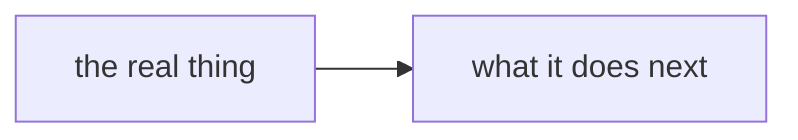

# Decisions

Every decision the owner makes lands here, one file per decision, the turn it is made
([0001](./0001-decisions-live-in-the-repo.md)). Long design notes stay in
[`docs/direction/`](../docs/direction/README.md); a decision file links its note when one exists.

## When to write one

Whenever the owner settles something: a rule, a name, a shape, a yes or no on a plan's question.
Write it the same turn, in its own docs pull request, with the
[adr skill](../.agents/skills/adr/SKILL.md). Never batch two decisions, and never wait for
a code pull request. A docs-only decision PR merges on green CI with a clean leak grep.

## The file

`NNNN-slug.md`: the next free four-digit number, then a kebab-case slug of at most five words.

````markdown
---
id: 0002
title: <the decision in one clause, not the topic>
status: accepted
date: YYYY-MM-DD
tags: [a, few, words]
---

# 0002: <the same title>



```ts
// one small real code block with the shape
```

**What this decides:** one plain sentence.

## Context

Why it came up. Link the note, ticket or pull request.

## Decision

**One bold sentence first.** Then the rules, as short bullets.

## Consequences

What changes, what it costs, what is not decided here.
````

- A decision that has a shape opens with the Mermaid diagram and the code block; one with no shape
  leaves both out ([0005](./0005-patterns-and-decisions-are-visual.md), and the
  [adr skill's diagram rules](../.agents/skills/adr/SKILL.md#diagrams)).

- `status` is `accepted`, `superseded` or `amended`. A later decision that replaces one sets the
  old file's status to `superseded by NNNN`; nobody deletes a decision.
- Keep it short. The long reasoning goes in a `docs/direction/` note.
- A decision moved in from elsewhere leaves only a one-line link behind
  ([0002](./0002-moving-a-decision-removes-it-from-its-source.md)).
- Never quote what a person typed. Record the decision.

## Search before you ask

Before an agent asks the owner anything or writes a plan, it searches `.decisions/`, `.glossary/`
and `docs/direction/` for the topic.

## The governance check

```sh
sh .agents/skills/lead/scripts/governance.sh [base]
```

It lists the decision files whose title, tags or slug words show up in the diff from `base`
(default `origin/main`) to `HEAD`, and every decision file the diff edits. The review step and the
lead read each one listed and say whether the diff walks it back. For now it only lists and always
exits 0. It blocks later, once its false alarms are measured.
