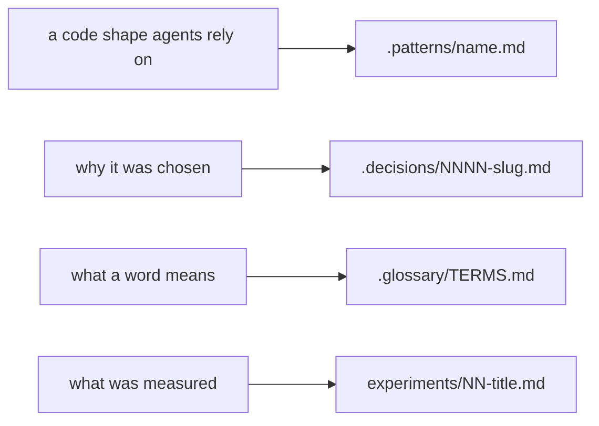

# Patterns

How the code is shaped now, one doc per shape. Each doc opens with a Mermaid diagram of the
mechanism, then one small real code block, then the words, and it points at real files with
`path:line` ([0005](../.decisions/0005-patterns-and-decisions-are-visual.md)). Write or re-ground
one with the [write-pattern skill](../.agents/skills/write-pattern/SKILL.md).

A pattern doc says how; it links the decision for why and never argues it again. When the source
and a doc disagree, the doc is wrong.

## When to add a doc

Add one only when all of these hold:

- **It is a shape.** Real source and tests here show a reusable shape and where it stops, or an
  accepted decision names a shape about to be used and the dependency's own source or docs ground
  it.
- **It is not obvious.** A reader new to the code would write a different, worse version.
- **Every rule points at a line.** Each rule names the `path:line`, type or test that holds it.

Narrating obvious code, general framework advice, guessed conventions and rules from feel stay out.
A doc that already covers the shape is extended, never doubled.

## Index

Once the table passes about a dozen rows, split it into sections by area.

| Pattern | Where | Read when |
|---|---|---|
| [effect-errors-keep-their-cause.md](./effect-errors-keep-their-cause.md) | next/ | Writing an error class, a `catch:` or `mapError`, or a handler for a failure |
| [effect-tests-run-in-it-effect.md](./effect-tests-run-in-it-effect.md) | next/ tests | Writing a test whose body runs an Effect, or a law that depends on time |
| [effect-services-and-layers.md](./effect-services-and-layers.md) | next/ | Adding a service, wiring a Layer, or giving an object class its runtime |
| [effect-state-and-time.md](./effect-state-and-time.md) | next/ host code | Keeping state that changes between calls, adding a limit, reading the time, or writing a retry or a loop that repeats |
| [effect-swallowed-failures-leave-a-trace.md](./effect-swallowed-failures-leave-a-trace.md) | next/ | Reaching for `Effect.ignore`, a catch-all, or a finalizer |
