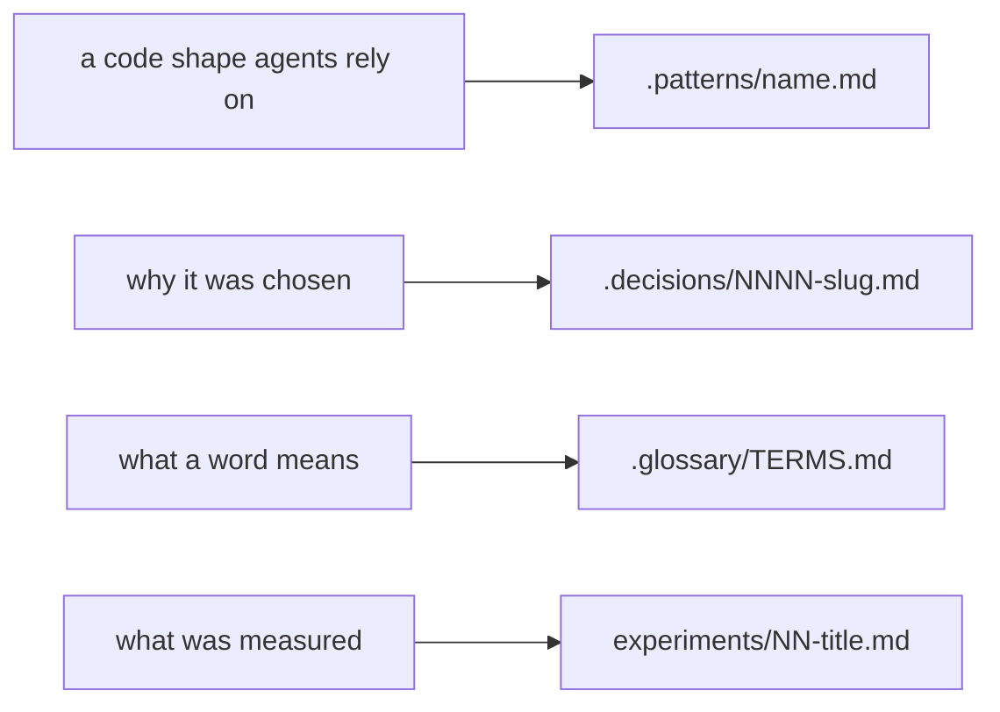

# Patterns

How the code is shaped now, one doc per shape. Each doc opens with a Mermaid diagram of the
mechanism, then one small real code block, then the words, and it points at real files with
`path:line` ([0005](../.decisions/0005-patterns-and-decisions-are-visual.md)). Write or re-ground
one with the [write-pattern skill](../.agents/skills/write-pattern/SKILL.md).



A pattern doc says how; it links the decision for why and never argues it again. When the source
and a doc disagree, the doc is wrong.

## When to add a doc

Add one only when all of these hold:

- **It is a shape.** Real source and tests here show a reusable shape and where it stops, or an
  accepted decision names a shape about to be used and the dependency's own source or docs ground
  it.
- **It is not obvious.** A reader new to the code would write a different, worse version.
- **Every rule points at a line.** Each rule names the `path:line`, type or test that holds it.

Narrating obvious code, general framework advice, guessed conventions and rules from feel stay out.
A doc that already covers the shape is extended, never doubled.

## Every doc

This folder keeps no table of its docs
([0522](../.decisions/0522-no-folder-keeps-an-index-table.md)). Each doc opens with a small top
block above its `# ` heading: `where` is the code it covers, and `when` is the moment to read it.
Each value is one line, in double quotes. The Mermaid diagram comes right after the heading.

```markdown
---
where: "next/ settings"
when: "Adding a setting, or reading or writing a settings file"
---

# One settings declaration gives both encodings
```

The lead's command prints one line per doc as it is on `origin/main`:

```sh
node .agents/skills/lead/scripts/records.ts list .patterns
```
