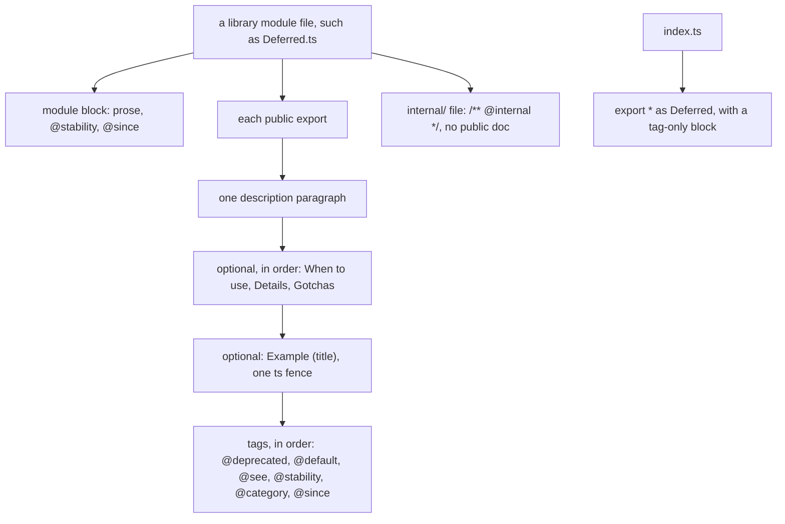

# A public export carries an Effect-shaped doc comment



````ts
// node_modules/effect/src/Deferred.ts:153-178 (effect@4.1.2)
/**
 * Creates a new `Deferred`.
 *
 * **When to use**
 *
 * Use to allocate an empty `Deferred` inside an `Effect` workflow.
 *
 * **Example** (Creating a Deferred)
 *
 * ```ts import.meta.vitest
 * import { Deferred, Effect } from "effect"
 *
 * const program = Effect.gen(function*() {
 *   const deferred = yield* Deferred.make<number>()
 *   yield* Deferred.succeed(deferred, 42)
 *   return yield* Deferred.await(deferred)
 * })
 *
 * await Effect.runPromise(program) // => 42
 * ```
 *
 * @stability stable
 * @category constructors
 * @since 2.0.0
 */
export const make = <A, E = never>(): Effect<Deferred<A, E>> => internalEffect.sync(() => makeUnsafe())
````

Every public export in a `next/` library gets this block, in this order. The rules come from
Effect's own doc skill at the tag (`.agents/skills/jsdocs/declarations.md`, `categories.md`,
`examples.md` in [Effect-TS/effect at effect@4.1.2](https://github.com/Effect-TS/effect/tree/effect%404.1.2/.agents/skills/jsdocs)),
and each one is visible in the installed source:

- **The module block comes first, above the imports.** Prose about the whole module, then
  `@stability` and `@since`, no `@category` (`node_modules/effect/src/Deferred.ts:1-10`).
- **The description is one paragraph.** A function starts with a present-tense verb: `Creates`,
  `Returns`, `Converts` (`node_modules/effect/src/Deferred.ts:154`). A value starts with its noun
  family: `Schema for`, `Layer that`, `Service that`.
- **Three optional sections, each at most once, in this order:** `**When to use**`,
  `**Details**`, `**Gotchas**`. `**When to use**` begins `Use to`, `Use when`, `Use as` or
  `Use with` (`node_modules/effect/src/Deferred.ts:156-158`). `**Gotchas**` holds only concrete
  caveats (`node_modules/effect/src/BigInt.ts:30-33`). No other headings.
- **Examples are `**Example** (Title)` sections, never `@example` tags.** One `ts` fence each, with
  a title unique in the block (`node_modules/effect/src/Deferred.ts:160`). A runnable fence says
  `ts import.meta.vitest` and asserts with `// =>`. An example is kept only when the signature does
  not already say it.
- **Tags close the block, in this order:** `@deprecated`, `@default`, `@see`, `@stability`,
  `@category`, `@since`. `@see {@link name}` only for a real neighbour API, with a reason
  (`node_modules/effect/src/Deferred.ts:224-229`).
- **`@stability` is `stable`, `unstable` or `experimental`.** `unstable` may break in a minor
  release, `experimental` in a patch. An export that exposes a third-party type is `unstable`.
- **`@category` is a lowercase plural or gerund** reused from nearby: `constructors`, `models`,
  `guards`, `getters`, `services`, `layers`, `errors`, `error handling`, `combinators`
  (`node_modules/effect/src/Deferred.ts:57`, `:74`, `:175`).
- **Exactly one blank line** between the description, each section, each example and the tag group.
- **Internal code gets `/** @internal */` and no public doc.** It lives in `src/internal/`
  (`node_modules/effect/src/internal/core.ts:18`), and the checker skips it.
- **A barrel re-export gets a tag-only block:** `@stability` and `@since` above
  `export * as Duration from "./Duration.ts"` (`node_modules/effect/src/index.ts:190-195`).
- **A member's doc is optional.** When present it takes `@since` and `@default`, never
  `@category`.
- **One doc block per export.** A tool reads only the block right above the export, so a
  description in one block and `@internal` in a second loses the description. Put both in one block:

  ```ts
  // next/packages/libfabrika/src/processes/internal/processTable.ts:66-71
  /**
   * The canonical (recipient, ref) key a watch is held under.
   *
   * @internal
   */
  export const watchKey = (to: To, ref: string): string => JSON.stringify([canonical(to), ref]);
  ```

- **No plan codes, no history.** A comment never cites a plan row, a law number or a flag (`P6`,
  `law p92`, `flag 13`, `Tier 1`), and never points at a past version ("as before"). A stranger
  cannot read them, and they rot when the plan moves. Keep the reason in words; a decision number
  such as `(0095)` may stay, since the record lasts. Effect's source cites no ticket.

## Intended scope

Every public export of a library under `next/packages/` (today `libfabrika`), and its module
files. App code in `next/apps/` does not require it. A test helper (`*.test-support.ts`) does not
either. Today no file in `next/` has a `@since` tag, and Effect's checker finds 92 places in
`next/packages/libfabrika/src` that need a block or its tags. `@since` carries the library's own
version, which is `0.0.0` while it is unpublished, so our blocks leave the tag out until a first
release ([0118](../.decisions/0118-no-since-tag-before-a-release.md)).

Not yet, in `next/packages/libfabrika/src`:

- Doubled blocks: `ledger/internal/ledgerPages.ts:7-8`, `ledger/internal/ledgerTrace.ts:3-4` and
  `processes/internal/processMail.ts:9-14`, each a description block followed by a second
  `/** @internal */` block.
- Plan codes: a regex count on main `4cc93a8a0` finds 89 comment lines in 52 product files, for
  example `ledger/Log.ts:1-2` ("Tier 1, P6 (laws p68 and p92)"), `processes/Mailbox.ts:2-3` and
  `ledger/internal/ledgerStore.ts:20` ("(flag 13)"). A count, not a list.
- History: `processes/internal/processMail.ts:10` ("Historical mailbox replay stays unchanged").

## Decision

[0023](../.decisions/0023-next-follows-effects-code-style.md): `next/` follows Effect's code style
and doc comment structure.

## What can hold it

- **Effect's own checker** (`packages/tools/jsdocs` in Effect's repo, run there as
  `pnpm jsdocs --check`) checks every rule above. It is private, not on npm, and needs the
  TypeScript JS API, which our TypeScript 7 does not have. A scratch copy with `effect@4.1.2`,
  `glob` and TypeScript 5.9 ran on both trees on 2026-11-09. On Effect's 144 modules in
  `packages/effect/src` it reported only `StandardSchema.ts`, which Effect's own config excludes: 0
  false alarms. On `libfabrika` it reported 92 places. A hand read of 20 (seed 119120) found 20
  real exports with no block or no tags; 2 were in `*.test-support.ts`, which a config would leave
  out.
- **Oxlint 1.90.0's `jsdoc` plugin cannot hold it.** It has no rule that requires a doc on an
  export. On Effect's correct tree, `check-tag-names` (with `since`, `category`, `stability`
  defined), `empty-tags` and `no-blank-blocks` fire 0 times, so they can guard tag spelling. Its
  `require-param` and `require-returns` fire 1,494 and 1,679 times there, since Effect writes no
  `@param` or `@returns`: all false alarms, so they stay off.
- **`@effect/docgen` 4.1.2 is on npm**, but it builds a docs site and checks less: `@since` and a
  description per export, not the section order.
- **No check finds plan codes or doubled blocks.** Two small rules of ours are proposed in the Effect
  code guidelines study (experiment 262, not on main yet): a word list on comments, and a rule on
  two doc blocks above one export. Their false alarms get counted before either can block.
- Lean, a guess, about 70% sure: a small rule of ours in `oxlint-plugins/` for presence, tag set
  and tag order, since it needs no type information, plus Effect's checker run by hand for the
  section rules until a block from it is measured on more of our tree. What would settle it: the
  rule's false alarms on all of `libfabrika` after the first sweep.

## Why it is not obvious

An agent writes the JSDoc it knows: `@param`, `@returns` and `@example` tags, or one line with no
tags. Both read as documented, and neither is Effect's shape. A reader who knows Effect then meets a
second dialect in the one library that should feel like Effect's, and a `@since` added later
cannot recover when an export first shipped.

> Derived from `effect@4.1.2`; re-verify on pin bump.
