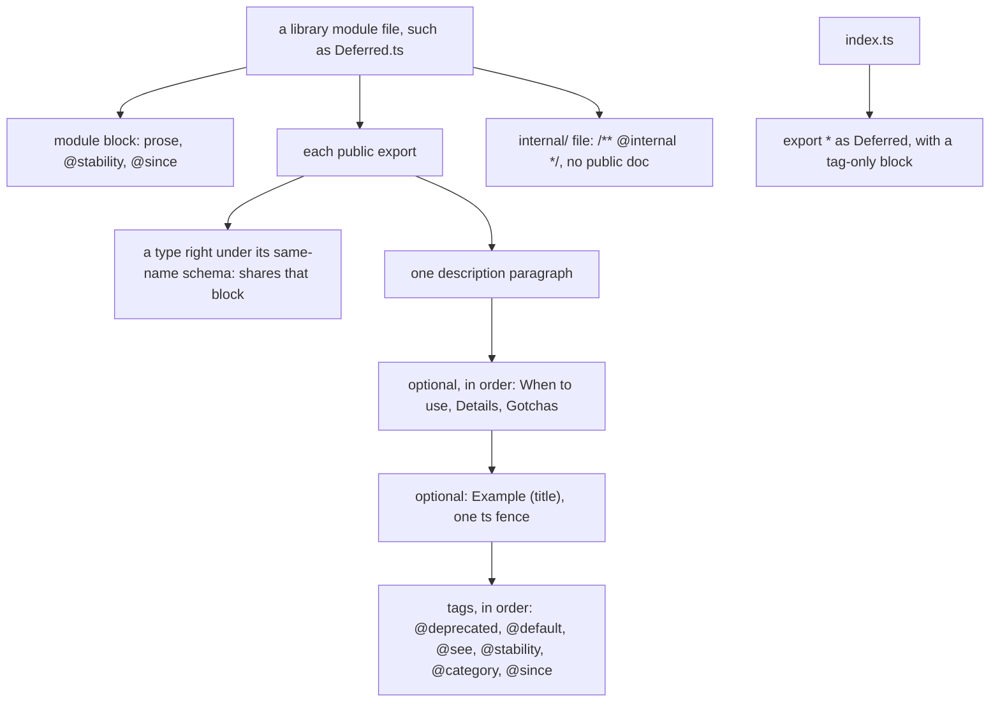

# A public export carries an Effect-shaped doc comment



````ts
// node_modules/effect/src/Deferred.ts:153-178 (effect@4.1.2)
/**
 * Creates a new `Deferred`.
 *
 * **When to use**
 *
 * Use to allocate an empty `Deferred` inside an `Effect` workflow.
 *
 * **Example** (Creating a Deferred)
 *
 * ```ts import.meta.vitest
 * import { Deferred, Effect } from "effect"
 *
 * const program = Effect.gen(function*() {
 *   const deferred = yield* Deferred.make<number>()
 *   yield* Deferred.succeed(deferred, 42)
 *   return yield* Deferred.await(deferred)
 * })
 *
 * await Effect.runPromise(program) // => 42
 * ```
 *
 * @stability stable
 * @category constructors
 * @since 2.0.0
 */
export const make = <A, E = never>(): Effect<Deferred<A, E>> => internalEffect.sync(() => makeUnsafe())
````

Every public export in a `next/` library gets this block, in this order. The lint rule
`fabrika/jsdocs` asks for it (`oxlint-plugins/jsdocs.ts`). The rules come from
Effect's own doc skill at the tag (`.agents/skills/jsdocs/declarations.md`, `categories.md`,
`examples.md` in [Effect-TS/effect at effect@4.1.2](https://github.com/Effect-TS/effect/tree/effect%404.1.2/.agents/skills/jsdocs)),
and each one is visible in the installed source:

- **The module block comes first, above the imports.** Prose about the whole module, then
  `@stability` and `@since`, no `@category` (`node_modules/effect/src/Deferred.ts:1-10`).
  When a file's first statement is not an import (an `export { a }` list, a `const`), one block
  above it is that statement's own, as Effect's checker reads it, so such a file puts two blocks
  there and the first is the module's (`oxlint-plugins/jsdocs.ts:29-35`).
- **The description is one paragraph.** A function starts with a present-tense verb: `Creates`,
  `Returns`, `Converts` (`node_modules/effect/src/Deferred.ts:154`). A value starts with its noun
  family: `Schema for`, `Layer that`, `Service that`.
- **Three optional sections, each at most once, in this order:** `**When to use**`,
  `**Details**`, `**Gotchas**`. `**When to use**` begins `Use to`, `Use when`, `Use as` or
  `Use with` (`node_modules/effect/src/Deferred.ts:156-158`). `**Gotchas**` holds only concrete
  caveats (`node_modules/effect/src/BigInt.ts:30-33`). No other headings.
- **Examples are `**Example** (Title)` sections, never `@example` tags.** One `ts` fence each, with
  a title unique in the block (`node_modules/effect/src/Deferred.ts:160`). A runnable fence says
  `ts import.meta.vitest` and asserts with `// =>`. An example is kept only when the signature does
  not already say it.
- **Tags close the block, in this order:** `@deprecated`, `@default`, `@see`, `@stability`,
  `@category`, `@since`. `@see {@link name}` only for a real neighbour API, with a reason
  (`node_modules/effect/src/Deferred.ts:224-229`).
- **`@stability` is `stable`, `unstable` or `experimental`.** `unstable` may break in a minor
  release, `experimental` in a patch. An export that exposes a third-party type is `unstable`.
- **`@category` is a lowercase plural or gerund** reused from nearby: `constructors`, `models`,
  `guards`, `getters`, `services`, `layers`, `errors`, `error handling`, `combinators`
  (`node_modules/effect/src/Deferred.ts:57`, `:74`, `:175`).
- **Exactly one blank line** between the description, each section, each example and the tag group.
- **Internal code gets `/** @internal */` and no public doc.** It lives in `src/internal/`
  (`node_modules/effect/src/internal/core.ts:18`), and the checker skips it.
- **A barrel re-export gets a tag-only block:** `@stability` and `@since` above
  `export * as Duration from "./Duration.ts"` (`node_modules/effect/src/index.ts:190-195`).
- **A member's doc is optional.** When present it takes `@since` and `@default`, never
  `@category`.
- **A type directly under its same-name schema shares the schema's block.** The pair is one
  thing to a reader, so it gets one block, above the schema. "Directly" means the statement right
  before it (`oxlint-plugins/jsdocs.ts:21-24`). This is a kept difference from Effect, which gives
  the type its own block ([0023](../.decisions/0023-next-follows-effects-code-style.md#amendments)):

  ```ts
  // A sketch: no pair in a folder the rule is on has this shape yet.
  /**
   * Schema for ...
   *
   * @stability unstable
   * @category schemas
   */
  export const Sent = Schema.Struct({ /* ... */ });
  export type Sent = typeof Sent.Type;
  ```

- **One doc block per export.** The rule reads only the last block right above the export
  (`oxlint-plugins/jsdocs.ts:25-28`), so a description in one block and `@internal` in a second
  loses the description. Put both in one block:

  ```ts
  // next/packages/libfabrika/src/processes/internal/processTable.ts:66-71
  /**
   * The canonical (recipient, ref) key a watch is held under.
   *
   * @internal
   */
  export const watchKey = (to: To, ref: string): string => JSON.stringify([canonical(to), ref]);
  ```

- **No plan codes, no history.** A comment never cites a plan row, a law number or a flag (`P6`,
  `law p92`, `flag 13`, `Tier 1`), and never points at a past version ("as before"). A stranger
  cannot read them, and they rot when the plan moves. Keep the reason in words; a decision number
  such as `(0095)` may stay, since the record lasts. Effect's source cites no ticket.

## Where it applies

Every public export of a library under `next/packages/` (today `libfabrika` and `tuval`), and its
module files ([0023](../.decisions/0023-next-follows-effects-code-style.md),
[0120](../.decisions/0120-effect-code-guidelines.md)). `fabrika/jsdocs` is on at `error` for
`next/packages/*/src/**` (`.oxlintrc.json:2028-2029`), so a new folder or package blocks from its
first file. A folder not yet at zero has one line in the `warn` override right after it
(`.oxlintrc.json:2036-2047`), where its fires print as advice and do not fail. The pull request that
fills a folder deletes its line, and a whole `pnpm lint` fails until it does
([0523](../.decisions/0523-advice-rules-block-where-clean.md), ticket 948,
[Plan B, B2](../docs/plan/effect-rules-big.md#b2-the-docs-rule)). Until then, review holds the
shape in that folder.

It stops at what is not public: `internal/`, tests, test support (`*.test-support.ts`), shared
suites (`*Test.ts`), fixtures and declaration files, where the rule is off
(`.oxlintrc.json:2052-2061`). That override comes last, so a warn line never turns the rule on
there. App code in `next/apps/` is not asked either. `@since` carries the library's own version,
`0.0.0` while it is unpublished, so a block leaves the tag out until a first release, and the
rule's `since: "absent"` fires on one
([0118](../.decisions/0118-no-since-tag-before-a-release.md), `oxlint-plugins/jsdocs.ts:114-115`).

How far it is, counted by the rule on 2026-11-14 on main `c0aaf4a24`
(`oxlint-plugins/README.md`, "The docs rule, E6"), beside the counts made before it:

- **At zero then:** `ci` 9 of 9 exports pass and `codehost` 12 of 12, with both module blocks: 0
  fires, as the plan's prototype found.
- **Not at zero then:** the other public files of `libfabrika`, 136 in all, fire 666 times: 346
  exports with no block, 232 with a block out of shape (most lack `@stability` and `@category`)
  and 88 files with no module block or a wrong one. The README has the count by module.
- **On 2026-11-13, ticket 948, at `cf03efb9f`:** 316 fires, all in the 9 folders that still
  advise. The other 14 `libfabrika` folders block. The README has the count by folder
  (`oxlint-plugins/README.md`, "Where a rule still advises").
- **The counts before the rule:** Effect's checker run by hand found 92 places (2026-11-09); the
  plan's grep found 333 exports with no block and 114 files with no module block. Neither read a
  name in an `export { a }` list or a block out of shape, which is why the rule finds more.

Not yet, in `next/packages/libfabrika/src`, and no rule catches them:

- Doubled blocks: `ledger/internal/ledgerPages.ts:7-8`, `ledger/internal/ledgerTrace.ts:3-4` and
  `processes/internal/processMail.ts:9-14`, each a description block followed by a second
  `/** @internal */` block. `fabrika/jsdocs` reads only the last block and is off in `internal/`.
- Plan codes: a regex count on main `4cc93a8a0` found 89 comment lines in 52 product files, for
  example `ledger/Log.ts:1-2` ("Tier 1, P6 (laws p68 and p92)") and
  `ledger/internal/ledgerStore.ts:81` ("(flag 13)"). A count, not a list.
- History: `processes/internal/processMail.ts:10` ("Historical mailbox replay stays unchanged").

## What holds it

- **`fabrika/jsdocs`, ours** (`oxlint-plugins/jsdocs.ts`), finds each export and its block through
  oxlint's syntax tree: `export const`, `let`, `function` (the first overload), `class`,
  `interface`, `type`, `declare namespace` and each export in it, `export * as` and each name of
  `export { a }`. No kind of export is exempt; only `@internal` takes one out.
- **Whether a block is right is Effect's own grammar,** copied from Effect's checker
  (`packages/tools/jsdocs/src/Jsdocs.ts` at `effect@4.1.2`) into `oxlint-plugins/effect-jsdocs.ts`
  with Effect's MIT notice; its head lists every line taken and every change. So the description,
  the sections, the examples and the tag order are judged as Effect judges them, and an Effect bump
  means diffing those lines again.
- **Measured against Effect's own verdict:** on Effect 4.1.2's 432 files outside `internal/`, with
  `since` set to `required`, it fires 10 times, each where Effect's own checker also reports: the 6
  exports of `StandardSchema.ts`, which Effect's config leaves out, and 4 files with no module block
  of their own. 0 false alarms. The laws are in `oxlint-plugins/jsdocs.test.ts`.
- **What it cannot see:** whether a description is true, whether `@see {@link x}` names a real
  thing, whether an example compiles, and a name sent on under a new binding. A review reads each
  description against the code.
- **No check finds plan codes or doubled blocks.** A plan-code rule on comments comes later, with
  its own plan, once its false alarms are counted (Plan B, B2, item 9).
- The lean before the rule (2026-11-09, about 70% sure) was a small rule of ours for presence and
  tags only, with Effect's checker run by hand for the sections. It was wrong in part: copying
  Effect's grammar holds the sections in the same rule.

## Why it is not obvious

An agent writes the JSDoc it knows: `@param`, `@returns` and `@example` tags, or one line with no
tags. Both read as documented, and neither is Effect's shape. A reader who knows Effect then meets a
second dialect in the one library that should feel like Effect's, and a `@since` added later
cannot recover when an export first shipped.

> Derived from `effect@4.1.2`; re-verify on pin bump.
