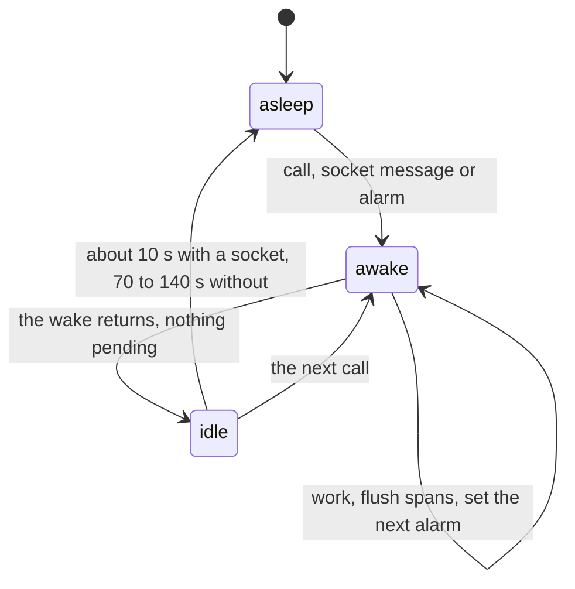

# A Durable Object works inside a wake, sets an alarm for later, and sleeps



```ts
// next/packages/libfabrika/src/cloudflare/runtime.ts:820-826 and :857-861, the Process object.
// Later work is a saved due time plus the object's one alarm, set before the wake ends.
Layer.succeed(Alarm, {
  // The program's wake is saved as it set it; the platform alarm moves a past time to now.
  set: (at) =>
    (at === null
      ? rpc(storage.delete("wake")).pipe(Effect.andThen(rpc(storage.deleteAlarm())))
      : rpc(storage.put("wake", at)).pipe(Effect.andThen(rpc(storage.setAlarm(at))))
    ).pipe(Effect.orDie),
}),
// The alarm is a wake like any call: read the saved time, do the work, return.
alarm: () =>
  rpc(storage.get<number>("wake")).pipe(
    Effect.flatMap((at) => (at === undefined ? Effect.void : attributed(runner.due(at)))),
  ),
```

An object in `next/` is awake only while it handles a wake: a call, a socket message or an alarm.
When the wake returns, nothing of it is left running. Work for later is a time in storage and the
object's one alarm (`runtime.ts:820-826`). The alarm reads the time back and runs the same code a
call would (`runtime.ts:858-861`). Nothing in memory has to survive, because the platform drops
memory when the object sleeps and runs the constructor again on the next wake
([lifecycle](https://developers.cloudflare.com/durable-objects/concepts/durable-object-lifecycle/)).

The rule and its reason are [0105](../.decisions/0105-a-durable-object-never-stays-awake-on-its-own.md).
This doc is the shapes that keep it.

## What the platform does

Read on 2026-11-11 from Cloudflare's docs. `next/apps/fabrika/alchemy.run.ts:41` sets the
compatibility date `2026-10-12`, so the 2026-10-01 change below is on.

- **Sleeping needs nothing pending.** An object hibernates only when no `setTimeout` or
  `setInterval` is set, no `waitUntil` promise or I/O is unfinished, no outbound connection is
  open, no standard (non-hibernatable) WebSocket is in use, and no event is running. Then it
  hibernates after about 10 s. Otherwise it sits idle in memory and is evicted after 70 to 140 s
  ([lifecycle](https://developers.cloudflare.com/durable-objects/concepts/durable-object-lifecycle/)).
- **Waiting is billed.** Duration (128 MB, wall clock) is billed while the object runs, and while it
  is idle but cannot hibernate. An idle object that could hibernate is not billed, even before it
  does ([pricing](https://developers.cloudflare.com/durable-objects/platform/pricing/)). A
  standard socket's `accept()` bills the whole time it is open.
- **Pending work holds off eviction.** From compatibility date 2026-10-01, each pending timer,
  `waitUntil` promise, RPC call to another object or service binding call keeps the object in
  memory for up to 15 minutes from its start, and a later one extends it
  ([changelog](https://developers.cloudflare.com/changelog/post/2026-10-01-pending-io-keep-alive/)).
  An exporter that starts a new timer every few seconds is never evicted.
- **One alarm per object, at least once.** `setAlarm` replaces the one alarm. `alarm()` runs at
  least once, sometimes twice, and an uncaught failure is retried with backoff from 2 s, up to six
  retries, then never again ([base class](https://developers.cloudflare.com/durable-objects/api/base/),
  [rules](https://developers.cloudflare.com/durable-objects/best-practices/rules-of-durable-objects/)).
  An alarm cut by `ctx.abort()` retries unless the abort passes `{ retryAlarm: false }`
  ([changelog](https://developers.cloudflare.com/changelog/post/2026-08-25-durable-object-alarm-abort-no-retry/)).
- **A hibernatable socket stays open while the object sleeps.** `ctx.acceptWebSocket` keeps the
  client connected; the next message runs the constructor, then `webSocketMessage`. What the socket
  needs after a sleep goes in its attachment and tags
  ([WebSockets](https://developers.cloudflare.com/durable-objects/best-practices/websockets/)).
  `setWebSocketAutoResponse` answers a ping without waking the object.

## Work in a wake, and flush spans before it ends

```ts
// next/packages/libfabrika/src/cloudflare/runtime.ts:259-269
export const complete = Effect.fn(function* <A, E, R>(work: Effect.Effect<A, E, R>) {
  return yield* work.pipe(
    Effect.exit,
    Effect.flatMap((exit) =>
      flushed.pipe(
        Effect.flatMap(() => exit),
        Effect.catch((error) => (Exit.isFailure(exit) ? exit : Effect.fail(error))),
      ),
    ),
  );
});
```

Every object call in `next/` runs its work, then flushes its spans, on success and failure:
`complete` above for `Project` and `Connection` (`runtime.ts:568`, `connection.ts:21`), and the
runner's own `call` wrapper for `Process` (`next/packages/libfabrika/src/runtime/Runner.ts:1301-1305`).
The span sink keeps its queue as a table, not in memory, and runs no timer
(`next/packages/libfabrika/src/telemetry/Sink.ts:1-7`); the hourly rollup and the R2 archive run
inside a span's end and inside `flush`, never on a clock
(`next/packages/libfabrika/src/telemetry/internal/measurements.ts:6-8`). A ledger wait answers at
once, `ready` or a ring row, so a parked wait leaves no fiber behind
(`next/packages/libfabrika/src/ledger/internal/ledgerStore.ts:5-8`).

Alchemy's own bridge, used today by `RecordPart` (`next/apps/fabrika/src/brain.ts:304-311`), does
the same for Effect exporters: it builds the configured telemetry layer into a scope of its own per
call and closes that scope inside `waitUntil` once the call's background work settles
(`@alchemy.run/cloudflare/src/Workers/DurableObjectBridge.ts:150-191`). Its per-event exporters set
`exportInterval: "1 hour"` so no export races the close (`alchemy/src/TelemetryRuntime.ts:350-365`).

**Telemetry an instance records outside a call is not settled.** A fiber forked when the instance
starts gets no per-call exporter, and exporters built into an instance scope keep a timer pending
([alchemy issue 2878](https://github.com/alchemy-run/alchemy/issues/2878), reproduced on effect
4.1.1). On effect 4.1.2, the installed one, the OTLP export loop waits on a timer only while its
buffer holds data (`effect/src/observability/OtlpExporter.ts:271-286`, `armed` and `wake`), and
`OtlpExporter.Flusher`'s `flush` drains every signal at once (`OtlpExporter.ts:73-99`). Whether that
lets an instance-scope exporter sleep, or whether per-wake flushing needs a patch to Alchemy, to
Effect, or only our own code, is the question of the experiment running on issue 2878. **Pending:
do not build an instance-scope exporter until it reports.** Until then the shape is the one above:
no fiber outside a call, and the flush is the last step of every wake.

## Later work is an alarm, set before the wake ends

The opening block is the real shape. The runner computes one next time from the program's own wake
and any recovery wait, and sets the alarm only when that time changed
(`next/packages/libfabrika/src/runtime/Runner.ts:282-300`). The time is saved in storage beside the
alarm (`runtime.ts:825`), because the alarm handler gets no payload, and `savedAlarm` reads it back
for tests (`runtime.ts:206-208`).

A handler is safe to run twice when its effect has an ID from the due time. The runner sends the
timer letter as `` `${process.id}/due/${time}` `` (`Runner.ts:1413`), and the ledger answers a resend
with its first placing (`next/packages/libfabrika/src/ledger/Log.ts:75`), so a repeated alarm is
the same letter (`runtime.ts:857`).

## A loop is an alarm that sets the next alarm

Nothing in `next/` loops yet. The shape, as a sketch (names from 0105's block; `LastRan` and
`Loops` are made up):

```ts
// sketch: one loop on one object. The handler never fails, always re-arms, and records its run.
const tick = Effect.fn("cleanup.tick")(function* () {
  const now = yield* Clock.currentTimeMillis;
  const ran = yield* runner.msg({ type: "tick", at: now }).pipe(Effect.exit); // work, idempotent by `at`
  yield* storage.put("cleanup.lastRan", LastRan.make({ at: now, ok: Exit.isSuccess(ran) }));
  yield* alarm.set(now + Duration.toMillis(Exit.isSuccess(ran) ? "1 hour" : "1 minute"));
  if (Exit.isFailure(ran)) yield* Effect.logError("cleanup.tick failed", ran.cause);
});
```

- **Catch, then re-arm, always.** Six platform retries in about two minutes are not a retry policy:
  after them the loop is silent forever. Catch every failure, set the next alarm on both paths, and
  fail only if the re-arm itself fails, so the platform retries that.
- **Record when it last ran.** A fact in storage (or a ledger entry), written each run, with whether
  it worked. A loop that stopped is then a stale time a reader can see, not an absence.
- **Safe to run twice.** The work takes an ID from the due time, as the runner's `due` letter does.
- **Re-arm from storage on the next wake too.** A wake that finds a due time saved but no alarm set
  (`storage.getAlarm()` is `null`) sets it again. That covers an alarm lost to `ctx.abort` with
  `retryAlarm: false`.

## Many due times on one object, or one object per loop

An object has one alarm, so many due times need a table of them. Two shapes, and 0105 leaves the
choice to the loops and queues study.

| Shape | What holds the due times | Failure | Fits |
|---|---|---|---|
| Alchemy's `makeCallback` | its `alchemy_alarm_callbacks` table, one native alarm set to the earliest (`@alchemy.run/cloudflare/src/Workers/AlarmCallback.ts:48-59`) | its own budget: 30 s delay doubling, 8 attempts, then parked and retried hourly, never dropped (`AlarmCallback.ts:31-38`) | many jobs per object, each with an ID and a JSON payload |
| Alchemy's older `scheduleEvent` and `processScheduledEvents` | `alchemy_scheduled_events`, with `repeatMs` (`ScheduledEvents.ts:57-61`) | the handler's, as with a plain alarm | kept for old rows; `makeCallback` is the newer form (`DurableObject.ts:930-960`) |
| One object per loop | that object's one alarm | the catch-and-re-arm sketch above | a loop that owns its own state, as `Process` owns its program's wake |

`makeCallback` is registered once in the object's inner Effect and dies if registered later
(`AlarmCallback.ts:149-159`). Both forms need the Alchemy bridge, which only `RecordPart` uses
today ([0041](../.decisions/0041-object-classes-are-effect-objects.md) moves the rest). Do not
write a second scheduler beside them ([0040](../.decisions/0040-existing-tools-before-hand-written.md)).

## Sockets use the hibernatable form

```ts
// next/packages/libfabrika/src/cloudflare/connection.ts:202-206
const pair = new WebSocketPair(),
  server = pair[1];
ctx.acceptWebSocket(server, [session, tab, key]);
ctx.setWebSocketAutoResponse(new WebSocketRequestResponsePair("ping", "pong"));
server.serializeAttachment(Attached.cases.new.make({ client, nonce }));
```

The `Connection` object accepts every socket with `ctx.acceptWebSocket`, never `ws.accept()`, and
answers pings with the auto response, so a ping wakes nothing; the last ping's time comes from
`getWebSocketAutoResponseTimestamp` (`connection.ts:40`). Who the socket is lives in its tags and
attachment (`connection.ts:24-33`), and the `connections` map is only a cache rebuilt from them
after a sleep (`connection.ts:23`). Events enter through `webSocketMessage`, `webSocketClose` and
`webSocketError` (`next/apps/fabrika/src/brain.ts:273-286`). Alchemy's `Cloudflare.upgrade` is the
same shape on the bridge (`@alchemy.run/cloudflare/src/Workers/WebSocket.ts:158-173`).

## State that must survive a sleep lives in storage

A field, a `let`, a `Map` or a `Ref` in an object's runtime lasts until the next sleep. The
runtime is a class field built in the constructor (`brain.ts:27`, `:208`, `:266`), so it is rebuilt
on every wake. Keep in memory only what the next wake can rebuild: a cache like `connections`, or
`alarmAt`, which starts `undefined` and only saves a repeated `setAlarm` (`Runner.ts:222`, `:294`).
Anything a later wake needs to act on goes in storage: the due time (`runtime.ts:825`), the stepping
marker (experiment 231 found the constructor cannot tell sleep from crash; a saved marker can), a
socket's attachment.

## A retry that survives a sleep saves its count and reuses the supervisor's backoff

```ts
// next/packages/libfabrika/src/runtime/internal/supervisor.ts:120-124, inside the saved machine.
      const { failure, process } = s.recovery;
      const crashes = s.crashes ?? 1;
      const wait = Math.min(s.policy.backoff.minMs * 2 ** Math.min(crashes - 1, 53), s.policy.backoff.maxMs);
      const until = m.at + wait;
      const reason = crashReason(failure);
```

A `Schedule` lives in a fiber's memory, so a sleep forgets how many times it ran and when the next
try is due. A retry that must outlive the wake keeps both as data: the attempt count in the saved
record (`crashes`, `runtime/internal/recovery.ts:120`), and the next time as the object's alarm. The
wait grows from `minMs`, doubles per crash and stops at `maxMs` (`supervisor.ts:122`), with the
policy's numbers saved beside it (`recovery.ts:18`). A new retry of this kind reuses this machine's
backoff rather than writing its own.

Inside one wake, a retry is a plain `Effect.retry`, which ends with the wake
(`next/packages/libfabrika/src/cloudflare/runtime.ts:760-766`), or a `Schedule`
([effect-state-and-time.md](./effect-state-and-time.md)).

Not yet: the runner's retry of a failed send waits a fixed `minMs` every time and keeps its due time
in a `let` (`next/packages/libfabrika/src/runtime/Runner.ts:1344-1348`, `mailRetry` at `:234`), so
the wait never grows and its count is not saved.

## What keeps an object awake

Each line is a thing that leaves something pending when the wake returns, its Effect form, and the
fix.

- **A timer.** `setTimeout`, `setInterval`, or `Effect.sleep` (it is a `setTimeout` underneath,
  `effect/src/internal/effect.ts:6397`) in a fiber that outlives the call. Fix: an alarm.
- **A repeat.** `Effect.repeat(Schedule.spaced(...))`, `Effect.forever` with a sleep, `Stream.tick`,
  `Stream.fromSchedule`. Fix: an alarm whose handler sets the next one.
- **A long-lived fiber.** `Effect.forkDetach`, `Effect.forkScoped` or `forkIn` into an instance
  scope, of anything that waits: a tick loop, a `PubSub` or `Queue` consumer, a subscription. Fix:
  do the work in the wake that produced it; a wait is data (a ring row, an attachment), never a
  fiber. A stream fiber dies silently at the sleep anyway (experiment 174).
- **A stream that never ends,** returned from a call or forked. While a call streams, the object is
  awake and billed. Fix: page it, or park the rest as data and send it from a later wake.
- **An exporter interval.** `OtlpTracer`, `OtlpLogger` or `OtlpMetrics` built into an instance
  scope: a 5 s and a 1 s loop by default (`OtlpTracer.ts:85`, `OtlpLogger.ts:83`). Fix: per-wake
  build and flush, as above; the instance-scope case waits on the 2878 experiment.
- **Polling.** A loop that asks another object or a service "is it ready yet". Each pending RPC
  also holds off eviction for up to 15 minutes. Fix: the other side rings when ready, as the
  ledger's doorbell does.
- **A standard socket.** `ws.accept()`, `new WebSocket(...)` out of the object, or an
  `addEventListener("message")`. Fix: `ctx.acceptWebSocket`. An outbound socket cannot hibernate;
  keep it out of objects.
- **A `waitUntil` that never settles.** Fix: bound it, or make it the next alarm.

Retries and timeouts inside one call are fine (`runtime.ts:760-766` retries an RPC twice, at once):
they end with the wake. What breaks the rule is anything still waiting after the wake returns.

## How to test it

**Restart and check what survived.** `next/apps/fabrika/src/worker-supervision.test.ts:371-384`
runs the real local stage, calls `abort()` on a `Process` object (`brain.ts:260-262`), and checks
that the next call sees the counts, history and view it had: the constructor ran again and nothing
in memory was needed. Every object with saved state gets a law like it.

**Show an idle object hibernated.** No test in `next/` does this yet. A sketch, for an object with
a hibernatable socket, on the local stage:

```ts
// sketch, `debug.instance` is made up: a random ID made in the constructor, returned by a
// read-only call. Another value after the idle wait means the constructor ran again: it slept.
const before = await c.call("debug.instance", {});
await pause(15_000); // longer than the platform's 10 s
const after = await c.call("debug.instance", {});
expect(after).not.toEqual(before);
```

Two limits, from our own runs. Locally, an object with no socket was evicted within 200 s even with
a 1 s `setInterval` or an unsettled `waitUntil` (experiment 174), so a socketless test cannot catch
a pending timer. With a socket open, issue 2878's local repro did show the difference: exporters in
the instance scope kept the object awake. So the hibernation test uses a socket object, like
`Connection`. Real cloud times are in experiment 144 (an object restarts after 10 s with no call).

## Where it applies

Every Durable Object in `next/`: `Project`, `Process`, `Connection` (`next/apps/fabrika/src/brain.ts`)
and `RecordPart` (`next/packages/libfabrika/src/cloudflare/record.ts`), and any code they run:
`next/packages/libfabrika/src/cloudflare/`, and the modules they load (`runtime/`, `gateway/`,
`ledger/`, `processes/`, `telemetry/`, `access/`, `presence/`). Stops at Node-only code: the dev
stage's `Effect.forever` loops (`next/packages/libfabrika/src/node/dev/dev.ts:327-330`,
`next/apps/fabrika/dev.ts:39-47`) run on the laptop, not in an object, and
[effect-state-and-time.md](./effect-state-and-time.md) covers them.

## Today's code breaks this

The sweep of 2026-11-11, on `a8c4cd722`, found no pending timer, repeat, long-lived fiber,
standard socket or exporter interval in object code. It found two breaks of the other parts, each a
row in `field/findings/`:

- The `Process` alarm handler does not catch its failures or re-arm (`runtime.ts:858-861`;
  `Runner.ts:1286` clears `alarmAt` before the work). After six failed retries the program's timer
  is gone until some call comes in.
- A process's watchers are a `Set` in memory (`Runner.ts:225`, filled only by `open` at `:1333`).
  After the object sleeps, `publish` (`:868`) sends patches to nobody until the client opens the
  view again.

## Why it is not obvious

On Node, a loop is a fiber that sleeps, and Effect makes that one line. Every test passes, and the
local runtime even evicts a socketless object with a pending timer (experiment 174). In the cloud
the same line is an object billed for every second it waits, and a stopped alarm is silence. The
worse version is the natural one.

## Holds it

- Today: nothing but review.
- A lint rule could hold the shapes that are syntax, scoped to object code (the sweep's report says
  which and its edge cases). Catch-and-re-arm, "records when it last ran" and "safe to run twice"
  are judgment.

> Derived from `@alchemy.run/cloudflare@2.0.0-beta.84`, `alchemy@2.0.0-beta.84` and `effect@4.1.2`;
> re-verify on pin bump.
