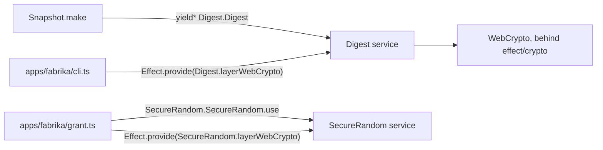

# Hashing, HMAC and random bytes go through Effect's crypto services



```ts
// next/packages/libfabrika/src/settings/Snapshot.ts:5 and :25-27
import { Digest } from "effect/crypto";

  const sorted = Object.entries(values).sort(([a], [b]) => (a < b ? -1 : 1));
  const digest = yield* Digest.Digest;
  const hash = yield* digest.digestHex(Digest.sha256, new TextEncoder().encode(JSON.stringify(sorted)));

// next/apps/fabrika/cli.ts:16: the edge picks the implementation.
    Effect.provide([NodeServices.layer, TomlParser.layer, Digest.layerWebCrypto]),
```

Domain code asks for a crypto service with `yield*` and never touches `crypto.subtle` or
`crypto.getRandomValues`. The program's edge provides the WebCrypto layer. A test can provide
another, and a failure is a typed `CryptoError`, not a rejected Promise to wrap.

What `effect/crypto` ships in 4.1.2, read from `node_modules/effect/src/crypto/`:

| Need | Service and call | Layer |
|---|---|---|
| A hash | `Digest.Digest`, `digest(algorithm, data)` or `digestHex(...)` with `Digest.sha256` (`Digest.ts:139-143`, `:85`) | `Digest.layerWebCrypto` (`Digest.ts:159`) |
| An HMAC | `Mac.Mac`, `sign(key, data)` and `verify(key, tag, data)` (`Mac.ts:161`, `:166`); a key from bytes with `Mac.key(Mac.hmacSha256, bytes)` (`Mac.ts:295`, `:67`) | `Mac.layerWebCrypto`, which needs `SecureRandom` (`Mac.ts:279`) |
| Random bytes, ints, ids | `SecureRandom.SecureRandom`: `randomBytes`, `intBetween`, `shuffle`, `uuidV4`, `uuidV7`, `ulid` (`SecureRandom.ts:61-122`) | `SecureRandom.layerWebCrypto` (`SecureRandom.ts:282`) |
| A signature | `Signature` (`crypto/Signature.ts`) | its own `layerWebCrypto` |

Every one of these modules is marked `@stability unstable` in 4.1.2: it may change in a minor
release. We use them anyway, and a bump re-reads them.

Rules:

- **Ask for the service; let the edge provide it.** `Snapshot.make` yields `Digest.Digest`
  (`Snapshot.ts:26`), so its type says it needs one, and `cli.ts:16` and `dev.ts:100` provide
  `Digest.layerWebCrypto`.
- **Random bytes and ids come from `SecureRandom`.** `grant.ts:69` makes a grant id with
  `SecureRandom.SecureRandom.use((random) => random.uuidV4())`, and `grant.ts:132` provides
  `SecureRandom.layerWebCrypto`. The service's `uuidV7` reads the `Clock`, so a test clock moves it
  (`SecureRandom.ts:90-107`); the module-level `uuidV7Unsafe` reads `Date.now()` and does not
  (`:358-375`).
- **An HMAC is `Mac.sign` and `Mac.verify`,** never `crypto.subtle.sign("HMAC", ...)`.
  `verify` compares tags in constant time inside the service (`Mac.ts:248`).
- **The bytes in are the same bytes.** `new TextEncoder().encode(text)` as before; only the call
  changes.

## Where it applies

Every hash, HMAC, signature and random value in `next/` product code. Stops at `Id.ts`'s
monotonic TypeID maker (`next/packages/libfabrika/src/Id.ts:129`), which reads raw random bytes for
its own UUIDv7 layout; whether `SecureRandom.uuidV7` can replace it is not checked.

## Not yet

- `next/packages/libfabrika/src/runtime/Built.ts:14-18` uses `Digest` but provides
  `Digest.layerWebCrypto` inside `hash` itself, so its callers cannot pick the layer.
- `next/packages/libfabrika/src/gateway/Gateway.ts:1649` and `:1654-1661` hash with
  `crypto.subtle.digest("SHA-256", ...)`, each under its own `tryPromise`, and `:1637` and `:606`
  call `crypto.getRandomValues`.
- `next/packages/libfabrika/src/gateway/GatewayNonce.ts:19`, `:38`, `:45-48` and `:75` import an
  HMAC key, sign and verify with `crypto.subtle`, and make salt with `crypto.getRandomValues`. The
  stateless nonce itself stays (`:6`, a SYN cookie); only the calls move to `Mac` and
  `SecureRandom`.

## Why it is not obvious

An agent knows WebCrypto and older Effect, and older Effect had no crypto module. So it writes
`crypto.subtle` inside a `tryPromise`, which works on Node and workerd and passes every law. Each
copy then needs its own edge comment and its own error mapper, and none can be swapped in a test.

## Holds it

- Effect's checker, on at `error`: `globalRandomInEffect` (`tsconfig.base.json:47`), which refuses
  `Math.random` inside an Effect. `cryptoRandomUUID` and `cryptoRandomUUIDInEffect` are off and found
  0 hits in the study's run, so they could block at no cost.
- No check finds `crypto.subtle` or `crypto.getRandomValues`: Effect's `nodeBuiltinImport` sees only
  `node:crypto`. A lint rule of ours is proposed in the Effect code guidelines study (experiment
  262, not on main yet), not built.

## Decision

[Build on Effect](../docs/direction/build-on-effect.md): Effect's own modules first;
[0040](../.decisions/0040-existing-tools-before-hand-written.md): an existing tool before a
hand-written one.

> Derived from `effect@4.1.2`; re-verify on pin bump.
