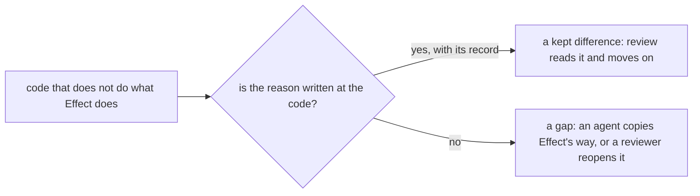

# Where we differ from Effect on purpose, the reason sits beside the code



```ts
// next/packages/libfabrika/src/ledger/internal/ledgerStore.ts:5-8
// An append is decided and written in one `Sql.transaction`, so nothing runs between the number and
// the write. A wait answers at once: `ready`, or a ring row that the next append past it takes out
// in its own step and rings once. No fiber, timer or Deferred is left behind, so the object can
// sleep under a parked wait. Every call ends one span with names, ids and numbers only.

// next/packages/libfabrika/src/ledger/NodeSqlite.ts:3
import type { DatabaseSync, SQLOutputValue, StatementSync } from "node:sqlite"; // edge: Effect SQL has no synchronous SQLite handle for the referee's transactions
```

Effect's own event journal hands live readers a `PubSub` subscription of changes
(`effect/src/eventlog/EventJournal.ts:162`), and its SQL runs through Effect's async `SqlClient`.
Our ledger does neither, and a reader who knows Effect would ask why. The comment
at `ledgerStore.ts:5-8` answers before the question: one synchronous transaction, so nothing runs
between the number and the write, and no waiting fiber, so a Durable Object can sleep. A
difference with its reason beside it is a kept choice. Without one, it looks like a missed
primitive, and the next agent "fixes" it.

Effect writes its own departures the same way, in place:

```ts
// @effect/sql-d1/src/D1Client.ts:184 (@effect/sql-d1@4.1.2)
        // D1 batches execute on the binding directly and intentionally cannot participate in SqlClient transactions.
```

Rules:

- **Say the reason at the line it guards.** A file-level difference goes in the file's opening
  comment (`ledgerStore.ts:5-8`); a one-line difference goes on that line (`NodeSqlite.ts:3`).
- **Name what it protects, in plain words.** "so the object can sleep under a parked wait"
  (`ledgerStore.ts:7-8`), "SYN cookies keep an unproved connection out of storage"
  (`gateway/GatewayNonce.ts:6`), "a timer fiber is what 'a wait is data' forbids. Nothing is
  dropped." (`telemetry/Sink.ts:5-6`).
- **Point at the record when one decided it.** A decision number such as `(0095)` (as
  `ledger/internal/ledgerPages.ts:1` does) or a standard such as `(RFC 4987, section 3.6)`
  (`GatewayNonce.ts:6`). Never a plan code: a stranger cannot read `P6`
  ([doc-comments.md](./doc-comments.md)).
- **A comment says why, never what the code says again.**

## Kept differences

Each of these differs from Effect's habit, and each reason is recorded.

| Ours | Effect's habit | Reason, and where it is written |
|---|---|---|
| Synchronous SQL and ledger steps | async `SqlClient` transactions | a step decides and writes in one transaction ([0050](../.decisions/0050-a-ledger-step-is-a-plain-function.md); `ledgerStore.ts:5-8`, `NodeSqlite.ts:3`) |
| A span sink that writes each span to SQLite | an OTLP exporter with an in-memory buffer and a timer | a sleeping object keeps every span (`telemetry/Sink.ts:5-7`) |
| A stateless HMAC nonce | a challenge kept in memory | a sleeping object loses memory (`GatewayNonce.ts:6`) |
| The supervisor's backoff as a saved tea machine | a `Schedule` | a `Schedule` cannot be saved across a sleep ([durable-objects-sleep.md](./durable-objects-sleep.md)) |
| Contract-only service files, no static layer | a static `layer` on the service class | bundles stay platform-clean ([0095](../.decisions/0095-a-service-file-holds-only-its-contract.md)) |
| A named `Effect.fn` span on every exported function | `fnUntraced` in library code | record wide ([the `Effect.fn` note](../docs/direction/effect-fn-for-traced-functions.md)) |

## Where it applies

Every place in `next/` that does not do what Effect does: a hand-built part where an Effect module
exists, a platform edge, a choice a decision made against Effect's guide. Stops at a plain
difference of taste with no cost either way; that needs no comment.

## Not yet

- `next/packages/libfabrika/src/runtime/Runner.ts:1-5` says what a turn does, but not why the
  runner is not Effect's `cluster/internal/entityManager.ts`.
- `next/packages/libfabrika/src/runtime/internal/supervisor.ts` computes its capped backoff by hand
  (`:122`) with no line saying why it is not a `Schedule`.

## Why it is not obvious

The author knows the reason, so the code looks complete to them. A reviewer, or an agent told to
build the way Effect's team would, sees only the difference. Without the reason they reopen a
settled choice, or quietly swap in Effect's module and lose what the choice protected.

## Holds it

Review only: whether a comment gives a real reason is judgment. A plan names the nearest Effect
module for each new hand-built part, and the review reads the reason beside it.

## Decision

[0023](../.decisions/0023-next-follows-effects-code-style.md): `next/` follows Effect's style, and a
kept difference names its reason.

> Derived from `effect@4.1.2` and `@effect/sql-d1@4.1.2`; re-verify on pin bump.
