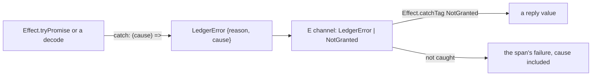

# An error keeps its cause and is caught by its tag



```ts
// Real code from an Effect maintainer's agent, on Effect 4.1.1: clanka src/CodexAuth.ts:50-59.
export class CodexAuthError extends Schema.TaggedError<CodexAuthError>()("CodexAuthError", {
	reason: Schema.Literals(["DeviceFlowFailed", "TokenExchangeFailed", "RefreshFailed"]),
	message: Schema.String,
	cause: Schema.optional(Schema.Defect()),
}) {}

// clanka src/AgentTools.ts:698-700: one reason of a platform error, caught by its tags.
Image.readBoundedFile(fs, path).pipe(
	Effect.catchReason("PlatformError", "NotFound", () => Effect.succeed(null)),
);
```

The same shape on ours, as a sketch (today's `LedgerError` has no `cause`, and says `why`):

```ts
export class LedgerError extends Schema.TaggedError<LedgerError>()("LedgerError", {
	reason: Schema.Literals(["unreachable", "bad_row", "storage", "refused", "crypto"]),
	cause: Schema.optional(Schema.Defect()),
}) {}

const io = Effect.tryPromise({
	try: () => Reflect.apply(stub[name], stub, args),
	catch: (cause) => new LedgerError({reason: "unreachable", cause}),
});

// Catch by tag, on a typed union. The handler's argument is the narrowed class.
work.pipe(
	Effect.catchTags({
		SigningRefused: (e) => Effect.succeed(SigningReply.cases.SigningRefused.make({reason: e.reason})),
		NotGranted: () => Effect.succeed(SigningReply.cases.NotGranted.make({})),
	}),
);
```

An error is a `Schema.TaggedError`. When it wraps a failure from below (a rejected Promise, a
`SchemaError`, a throw in a SQLite callback), it has a `cause: Schema.Defect()` field, and every
`catch` and `mapError` that builds it passes the cause on. A handler catches by tag with
`Effect.catchTag` or `Effect.catchTags`, on an error union the type spells out. Effect's own
example error carries exactly this field (`node_modules/effect/AGENTS.md`, "Context.Service", and
`ai-docs/src/01_effect/03_services/20_layer-unwrap.ts`, `catch: (cause) => new MessageStoreError({cause})`).
[clanka](https://github.com/Effectful-Tech/clanka/blob/44eb97a4eff8ae00bcf18750b387fe5a98cd191c/src/CodexAuth.ts#L50-L59)
does it on every boundary error ([`CopilotAuth.ts:47-52`](https://github.com/Effectful-Tech/clanka/blob/44eb97a4eff8ae00bcf18750b387fe5a98cd191c/src/CopilotAuth.ts#L47-L52),
[`ExaSearch.ts:46-47`](https://github.com/Effectful-Tech/clanka/blob/44eb97a4eff8ae00bcf18750b387fe5a98cd191c/src/ExaSearch.ts#L46-L47)),
and catches by tag ([`Agent.ts:613`](https://github.com/Effectful-Tech/clanka/blob/44eb97a4eff8ae00bcf18750b387fe5a98cd191c/src/Agent.ts#L613))
or by reason ([`AgentTools.ts:698-700`](https://github.com/Effectful-Tech/clanka/blob/44eb97a4eff8ae00bcf18750b387fe5a98cd191c/src/AgentTools.ts#L698-L700)).

Rules:

- **Keep the cause.** `catch: (cause) => new X({..., cause})`, `Effect.mapError((cause) => new X({..., cause}))`.
  A callback with no parameter throws the reason away. The cause does not go in a span tag: it rides
  in the span's failure, where the message goes today (`next/packages/libfabrika/src/ledger/Ledger.ts:16-17`).
  A real one: `Effect.mapError((cause) => new JobsError({ reason: "storage", cause }))`
  (`next/packages/libfabrika/src/jobs/JobsLedger.ts:124`).
- **Catch by tag.** `catchTag` / `catchTags`, never `catchIf(e instanceof X)`. The real use is
  `Effect.catchTag("PlatformError", ...)` (`next/packages/libfabrika/src/node/settings/Load.ts:34`).
- **Never `instanceof` on a Schema class.** In a handler, `catchTag`. In a guard, `Schema.is(X)`
  (`effect/src/Schema.ts:1461`), as `next/packages/libfabrika/src/gateway/Gateway.ts:67` does.
  Effect's checker names this `instanceOfSchema`.
- **Read a typed error out of a `Cause` with `Cause.findError`,** never `Cause.squash` then
  `instanceof`. `findError` returns a `Result` of the first typed error `E` (`effect/src/Cause.ts:971`;
  `Cause.findErrorOption`, `:997`, gives an `Option`). `squash` picks one value, a failure, else a
  defect, else a made-up `Error`, and Effect's own doc calls it lossy (`Cause.ts:860-889`). `squash`
  stays only where a span needs one error's class name (`telemetry/Sink.ts:130`,
  `ledger/internal/ledgerStore.ts:274`).
- **Never widen to `unknown`.** A helper takes `Effect.Effect<A, E | NotGranted>`, not
  `Effect.Effect<A, unknown>`. Once the type is `unknown`, `catchTag` cannot be written, and
  `instanceof` is all that is left.
- **Fail by yielding.** `return yield* new X(...)`, never `throw` inside `Effect.gen`
  (`fabrika/no-throw-in-effect-gen`). A throw stays only inside a sync SQLite transaction, where it
  is how the transaction rolls back, and is caught into a typed error at the Effect border.
- **The key is `reason`** (`next/packages/libfabrika/src/ledger/Ledger.ts:15`).
- **A family of cases** can be one parent error whose `reason` is a union of tagged errors, handled
  with `Effect.catchReason` (`ai-docs/src/01_effect/04_errors/20_reason-errors.ts`). Effect's own
  `PlatformError` is one: `Effect.catchReason("PlatformError", "NotFound", ...)` catches one reason,
  where `next/packages/libfabrika/src/node/settings/Load.ts:34-35` checks
  `cause.reason._tag === "NotFound"` by hand. Our own errors are one class with a string literal
  `reason`, so `catchReason` cannot reach them. Moving to tagged reasons is a design call, not part
  of this pattern yet.

## Where it applies

Every error class and every error handler in `next/`. Stops at the edge where a platform hands us an
untyped value (a user's program that threw, `ProgramDown`): that value is the cause, kept as a
`Defect`, never re-tagged by guesswork.

## Today's code breaks this

Ticket 440 sweeps it. A regex count on main `4cc93a8a0`, in `next/` product code (tests and test
support left out), so a size, not a list:

- 63 `mapError(() =>` and 99 `catch: () =>`, `catch: fail` or `catch: unreachable`, against 9
  `Schema.Defect` in all of `next/`. For example `next/packages/libfabrika/src/ledger/LedgerRemote.ts:24-29`:
  a rejected stub call becomes `unreachable` with no trace of why, and a bad answer becomes
  `bad_row` with no field named.
- 8 `catchIf`, most with an `instanceof` guard, for example
  `next/packages/libfabrika/src/cloudflare/runtime.ts:139-146`, fed by `Effect.Effect<A, unknown>` at
  `:136`, and `next/packages/libfabrika/src/runtime/Runner.ts:1184-1186`.
- `Cause.squash` then an `instanceof` ladder in `next/packages/libfabrika/src/runtime/Runner.ts:751-769`,
  and `Cause.squash(cause) instanceof LedgerError` at `:1536`. `Cause.findError` or `Exit.match` with
  `Schema.is(ProgramDown)` reads the cause without guessing.

## Why it is not obvious

`mapError(() => new LedgerError({why: "bad_row"}))` compiles, passes every law and reads clean. What
it loses shows only when someone debugs a live failure and the span says `bad_row` and nothing else.
`instanceof` on a Schema class is correct JavaScript too, so nothing flags it; it only stops working
once the error type has been widened, which is why the two slips travel together. The repo wants
errors as data with their facts ([errors are diagnostics](../docs/direction/errors-are-diagnostics.md),
proposed), and a dropped cause is a dropped fact.

## Holds it

- Lint, on: `fabrika/no-data-taggederror` and `fabrika/no-throw-in-effect-gen` (`.oxlintrc.json:21`, `:24`).
- Effect diagnostics, off today: `anyUnknownInErrorContext` (368 hits, a sweep of its own),
  `errorPayloadShadowsName` (6 hits, 0 false alarms, ready after a fix), `instanceOfSchema` (31 hits;
  the lint audit counted them as false alarms because `instanceof` is correct JavaScript, but under
  this pattern they are the hits; needs a recount before it can block). The Effect code guidelines
  study (experiment 262, not on main yet) counted 20 product hits, every one on a Schema class, and
  found it misses `Cause.squash` and the `catchIf` guard at `Runner.ts:1185`. Ticket 438 carries the
  diagnostic rollout.
- No check finds `Cause.squash` used to pick an error. A lint rule for it is proposed, not built.
- A dropped cause has no built-in check. A custom oxlint rule could flag a `catch:` or `mapError`
  callback with no parameter; not built.

## Decision

[Build on Effect](../docs/direction/build-on-effect.md): Effect's own modules and shapes first.
Credit: kamp-us/phoenix's [effect-errors.md](https://github.com/kamp-us/phoenix/blob/4802776ad4911ac025ecfbf7bc49f6c17e13e2bb/.patterns/effect-errors.md)
and [effect-error-operators.md](https://github.com/kamp-us/phoenix/blob/4802776ad4911ac025ecfbf7bc49f6c17e13e2bb/.patterns/effect-error-operators.md)
(`catchTag` over `catch`, `cause: Schema.Defect()` on infra errors, no `instanceof` chains), rethought
for Effect 4.1.2 and for errors that cross object boundaries as data.

> Derived from `effect@4.1.2`; re-verify on pin bump.
