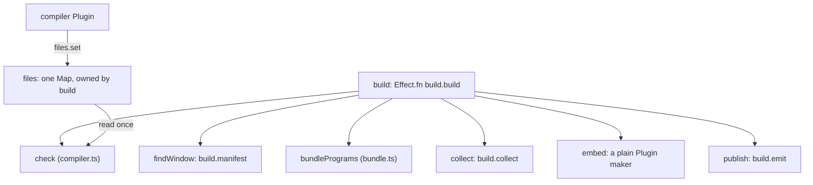

# A long Effect body is a shelf of small named pieces



```ts
// next/packages/libfabrika/src/node/build/build.ts:54-55, :92-93, :190-191 and :248 (bodies cut)
// The window a selected package exports, if any. A path, not a package name, has no manifest.
const findWindow = Effect.fn("build.manifest")(function* (from: string, selected: string) {
// Each emitted window file, under its own route. Two files on one route stop the build.
const collect = Effect.fn("build.collect")(function* (output: ReadonlyArray<OutputChunk | OutputAsset>) {
// Write the brain beside `out`, then swap it in: all or nothing.
const publish = Effect.fn("build.emit")(function* (
export const build = Effect.fn("build.build")(function* (options: Options) {

// build.ts:269, :292 and :352: the one value the pieces share, with one owner.
  const files = new Map<string, string>();
      files.set(path.relative(root, id), code);
  if (check(files, ledger).length) {
```

`node/build/build.ts` does a long job: read manifests, bundle every program and window, embed the
tables, check the Compiler ledger, then publish all or nothing. It is not one long closure. Each
step is its own module-level piece with a name, and `build` (`:248-367`) reads as the list of steps
calling them in order: `findWindow` (`:299`), `bundlePrograms` (`:306`), `bundle` then `collect`
(`:329-338`), `embed` (`:341`), `check` (`:352`) and `publish` (`:357`).

Rules:

- **One piece, one name, one span.** A piece that runs an Effect is a const made with
  `Effect.fn("module.piece")`, so it shows as its own span: `build.manifest` (`build.ts:55`),
  `build.collect` (`:93`), `build.emit` (`:191`). A piece with no Effect stays a plain function:
  `contentType` (`:85`), `embed` (`:142`).
- **A piece takes what it needs.** Values come in as arguments (`findWindow(from, selected)`,
  `:55`). Services come in by `yield*` inside the piece (`FileSystem` and `Path`, `:56-57`), so the
  type of each piece lists its own needs.
- **One line above each piece says what it does and its one rule** (`:54`, `:92`, `:190`).
- **State the pieces share is one named value with one owner.** `files` is made in `build`
  (`:269`), filled by the compiler plugin (`:292`) and read once by `check` (`:352`). No `let` is
  shared between pieces; the only `let` in the file is a loop's own (`:63`). Control state, a value
  that decides what may happen next, is a tea machine instead
  ([0037](../.decisions/0037-implicit-state-machines-made-explicit.md)).
- **When one body must stay long, mark it and move the hard parts out.** A layer's body whose pieces
  share a lock or a model may stay one `Effect.gen`. Then each part gets a `// --- Name ---` banner,
  and each hard part moves to the module's `internal/`, taking its services as arguments and
  returning an interface. Effect's own `cluster/Sharding.ts` does this: one `make` from `:242`, cut
  by ten banners from `:386` (`// --- Shard acquisition ---`) to `:2151` (`// --- Finalization ---`),
  with entity handling in `cluster/internal/entityManager.ts`, whose `make` takes `sharding` and
  `storage` in its options (`:141-145`).
- **No line count.** Effect's longest body is about 2,000 lines. The cut follows the jobs and the
  machines, not a number.

## Where it applies

Every long Effect body in `next/`: a function like `build`, and a layer's `Effect.gen` body. Stops
at a tea machine's `update`, which [0046](../.decisions/0046-one-tea-machine-per-file.md) shapes.

## Not yet

- `next/packages/libfabrika/src/runtime/Runner.ts:211-1733` is one `Layer.effect` closure with one
  banner (`:1086`, `// --- Cmds ---`) and nine `let`s shared by every piece (`:215-239`). 0043's
  rule 9 splits it move-only into a front file and `internal/` files
  ([0043](../.decisions/0043-rooms-on-floors.md)); the shared `let`s need the holder machine of
  [experiment 246](../experiments/246-implicit-state-machines-in-next.md) to cut cleanly.
- `next/packages/libfabrika/src/gateway/Gateway.ts` (one `make` used at `:1625`) and the project
  logic in `next/packages/libfabrika/src/cloudflare/runtime.ts` have the same shape.

## Why it is not obvious

A long closure with shared `let`s works, passes every law, and is the fastest way to add one more
thing: one more `let`, one more inner function. An agent copies the shape it reads, so a
1,500-line closure teaches it to write the next one. The cost shows later: no piece can be read,
traced or tested alone, and every piece may touch every `let`.

## Holds it

- No shipped Effect check looks at body length or shared `let`s (Effect code guidelines study,
  experiment 262, proposed, not on main yet).
- Review: a plan for a long body names its pieces and where each lives.

## Decision

[0043](../.decisions/0043-rooms-on-floors.md) rule 8 (`internal/`) and rule 9 (split move-only);
[0037](../.decisions/0037-implicit-state-machines-made-explicit.md) for state that decides what is
legal; the [`Effect.fn` note](../docs/direction/effect-fn-for-traced-functions.md) for one named
span per piece.

> Derived from `effect@4.1.2`; re-verify on pin bump.
