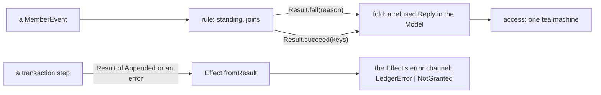

# Pure domain code returns a Result; the Effect edge turns it into a failure



```ts
// next/packages/libfabrika/src/access/Access.ts:264-280: a rule answers with a Result, never a throw.
const standing = (model: Founded, signer: string, person: string): Result.Result<Rank, Reason> => {
  const known = model.keys.get(signer);

  if (person !== model.person || known === undefined) {
    return Result.fail("not_member");
  }

  if (known._tag === "spent") {
    return Result.fail("used");
  }

  if (known._tag === "live") {
    return Result.succeed(known.rank);
  }

  return Result.fail(known._tag);
};

// Access.ts:431-435: the fold reads the Result; a refusal is a reply, and update stays total.
  const keys = rule(model, event);

  if (Result.isFailure(keys)) {
    return replied(model, Reply.cases.refused.make({ reason: keys.failure }));
  }

// next/packages/libfabrika/src/access/Authorization.ts:43: the Effect edge makes it a failure.
    const appended = yield* Effect.fromResult(result);
```

A domain rule is plain code: no Effect, no throw. It answers with `Result.Result<A, Reason>`, and
the caller decides what a refusal means. Inside a tea machine a refusal is part of the next Model,
so `update` always returns. At an Effect boundary, `Effect.fromResult` puts the failure in the
error channel, typed, where `catchTag` can reach it.

Rules:

- **A rule returns `Result`.** `standing` (`Access.ts:264`) and `joins` (`:283`) return
  `Result.fail(reason)` or `Result.succeed(value)`. Rules chain with `Result.flatMap` and
  `Result.map` (`grant`, `:318-326`).
- **A tea `update` never throws.** The fold turns a failed `Result` into a refused reply
  (`Access.ts:433-435`); the machine's `update` only calls the fold (`:450`).
- **Decoding inside pure code is a `Result` too.** `Schema.decodeUnknownResult(MemberEvent)`
  (`Authorization.ts:11`) gives a value to check (`:30`), never a `decodeUnknownSync` that throws.
- **The edge lifts it.** A synchronous ledger step returns a `Result` of the answer or a tagged
  error (`Authorization.ts:20`), and `Effect.fromResult` (`:43`) makes it the Effect's failure.
  Where an Effect already holds a `Result`, the same edge is
  `Result.isFailure(r) ? Effect.fail(r.failure) : Effect.succeed(r.success)`
  (`access/SessionManager.ts:192`); `Effect.fromResult` says it in one call.
- **A refusal is a word, a failure is an error.** The domain's `Reason` is a short literal; the
  edge picks the tagged error that carries it.

## Where it applies

Domain folds, rules and tea `update`s in `next/`, and synchronous ledger steps
([0050](../.decisions/0050-a-ledger-step-is-a-plain-function.md)). Stops inside a SQLite
transaction, where a throw is how the transaction rolls back
([effect-errors-keep-their-cause.md](./effect-errors-keep-their-cause.md), "Fail by yielding"), and
at a load-time check of a declaration, where a throw is a defect on purpose.

## Not yet

- `next/packages/libfabrika/src/processes/internal/processTable.ts:120` throws `LedgerError` inside
  the fold, and `:153` decodes with `decodeUnknownSync` (`:110`). It works only because the whole
  fold runs inside the store's `Effect.try`.
- `next/packages/libfabrika/src/runtime/State.ts:36-76` throws `ProgramDown` from plain code, and
  `next/packages/libfabrika/src/runtime/Program.ts:316-319` throws a failure and decodes with
  `decodeUnknownSync`. Whether each can become a `Result` without a wider change is not checked.

## Why it is not obvious

A throw inside a fold is caught somewhere, so every law passes. The cost is hidden: the type of
`update` says it returns a Model, and a reader cannot see that it may not. Move the fold out of its
`Effect.try`, or run it in a test without one, and a bad row becomes a crash. A `Result` says the
refusal in the type, and fast-check can then state laws over every refusal.

## Holds it

- Laws: refusals are properties over the `Result` (`access/AccessMachine.laws.test.ts:773-775`
  checks a step's success and failure against the model).
- Lint, on: `fabrika/no-throw-in-effect-gen` refuses a throw inside `Effect.gen`. No rule finds a
  throw in plain domain code; review holds it.

## Decision

[Elm first](../docs/direction/elm-first.md): `update` is a total function, as Elm's is, with a
`Result` for what can be refused; [0037](../.decisions/0037-implicit-state-machines-made-explicit.md).

> Derived from `effect@4.1.2`; re-verify on pin bump.
