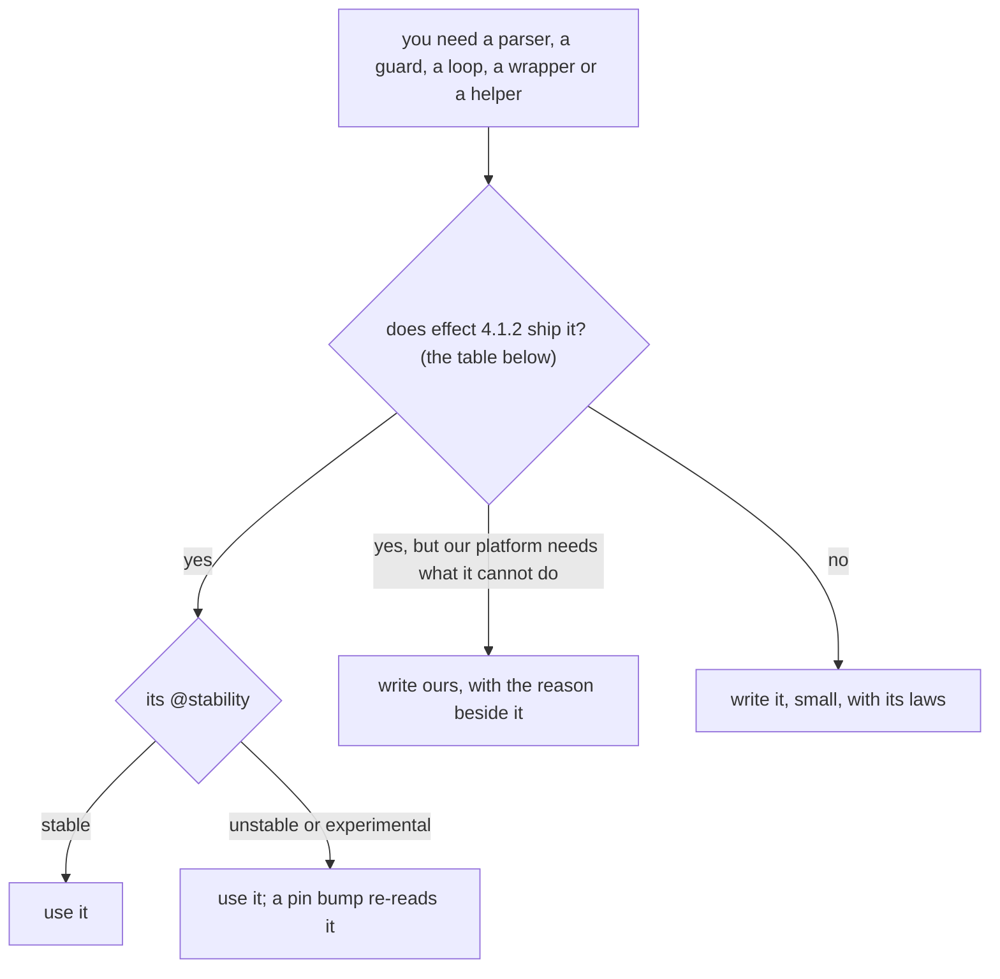

# Reach for what Effect 4.1.2 ships before writing a helper



```ts
// Before: next/packages/libfabrika/src/processes/internal/programMail.ts:19-21, a hand guard.
/** The business `ref` a message carries, if it has one. @internal */
export const businessRef = (m: unknown): string | null =>
  typeof m === "object" && m !== null && "ref" in m && typeof m.ref === "string" ? m.ref : null;

// After, the same job in our tree: next/packages/libfabrika/src/settings/Files.ts:31 and
// next/packages/libfabrika/src/processes/ExitReasonTest.ts:405.
  path.reduce<unknown>((v, key) => (Predicate.isObject(v) ? v[key] : undefined), value);
              Predicate.isObject(m) && Predicate.hasProperty(m, "_tag") && m._tag === "DOWN" ? [m] : [],
```

Agents know older Effect. Effect 4.1.2 ships modules an agent trained on v2 or v3 has never seen
(`effect/crypto`, `JsonPatch`, `SemVer`, `Glob`, `effect/cli`, `effect/process`), and some old names
are gone. Effect's own guide says it plainly: "**NEVER** write your own helper functions like
`isRecord` or `isString`, instead use the helpers from the `Predicate` module"
(`node_modules/effect/AGENTS.md:321-322`), and "**AVOID using predicates or manual parsing**"
(`:114`). Before you write a helper, look it up here.

## The table

Every row was read in `node_modules/effect/src` at 4.1.2: the export exists at the line named, and
the stability is its own `@stability` tag. `unstable` may break in a minor release, `experimental` in
a patch. All paths in "Ours" are under `next/`; `lib/` is `packages/libfabrika/src/`.

| You need | Effect 4.1.2 ships | Import | Stability | Ours |
|---|---|---|---|---|
| Retry with backoff | `Effect.retry(work, { schedule, times, while })` (`Effect.ts:7741`), `Schedule.exponential(base, factor)` (`Schedule.ts:1059`), `Schedule.spaced` (`:1527`), `Schedule.jittered` (`:1419`) | `import { Effect, Schedule } from "effect"` | stable | `lib/cloudflare/runtime.ts:760-766` (`times` and `while`). No `Schedule` in `next/` yet. In a Durable Object, a retry across a sleep is saved state: [durable-objects-sleep.md](./durable-objects-sleep.md) |
| A loop that repeats or polls | `Effect.repeat(work, Schedule.spaced("5 seconds"))` (`Effect.ts:15709`) | `import { Effect, Schedule } from "effect"` | stable | none. Never in a Durable Object: an alarm. Not yet: `lib/processes/ProgramMailLedger.ts:146`'s unbounded `for (;;)` |
| A timeout | `Effect.timeout` (`Effect.ts:8933`), `Effect.timeoutOrElse({ duration, orElse })` (`:9148`), `Effect.timeoutOption` (`:9053`) | `import { Effect } from "effect"` | stable | `lib/node/dev/dev.ts:342-345` |
| A duration | `Duration`, or a string such as `"30 seconds"` where an `Input` is taken (`Duration.ts:891`) | `import { Duration } from "effect"` | stable | `lib/node/dev/dev.ts:343` |
| Match a path against a pattern | `Glob.make(pattern)` (`Glob.ts:98`), `Glob.match` (`:134`) | `import { Glob } from "effect"` | **experimental** | none. Not yet: `apps/fabrika/src/exam/commits.ts:170`, a hand glob regex (the exam; it moves under its own rules) |
| List files by pattern | `FileSystem`'s `glob(pattern, { root, exclude, dot })` (`FileSystem.ts:158`) | `import { FileSystem } from "effect"` | unstable | `apps/fabrika/src/build.ts:32` |
| Compare versions | `SemVer.parse` (`SemVer.ts:373`), `SemVer.isGreaterThan` (`:623`), `SemVer.Order` (`:512`), `Schema.SemVerFromString` (`Schema.ts:17156`) | `import { SemVer, Schema } from "effect"` | **unstable**, since 4.0.6 | none. Not yet: `lib/settings/Files.ts:158-166`, a hand `triple` and `Order.Tuple` |
| A JSON patch | `JsonPatch.get(old, new)` (`JsonPatch.ts:184`), `JsonPatch.apply(patch, old)` (`:287`) | `import { JsonPatch } from "effect"` | stable | none. Not yet: `lib/runtime/Patch.ts`, a hand RFC 6902 diff. Doubt: whether `get`'s key order breaks a law that pins ours |
| CLI commands and flags | `Command.make` (`cli/Command.ts:644`), `Flag.String` (`cli/Flag.ts:60`), `Argument.String` (`cli/Argument.ts:62`), `Flag.withDefault` | `import { Argument, Command, Flag } from "effect/cli"` | unstable | `apps/fabrika/grant.ts:20-28`. Not yet: `apps/fabrika/src/exam/commits.ts:563` reads `process.argv` |
| An HTTP call | `HttpClient.HttpClient` service (`http/HttpClient.ts:169`), `HttpClient.get` (`:197`), `filterStatusOk` (`:751`), `retryTransient` (`:1169`); `FetchHttpClient.layer` (`http/FetchHttpClient.ts:254`) | `import { FetchHttpClient, HttpClient } from "effect/http"` | unstable | none. Not yet: `lib/node/dev/dev.ts:132`, raw `fetch` in `tryPromise` |
| A child process | `ChildProcess.make(command, args)` in a scope (`process/ChildProcess.ts:731`), then `child.stdout` and `child.exitCode`; the spawner comes from `NodeServices.layer` in `@effect/platform-node` | `import { ChildProcess } from "effect/process"` | unstable | `lib/node/dev/dev.ts:43-46` |
| Files and paths | `FileSystem.FileSystem`, `Path.Path` services | `import { FileSystem, Path } from "effect"` | unstable | `lib/node/build/build.ts:56-57`; provided by `NodeServices.layer` (`apps/fabrika/grant.ts:132`) |
| A hash, an HMAC, random bytes | `Digest`, `Mac`, `SecureRandom` services: [effect-crypto-through-services.md](./effect-crypto-through-services.md) | `import { Digest, Mac, SecureRandom } from "effect/crypto"` | unstable | `lib/settings/Snapshot.ts:26-27` |
| An id | `SecureRandom`'s `uuidV4`, `uuidV7` (reads the `Clock`, sorted), `ulid` (`crypto/SecureRandom.ts:87-122`) | `import { SecureRandom } from "effect/crypto"` | unstable | `apps/fabrika/grant.ts:69`. `lib/Id.ts` keeps its own TypeID maker |
| A type guard on `unknown` | `Predicate.isObject` (`Predicate.ts:1251`, false for arrays), `isObjectOrArray` (`:1218`), `hasProperty` (`:1352`), `isTagged` (`:1452`), `isString` (`:749`) | `import { Predicate } from "effect"` | stable | `lib/settings/Files.ts:31`. Not yet: `lib/runtime/Runner.ts:1747-1766` |
| Is this value of a schema | `Schema.is(S)` (`Schema.ts:1461`) | `import { Schema } from "effect"` | stable | `lib/gateway/Gateway.ts:67` |
| Decode unknown input | `Schema.decodeUnknownEffect(S)` in an Effect (`Schema.ts:1535`), `Schema.decodeUnknownResult(S)` in pure code (`:1736`), `Schema.fromJsonString(S)` for JSON text (`:9875`) | `import { Schema } from "effect"` | stable | `lib/ledger/LedgerRemote.ts:29`, `lib/access/Authorization.ts:11`, `lib/node/build/build.ts:70` |
| Equal values | `Schema.toEquivalence(S)` (`Schema.ts:18064`), never `JSON.stringify(a) === JSON.stringify(b)` | `import { Schema } from "effect"` | stable | `lib/processes/ExitReason.ts:22` |
| Catch one error by tag | `Effect.catchTag` (`Effect.ts:4702`), `Effect.catchTags` (`:4916`) | `import { Effect } from "effect"` | stable | `lib/node/settings/Load.ts:34` |
| Catch one reason of an error | `Effect.catchReason(tag, reason, f)` (`Effect.ts:5144`), `catchReasons` (`:5360`) | `import { Effect } from "effect"` | stable | none. `lib/node/settings/Load.ts:34-35` checks `cause.reason._tag === "NotFound"` by hand, which is `catchReason("PlatformError", "NotFound", ...)` |
| A typed error out of a `Cause` | `Cause.findError` (`Cause.ts:971`), `Cause.findErrorOption` (`:997`) | `import { Cause } from "effect"` | stable | none. Not yet: `lib/runtime/Runner.ts:751`, `Cause.squash` then `instanceof` |
| Wrap a Promise | `Effect.tryPromise({ try, catch: (cause) => ... })` (`Effect.ts:1459`), once per platform object: [effect-platform-wrapped-once.md](./effect-platform-wrapped-once.md) | `import { Effect } from "effect"` | stable | `lib/ledger/LedgerRemote.ts:26` |
| Wrap a callback API | `Effect.effectify(fn, onError)` for error-first callbacks (`Effect.ts:26994`); `Effect.callback((resume) => ...)` for any other (`:1897`) | `import { Effect } from "effect"` | stable | `apps/fabrika/src/port.test-support.ts:25` (test support only) |
| A `Result` into an Effect | `Effect.fromResult` (`Effect.ts:2699`) | `import { Effect } from "effect"` | stable | `lib/access/Authorization.ts:43`: [effect-pure-domain-returns-result.md](./effect-pure-domain-returns-result.md) |
| The time, and dates | `Clock.currentTimeMillis` (`Clock.ts:270`), `DateTime.now` (`DateTime.ts:908`), `DateTime.formatIso` (`:4538`), `DateTime.formatIsoDateUtc` (`:4592`) | `import { Clock, DateTime } from "effect"` | stable | `lib/Id.ts:195`, `lib/ledger/Log.ts:45`. Not yet: `lib/telemetry/internal/measurements.ts:201`, `new Date(...)` |
| A lock | `Semaphore.make(1)` (`Semaphore.ts:424`) | `import { Semaphore } from "effect"` | stable | `lib/runtime/Runner.ts:235` |
| A paged read as a stream | `Stream.paginate` (`Stream.ts:1573`) | `import { Stream } from "effect"` | stable | `lib/ledger/internal/ledgerPages.ts:13` |
| Settings from env and files | `Config.schema` (`Config.ts:1240`), `ConfigProvider.fromEnv` (`ConfigProvider.ts:1209`) | `import { Config, ConfigProvider } from "effect"` | stable | `lib/settings/Setting.ts:45` |
| A branded id | `Schema.brand` (`Schema.ts:5319`) | `import { Schema } from "effect"` | stable | none yet: `lib/Rev.ts` and `lib/ProcessId.ts` are plain (ticket T518 brands `ProcessId`) |

The imports follow today's `next/` code, which names modules from the `effect` barrel. Each module
also has its own path (`effect/Schedule`), which the package's `./*` export allows.

## Gone since older Effect

An agent may reach for these. None is exported in 4.1.2, so the type check fails: `Context.Tag`
and `Effect.Service` (use `Context.Service`,
[effect-services-and-layers.md](./effect-services-and-layers.md)), and `Effect.catchAll` (use
`Effect.catch`, `Effect.ts:4645`). Effect's checker also names them: its `outdatedApi` check, on by
default as a warning, "Detects usage of APIs that have been removed or renamed in Effect v4"
(`@effect/tsgo` 0.63.0, `schema.json:2775`).

## Where it applies

Every new helper, parser, wrapper or loop in `next/`. Stops where the platform needs what Effect's
module cannot do: then ours stays, with its reason at the code
([effect-differences-say-why.md](./effect-differences-say-why.md)), such as the synchronous ledger
SQL and the span sink.

## Why it is not obvious

A hand helper is a few lines, passes every law and reads fine. The agent that writes it does not
know the module exists, because its training stops before 4.x. A hand guard also differs in the
corners: `typeof x === "object" && x !== null` is true for an array, `Predicate.isObject` is not.

## Holds it

- Effect's checker, on today in `tsconfig.base.json`: `globalRandomInEffect` and the others there.
  Off, and proposed to turn on: `globalFetchInEffect`, `globalDateInEffect` (Effect code guidelines
  study, experiment 262, not on main yet).
- No check finds a hand guard, a hand version compare, a hand patch or a fixed retry. Review asks,
  for each new hand-built part, which Effect module is nearest and why it was not used.

## Decision

[Build on Effect](../docs/direction/build-on-effect.md): Effect's own modules and shapes first;
[0040](../.decisions/0040-existing-tools-before-hand-written.md): an existing tool before a
hand-written one; [0023](../.decisions/0023-next-follows-effects-code-style.md).

> Derived from `effect@4.1.2`; re-verify on pin bump. Every row's line and stability is re-read on a
> bump.
