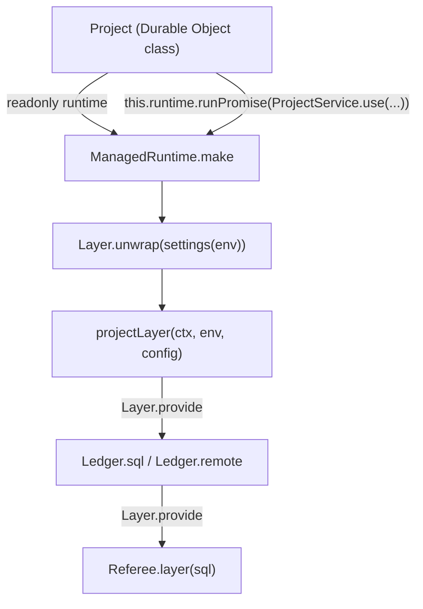

# A service is a `Context.Service`; Layers compose once, at the edge



```ts
// next/apps/fabrika/src/runtime.ts:12-23: settings are decoded once, then pick the Layer.
export const settings = Effect.fn("stage.settings")(function* (env: Env) {
	return yield* Schema.decodeUnknownEffect(Schema.fromJsonString(Settings))(env.STAGE).pipe(/* ... */);
});
export const projectRuntime = (ctx: DurableObjectState, env: Env) =>
	ManagedRuntime.make(Layer.unwrap(settings(env).pipe(Effect.map((config) => projectLayer(ctx, env, {config /* ... */})))));

// next/apps/fabrika/src/brain.ts:30-33: the object class holds one runtime and hands off in one line.
readonly runtime = projectRuntime(this.ctx, this.env);
target(name: string, code: string) {
	return this.runtime.runPromise(ProjectService.use((p) => p.target(name, code)));
}
```

A service is a class that extends `Context.Service`, with its Layers as statics. A Layer asks for what
it needs with `yield*` and is composed with `Layer.provide` and `Layer.mergeAll`. The whole graph is
provided once, at the edge: on workerd, one `ManagedRuntime` per object instance, built from the
object's Layer; on Node, `NodeRuntime.runMain` (`next/apps/fabrika/grant.ts:111`). Inside, nothing
builds a Layer by hand or provides services per call.

`next/packages/libfabrika/src/data/ledger.ts:49-110` is the model: one shape, two statics. `Ledger.sql`
is a `Layer.effect` that yields `Referee` and provides `Referee.layer(sql)` (`:64-75`). `Ledger.remote`
wraps a Promise stub at the service boundary, so no caller sees a Promise (`:79-110`).

Rules:

- **Define with `Context.Service`.** Never `Context.Tag` or `GenericTag` (`fabrika/no-context-tag`).
  The key names the package and path, `@kampus/libfabrika/<path>/<Name>` (Effect's own advice,
  `node_modules/effect/AGENTS.md`, "Context.Service"). Today two styles live side by side
  (`@kampus/libfabrika/Ledger`, `fabrika/Project`); which one wins is ticket 438's `deterministicKeys` call.
- **Inferred shape: use `make`.** When the shape comes from the implementation, write
  `Context.Service<X>()("key", {make: Effect.gen(...)})` and `static layer = Layer.effect(this, this.make)`.
  Effect 4.1.2 infers the shape from `make` (`node_modules/effect/src/Context.ts:320-334`). Not
  `Context.Service<X, Effect.Success<ReturnType<typeof logic>>>`.
- **Explicit shape when the shape is the contract,** as `Ledger` and `Mailbox` do.
- **Compose, never build.** No `Layer.build` then `Context.get` then `Effect.provideContext` on each
  call: that is what `Layer.provide` does. A service that needs another captures it once with
  `yield*` in its own Layer.
- **Ordered setup is `Layer.unwrap`.** When a Layer depends on a value read first (settings, a
  saved descriptor), read it in an Effect and return the Layer from it (`runtime.ts:19`,
  `ai-docs/src/01_effect/03_services/20_layer-unwrap.ts`).
- **Config at the edge.** On workerd the platform's config is a binding, so `env.STAGE` is decoded
  once with Schema. On Node it is `Config`; never mix `process.env.X ??` with `Config` on one line.
- **A resource lives in a Layer.** `Effect.acquireRelease` inside `Layer.effect`, so teardown runs
  when the runtime is disposed (`ai-docs/src/01_effect/05_resources/10_acquire-release.ts`).
- **The object class stays thin.** Every method is one `this.runtime.runPromise(...)` under an edge
  comment ([an object class stays thin](../docs/direction/object-classes-stay-thin.md)). A bare
  `Effect.runPromise` there gets none of the runtime's Layers, tracer included.

## Where it applies

Every service and every runtime in `next/`. Stops at tea: a program's state lives in its tea machine
([Elm first](../docs/direction/elm-first.md)); a service is what the host gives that machine.

## Today's code breaks this

Ticket 442 sweeps it. On main `d48cb774`, in `next/` product code: 4 `Layer.build` in 3 files
(`next/packages/libfabrika/src/workers/runtime.ts:325`, `:667`, `workers/gateway.ts:28`,
`node/stage-recording.ts:29`), followed by 23 `Effect.provideContext` in 7 files (for example
`workers/runtime.ts:710-746`); 5 `Effect.Success<ReturnType<...>>` shapes (`workers/runtime.ts:634-637`,
`:754-757`, `workers/gateway.ts:218-220`, `door/door.ts:1381`); 2 bare `Effect.runPromise` in an object
class (`next/apps/fabrika/src/brain.ts:148`, `:152`); and `next/apps/fabrika/dev.ts:46` mixes
`process.env` with `Config`.

## Why it is not obvious

`Layer.build` plus `provideContext` works and passes every law, and it looks like control. It costs
in reading: each call site must remember to provide, and a forgotten one is a missing-service defect
at run time, not a type error. The hand-written `Effect.Success<ReturnType<...>>` is a reinvention of
the `make` option most agents do not know Effect 4 has.

## Holds it

- Lint, on: `fabrika/no-context-tag` (`.oxlintrc.json:20`); `fabrika/no-effect-run-outside-edge` and
  `fabrika/edge-comment` in `next/` (`.oxlintrc.json:345-346`).
- Effect diagnostics, 0 hits and free to turn on: `leakingRequirements`,
  `missingEffectServiceDependency`. `multipleEffectProvide`: 1 product hit
  (`next/apps/fabrika/src/stage.ts:29`). `deterministicKeys`: 105 hits, the owner's pick.
  `processEnvInEffect`: advise only, since each hit is an edge. Ticket 438.
- `Layer.build` outside tests: no rule. A custom oxlint rule could ban it; not built.

## Decision

[Build on Effect; let types be inferred](../docs/direction/build-on-effect.md); [an object class
stays thin](../docs/direction/object-classes-stay-thin.md). Credit: kamp-us/phoenix's
[effect-context-service.md](https://github.com/kamp-us/phoenix/blob/4802776ad4911ac025ecfbf7bc49f6c17e13e2bb/.patterns/effect-context-service.md)
(class form, wrap a Promise client at the service boundary) and
[effect-layer-composition.md](https://github.com/kamp-us/phoenix/blob/4802776ad4911ac025ecfbf7bc49f6c17e13e2bb/.patterns/effect-layer-composition.md)
(`provide` against `provideMerge`, never build a Layer per call, one runtime built at init). Phoenix
uses explicit shapes only; on 4.1.2 the `make` option fits `next/`'s inferred services better.

> Derived from `effect@4.1.2`; re-verify on pin bump.
