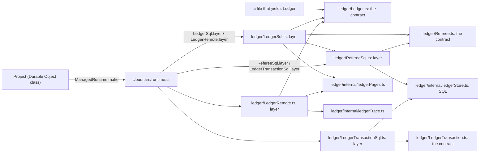

# A service file holds its contract; each Layer is a sibling file, composed once at the edge



```ts
// next/packages/libfabrika/src/ledger/Ledger.ts:33-42: the contract, its type written out.
export class Ledger extends Context.Service<
  Ledger,
  {
    readonly append: (stream: string, id: string, line: Line) => Effect.Effect<Appended, LedgerError>;
    readonly read: (stream: string, after: Rev) => Stream.Stream<Entry, LedgerError>;
    readonly wait: (stream: string, after: Rev) => Effect.Effect<Waited, LedgerError>;
  }
>()("@kampus/libfabrika/ledger/Ledger") {}

// next/packages/libfabrika/src/ledger/LedgerSql.ts:12-23: one implementation, a sibling file.
export const layer = (sql: Sql, caller: { readonly reader: string }): Layer.Layer<Ledger, never, Doorbell> =>
  Layer.effect(
    Ledger,
    Effect.gen(function* () {
      const referee = yield* Referee;
      return {
        append: referee.append,
        read: (stream, after) => pages(after, (from) => referee.read(stream, from, caller.reader)),
        wait: (stream, after) => referee.wait(stream, after, caller.reader),
      };
    }),
  ).pipe(Layer.provide(RefereeSql.layer(sql)));

// next/packages/libfabrika/src/cloudflare/runtime.ts:338-342 and :740: callers read each by its module.
const ledgerLayer = Layer.mergeAll(
  LedgerSql.layer(sql, { reader: `project:${name}` }),
  LedgerTransactionSql.layer(sql),
  RefereeSql.layer(sql),
).pipe(Layer.provide(bell));
const ledger = LedgerRemote.layer(stub, { reader: saved.id });
```

A service is a class that extends `Context.Service`, with its type written out. Its file holds the
contract and nothing that runs: the class, its own error, and the types and small ports it speaks
in. `next/packages/libfabrika/src/ledger/Ledger.ts` is the model: `LedgerError` (`:10-18`), the
`Doorbell` port (`:21-24`), the `LedgerCalls` platform port (`:27-31`) and `Ledger` (`:33-42`).
It imports `Effect`, `Stream`, `Rev` and the log types as types only (`:6-8`), so a browser bundle
of it holds `effect` and this one file, never `Referee` or the SQL store.

Each Layer is its own sibling file, named for the service and the variant, exporting `layer`, as
Effect writes `NodeFileSystem.layer`. `LedgerSql.layer` (`ledger/LedgerSql.ts:12`) yields `Referee`
and provides `RefereeSql.layer(sql)`. `RefereeSql.layer` (`ledger/RefereeSql.ts:8`) and
`LedgerTransactionSql.layer` (`ledger/LedgerTransactionSql.ts:8`) each build the store on the same
`Sql` with the `Doorbell` they yield, as their static layers did. `LedgerRemote.layer` (`ledger/LedgerRemote.ts:13`) wraps a
Promise stub at the service boundary, so no caller sees a Promise. Code both layers share sits under
`internal/`: `pages` (`ledger/internal/ledgerPages.ts:9`) and the span keys `STREAM` and `tag`
(`ledger/internal/ledgerTrace.ts:5-7`). A Layer asks for what it needs with `yield*` and is
composed with `Layer.provide` and `Layer.mergeAll`. The whole graph is provided once, at the edge:
on workerd, one `ManagedRuntime` per object instance (`next/apps/fabrika/src/runtime.ts:19-23`,
held at `next/apps/fabrika/src/brain.ts:26`); on Node, `NodeRuntime.runMain`
(`next/apps/fabrika/grant.ts:129`).

Rules:

- **Define with `Context.Service`.** Never `Context.Tag` or `GenericTag` (`fabrika/no-context-tag`).
  The key is the package, the source file's path without its extension, then `.Name` when the
  service is named otherwise than its file: `@kampus/libfabrika/ledger/Ledger`,
  `@kampus/libfabrika/ledger/Ledger.Doorbell`, `@kampus/libfabrika/Id.Generator` (Effect's own
  advice, `node_modules/effect/AGENTS.md`, "Context.Service", which
  [0023](../.decisions/0023-next-follows-effects-code-style.md) has `next/` follow). Moving the file
  changes the key. `fabrika/service-id` advises on a key that does not fit
  (`oxlint-plugins/service-id.ts`).
- **Write the service's type out.** The contract is the type, so it is never inferred from an
  implementation: no `make` option and no `Effect.Success<ReturnType<...>>` shape.
- **No static layer on a service class.** A layer is a sibling file read through its module:
  `import * as LedgerSql from "./LedgerSql.ts"`, then `LedgerSql.layer(...)`. A memory or test layer
  is a sibling too.
- **A platform's adapter lives in its platform's folder.** `cloudflareSql`, which turns a Durable
  Object's storage into our `Sql`, is `next/packages/libfabrika/src/cloudflare/CloudflareSql.ts:3`.
- **Compose, never build.** No `Layer.build` then `Context.get` then `Effect.provideContext` on each
  call: that is what `Layer.provide` does. A service that needs another captures it once with
  `yield*` in its own Layer (`ledger/LedgerSql.ts:16`).
- **Never provide inside a layer body.** A layer lists what it needs in its type and yields it. An
  `Effect.provide(X.layer(...))` inside the `Effect.gen` hides the need and builds the dependency
  where the caller cannot replace it. `LedgerSql.layer` yields `Referee` in the body (`:16`) and
  composes `RefereeSql.layer(sql)` outside it, on the returned Layer (`:23`): the body only asks,
  and the wiring is one `Layer.provide` a reader sees at the end. Effect's own cluster code does the same: `entityManager`'s `make` takes its
  `storage` in its options and the caller picks it
  (`effect/src/cluster/internal/entityManager.ts:141-145`).
- **A needed service is in the type, never found at run time.** `Effect.serviceOption(X)` is for a
  service that is truly optional. One that a path needs goes in the layer's requirements, so a
  missing one is a type error, not an `Effect.die` or an `Option.getOrThrow` deep in a call.
- **Ordered setup is `Layer.unwrap`.** When a Layer depends on a value read first (settings, a
  saved descriptor), read it in an Effect and return the Layer from it
  (`next/apps/fabrika/src/runtime.ts:20`, `ai-docs/src/01_effect/03_services/20_layer-unwrap.ts`).
- **Config at the edge.** On workerd the platform's config is a binding, so `env.STAGE` is decoded
  once with Schema (`next/apps/fabrika/src/runtime.ts:13-17`). On Node it is `Config`; never mix
  `process.env.X ??` with `Config` on one line.
- **A resource lives in a Layer.** `Effect.acquireRelease` inside `Layer.effect`, so teardown runs
  when the runtime is disposed (`ai-docs/src/01_effect/05_resources/10_acquire-release.ts`).
- **The object class stays thin.** Every method is one `this.runtime.runPromise(...)` under an edge
  comment (`next/apps/fabrika/src/brain.ts:28-31`,
  [an object class stays thin](../docs/direction/object-classes-stay-thin.md)). A bare
  `Effect.runPromise` there gets none of the runtime's Layers, tracer included.

## Where it applies

Every service and every runtime in `next/`. Stops at tea: a program's state lives in its tea machine
([Elm first](../docs/direction/elm-first.md)); a service is what the host gives that machine.

## Services awaiting their slice

`Ledger` (ticket 702, slice 1), `Referee` and `LedgerTransaction` (ticket 723, slice 3) are
converted alongside ClientManager (ticket 731) so far. The rest still carry static layers, and each moves in its own slice. A search of
`next/packages/libfabrika/src` outside tests finds 19 static Layer members, for example
`Mailbox.layer` (`processes/Mailbox.ts:118`), `RecordManager.sql`, `.memory` and `.remote`
(`telemetry/Records.ts:420-429`) and `Gateway.layer` (`gateway/Gateway.ts:1622`). The Node adapter,
`next/packages/libfabrika/src/ledger/NodeSqlite.ts`, still sits in `ledger/`; slice 2 moves it. New
code follows this doc now.

`Layer.build` is still used in product code: `cloudflare/runtime.ts:357` and `:752`,
`cloudflare/connection.ts:18` and `node/dev/dev-recording.ts:31`, each followed by
`Effect.provideContext` (ticket 442).

A layer still provides inside its own body in `next/packages/libfabrika/src/runtime/Runner.ts:218-221`:
`RecoveryStore` and `Replies` are built from `RecoveryStore.layer(...)` and `RepliesSql.layer(...)`
in the body, so they are missing from the layer's requirements (`:206-209`). The same file finds
`SessionManager` at run time with `Effect.serviceOption` (`:229`), then `Effect.die` (`:1169`) or
`Option.getOrThrow` (`:1174`) when a caused write needs it. `runtime/Built.ts:16` provides
`Digest.layerWebCrypto` inside `hash`, the same shape at function size.

## Why it is not obvious

`node_modules/effect/AGENTS.md` teaches a static layer on the service class as the default. Written
that way, importing the `Ledger` tag also loaded `Referee` and the 451-line SQL store, and
`Ledger.ts` and `Referee.ts` imported each other. Bundled alone for a browser, the contract file
loaded 255 modules and kept 82 before this split; it loads 248 and keeps 66 after, with no
libfabrika file but itself. The build step's unminified chunk, region comments included, went from
624,432 to 460,076 bytes (ticket 702, rolldown 1.2.13). The plan's own count, taken another way,
was 469,820 before and 278,245 for the contract in memory.

`Referee.ts` and `LedgerTransaction.ts` had the same cost: each imported the store for its static
layer, and `Referee.ts` re-exported the span helpers. Bundled alone for a browser, each loaded 256
modules and kept 80, among them `ledgerStore.ts` and `ledgerTrace.ts`. As contracts each loads 248
and keeps 15, with no libfabrika file but itself (ticket 723, rolldown 1.2.13, measured with the
bundle exam's load hook and output module list).

`Layer.build` plus `provideContext` works and passes every law, and it looks like control. It costs
in reading: each call site must remember to provide, and a forgotten one is a missing-service defect
at run time, not a type error.

ClientManager keeps Founder, Written and its explicit service type in
`next/packages/libfabrika/src/access/ClientManager.ts:9`. Its ledger implementation is
`access/ClientManagerLedger.ts:83`, consumed as `ClientManagerLedger.layer(founder)`.
Building captures Ledger without writing; founding, replay and write spans retain their timing.
Gateway imports the sibling only as a type for its founder argument.

Ticket 731's direct browser contract bundle loads **259** modules and keeps **79**, matching
the approved sketch, against the plan's baseline **265/86** (Rolldown 1.2.13).
The bundle exam inspects both loaded and kept ids for ClientManagerLedger, AccessFold,
Referee, RefereeSql, LedgerTransactionSql and ledgerStore.

## Holds it

- Bundle exam: `pinned: contract only Ledger reaches no store` in
  `next/apps/fabrika/src/exam/deps.test.ts` bundles `Ledger.ts` alone and fails if any Ledger layer,
  helper, `Referee` or the store is loaded or kept.
- Type test: `next/packages/libfabrika/src/ledger/Ledger.types.test.ts` holds the written-out
  service type, both layer types and the absence of `Ledger.sql` and `Ledger.remote`.
- Lint, on: `fabrika/no-context-tag` (`.oxlintrc.json:28`); `fabrika/no-effect-run-outside-edge` and
  `fabrika/edge-comment` in `next/` (`.oxlintrc.json:569-570`). `no-restricted-imports` keeps a
  module's `internal/` private, and `layer-rules.json` keeps `ledger/` from importing `cloudflare/`.
- Not yet a check: a lint rule that a `Context.Service` class has no static that returns a `Layer`
  ([0095](../.decisions/0095-a-service-file-holds-only-its-contract.md) names it as later work).

## Decision

[0095: a service file holds only its
contract](../.decisions/0095-a-service-file-holds-only-its-contract.md), which departs from
`node_modules/effect/AGENTS.md`'s static layer; [an object class stays
thin](../docs/direction/object-classes-stay-thin.md). Credit: kamp-us/phoenix's
[effect-context-service.md](https://github.com/kamp-us/phoenix/blob/4802776ad4911ac025ecfbf7bc49f6c17e13e2bb/.patterns/effect-context-service.md)
(class form, wrap a Promise client at the service boundary) and
[effect-layer-composition.md](https://github.com/kamp-us/phoenix/blob/4802776ad4911ac025ecfbf7bc49f6c17e13e2bb/.patterns/effect-layer-composition.md)
(`provide` against `provideMerge`, never build a Layer per call, one runtime built at init).

> Derived from `effect@4.1.2`; re-verify on pin bump.
