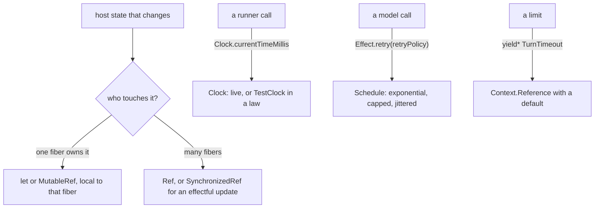

# State shared across fibers is a Ref; time comes from Clock; a repeat is a Schedule



```ts
// Real code from an Effect maintainer's agent, on Effect 4.1.1: clanka src/Agent.ts:1692-1695.
const retryPolicy = Schedule.min([Schedule.exponential(100, 1.5), Schedule.spaced(5000)]).pipe(
	Schedule.jittered,
);

// clanka src/Agent.ts:2104-2112: a limit with a default, overridden by a Layer.
export class TurnTimeout extends Context.Reference<Duration.Duration>("clanka/Agent/TurnTimeout", {
	defaultValue: () => Duration.minutes(5),
}) {
	static readonly layer = (timeout: Duration.Input) =>
		Layer.succeed(TurnTimeout, Duration.fromInputUnsafe(timeout));
}

// Ours, in use: next/packages/libfabrika/src/Id.ts:179
const now = yield* Clock.currentTimeMillis;
```

Rules for the host around a tea machine (program state itself stays in the tea model,
[Elm first](../docs/direction/elm-first.md)):

- **State one fiber owns may be a `let`.** A loop that runs in one fiber and keeps its own
  counters, flags and buffers can hold them in `let` locals or a `MutableRef`, with a comment on why
  each one exists. An Effect core maintainer's own agent loop does exactly this
  ([`Agent.ts:251-252`](https://github.com/Effectful-Tech/clanka/blob/44eb97a4eff8ae00bcf18750b387fe5a98cd191c/src/Agent.ts#L251-L252), [`:310-340`](https://github.com/Effectful-Tech/clanka/blob/44eb97a4eff8ae00bcf18750b387fe5a98cd191c/src/Agent.ts#L310-L340)). No other
  fiber can see it, so there is nothing to lock.
- **State many fibers touch is a `Ref`.** State that calls from different fibers read and change is
  a `Ref`, or a `SynchronizedRef` when the update runs an Effect and must not interleave with
  another (`SynchronizedRef.updateEffect`). The lock is then the Ref's own, and a reader sees at
  the type where the state changes. A `let` shared by many fibers and guarded by a
  `Semaphore.make(1)` that every caller must know to take is correct only as long as every caller
  takes it; on workerd one object is one thread, which makes it safe today, but not on the Node stage.
- **A limit is a `Context.Reference` with a default.** A timeout, a cap or a retry count is read
  with `yield*` and overridden by its `layer` in a test or a caller, not passed down as a
  plain number through every options object ([`Agent.ts:2104-2130`](https://github.com/Effectful-Tech/clanka/blob/44eb97a4eff8ae00bcf18750b387fe5a98cd191c/src/Agent.ts#L2104-L2130)).
  `next/` has 1 `Context.Reference` today; limits like `waiting`, `ping` and `inputCap` in
  `next/apps/fabrika/src/runtime.ts:41-44` are the candidates.
- **Time comes from `Clock`.** `Clock.currentTimeMillis` or `DateTime.now`, never `Date.now()` or
  `new Date()` inside an Effect. A law then runs on `TestClock` and needs no real wait. Formatting a
  time you already hold is fine (`new Date(at).toISOString()`, as in
  `next/packages/libfabrika/src/gateway/Gateway.ts:1293`), though `DateTime.formatIso` reads better.
- **A repeat or a retry is a named `Schedule`.** `Effect.repeat(Schedule.spaced(...))` or
  `Effect.retry(retryPolicy)`, never `Effect.forever(Effect.gen(function* () { yield* Effect.sleep(...); ... }))`.
  The Schedule names the policy and composes (capped, jittered) where a hand loop does not
  (`ai-docs/src/06_schedule/10_schedules.ts`).
- **A duration is a `Duration` input,** `"1 second"`, never a bare number (`fabrika/no-numeric-duration`).

## Where it applies

`next/` host code: runners, stages, managers, stores. Stops at a tea machine's model and at a view,
where a clock read is refused outright (`fabrika/no-clock-in-view`).

## Today's code breaks this

Ticket 443 sweeps it. On main `d48cb774`, in `next/` product code:

- 7 `Date.now()`: `next/packages/libfabrika/src/node/dev/dev.ts:204`, `:227`, `:250`, `:257`, `:262`,
  `:280` and `cloudflare/connection.ts:98`; and `new Date()` in `next/apps/fabrika/grant.ts:74`.
- 3 `Effect.forever` plus `sleep` loops: `node/dev/dev.ts:218`, `:305`, `next/apps/fabrika/dev.ts:31`.
  0 `Schedule` in all of `next/`.
- State many fibers touch, kept in `let` behind a permit: the clearest case is
  `next/packages/libfabrika/src/runtime/Runner.ts:207-228` (`store`, `process`, `supervision`, `woke`,
  `live`, `alarmAt`, `retry`), shared by every runner call and guarded by `Semaphore.make(1)` at
  `:224`. 0 `Ref` in all of `next/`. Not every `let` is a hit: of the 52 in 14 product files, the
  ones local to one fiber are fine.

## Why it is not obvious

Each of these works. `Date.now()` returns the right time, the `forever` loop ticks, the shared `let`
is safe under the permit. What they cost shows later: a time law that sleeps for real or flakes on CI, a
retry policy nobody can see, and a reader who must check every call for the permit before trusting a
variable. [Build on Effect](../docs/direction/build-on-effect.md) ("The clock") already decided that
time comes only from `Clock`; the lint rule it promised was never carried to `next/`.

## Holds it

- Lint, on: `fabrika/no-numeric-duration` (`.oxlintrc.json:23`), `fabrika/no-clock-in-view` for
  `next/**/*.tsx` (`.oxlintrc.json:364`).
- Effect diagnostics, off today: `globalDateInEffect` (8 product hits in `next/`, 0 false alarms in
  the sample) and `globalDate`, as errors for `next/` product code once fixed; `globalTimersInEffect`
  (0 hits, free). Ticket 438.
- A shared `let` against a local one, and `forever` with `sleep`: judgment only. A rule cannot tell
  which fibers touch a variable.

## Decision

[Build on Effect](../docs/direction/build-on-effect.md), "The clock". Effect's own guide says to use
`DateTime` and `Clock` over `Date` (`node_modules/effect/AGENTS.md`, "Working with DateTime").
[clanka](https://github.com/Effectful-Tech/clanka/tree/44eb97a4eff8ae00bcf18750b387fe5a98cd191c), an agent by an Effect core maintainer, is the worked example for the one-fiber `let`, the named retry
`Schedule` and the `Context.Reference` limits. phoenix has no state pattern; its [effect-testing.md](https://github.com/kamp-us/phoenix/blob/4802776ad4911ac025ecfbf7bc49f6c17e13e2bb/.patterns/effect-testing.md)
("A race between two synchronous ops") points the same way: put the read and write in one
`Ref.modify` behind a module, so the two-step shape cannot be spelled.

> Derived from `effect@4.1.2`; re-verify on pin bump.
