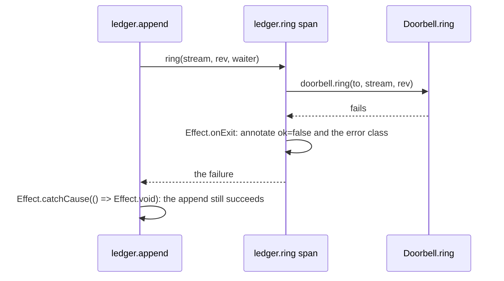

# A failure we swallow still leaves a trace



```ts
// next/packages/libfabrika/src/ledger/internal/ledgerStore.ts:252-267 and :301
const ring = Effect.fn("ledger.ring")(function* (stream: string, rev: Rev, {to, after}: Ring) {
	yield* Effect.annotateCurrentSpan({/* stream, to, after, rev */});
	return yield* Effect.suspend(() => doorbell.ring(to, stream, rev)).pipe(
		Effect.onExit((exit) =>
			Effect.annotateCurrentSpan(
				Exit.match(exit, {
					onSuccess: () => ({[tag("ok")]: true}),
					onFailure: (cause) => ({[tag("ok")]: false, [ERROR]: errorClass(Cause.squash(cause))}),
				}),
			),
		),
	);
});
// ...
(waiter) => ring(stream, rev, waiter).pipe(Effect.catchCause(() => Effect.void)),
```

Sometimes a failure must not fail the caller: a ring after an append, a flush in a background loop,
a publish to a window that left. Swallowing it is fine. Swallowing it silently is not. Before the
failure is dropped, it is recorded where someone debugging will look: on its own span, as the ring
does, or as a log line.

Rules:

- **Record, then drop.** The span that ran the work records the outcome (`Effect.onExit` plus
  `annotateCurrentSpan`, as above), and only then does the caller `catchCause(() => Effect.void)`.
  Effect's own one-step form is `Effect.ignore({log: "Warn"})`, which logs the cause and drops it
  (`node_modules/effect/src/Effect.ts`, `ignore`'s `log` option).
- **A bare `Effect.ignore` is a smell.** It drops the failure with no record. Each one either gets a
  record first or a comment saying why the failure is truly nothing.
- **A finalizer logs; it does not die.** `Effect.addFinalizer(() => stop.pipe(Effect.orDie))` turns a
  failed stop into a defect that hides the stop's own error. Record it and go on
  (`Effect.catchCause(Effect.logWarning)` or the span form above).
- **Every traced function is `Effect.fn("piece.verb")`,** so the record has a span to sit on
  ([effect-fn for traced functions](../docs/direction/effect-fn-for-traced-functions.md)).
- **The record keeps content rules.** An error's message rides in the span's failure, never in a tag
  (`next/packages/libfabrika/src/ledger/Ledger.ts:15`).

clanka, an agent by an Effect core maintainer, takes the log form: where it skips a failed MCP server it writes
`Effect.logWarning("MCP server failed")` with the server and error as log annotations
([`McpServers.ts:523-526`](https://github.com/Effectful-Tech/clanka/blob/44eb97a4eff8ae00bcf18750b387fe5a98cd191c/src/McpServers.ts#L523-L526)).

Both forms are in use: `next/` records with spans plus log lines
([0024](../.decisions/0024-next-records-with-spans-and-log-lines.md)). Effect's default
`tracerLogger` writes a log line onto the span it runs in, as an event, and the span sink keeps that
event in the row (`next/packages/libfabrika/src/telemetry/Sink.ts`, `ended`). So a log line sits inside
an `Effect.fn` body or a `withSpan`; outside one it reaches only the console (ticket 453, a lint rule,
advice first). A log with a cause adds `effect.cause`, the error's text and stack, as an event tag;
until ticket 454 settles what the sink keeps of it, prefer the span form when the error's text could
carry content.

## Where it applies

Every place in `next/` that catches a failure and goes on. Stops at a failure the caller must see:
that one propagates, typed ([errors keep their cause](./effect-errors-keep-their-cause.md)).

## Today's code breaks this

Ticket 444 sweeps it. On main `d48cb774`, in `next/` product code: 7 bare `Effect.ignore` in 4 files
(`next/packages/libfabrika/src/node/dev/dev.ts:208`, `:237`, `:318`, `:319`, `runtime/Runner.ts:682`,
`cloudflare/control.ts:93`, `cloudflare/runtime.ts:699`), and 1 finalizer that dies (`node/dev/dev.ts:212`).
The two `catchCause(() => Effect.void)` in `ledger/internal/ledgerStore.ts:301` and `:414` follow this pattern.

## Why it is not obvious

`Effect.ignore` is the shortest way to say "this may fail", and the code under it really may fail
without harm. The cost comes the day it fails for a new reason, such as a full disk on the flush, and
nothing anywhere says so.

## Holds it

- Lint, on: `fabrika/effect-functions` in `next/` (`.oxlintrc.json:347`) holds the span names.
- Effect diagnostics: `catchToIgnore` (5 hits, 0 false alarms) rewrites `catch(() => Effect.void)` to
  `Effect.ignore`, which is the shape, not the record; ticket 438. Nothing built in flags a bare
  `Effect.ignore`.
- Judgment only, for now. A custom rule could flag `Effect.ignore` with no options; not built.

## Decision

[0024: `next/` records with spans plus log lines](../.decisions/0024-next-records-with-spans-and-log-lines.md);
[a function that returns an Effect is written with `Effect.fn`](../docs/direction/effect-fn-for-traced-functions.md);
the owner's "record wide, read later" (AGENTS.md). Credit: kamp-us/phoenix's
[backend-exception-translation.md](https://github.com/kamp-us/phoenix/blob/4802776ad4911ac025ecfbf7bc49f6c17e13e2bb/.patterns/backend-exception-translation.md)
("a swallowed refusal still logs its cause") and its live publisher's
`Effect.ignore({log: "Warn"})` in [effect-context-service.md](https://github.com/kamp-us/phoenix/blob/4802776ad4911ac025ecfbf7bc49f6c17e13e2bb/.patterns/effect-context-service.md).

> Derived from `effect@4.1.2`; re-verify on pin bump.
