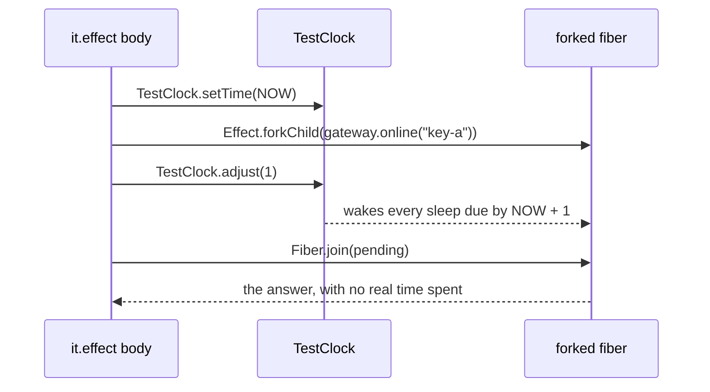

# An Effect test runs in `it.effect`, on the test clock



```ts
// next/packages/libfabrika/src/coordination/gateway-manager.test.ts:6-8 and :81-91
import {describe, expect, it} from "@effect/vitest";
import {TestClock} from "effect/testing";

return Effect.gen(function* () {
	yield* TestClock.setTime(NOW);
	const gateway = yield* GatewayManager;
	for (let i = 0; i < count; i++) yield* gateway.join(world.connection(`tab-${i}`));
	const pending = yield* Effect.forkChild(gateway.online("key-a"));
	yield* Effect.gen(function* () {
		yield* TestClock.adjust(1);
		expect(started, "all gateways are probed before any reply").toHaveLength(count);
		yield* TestClock.adjust(delay);
		expect(yield* Fiber.join(pending)).toHaveLength(count);
	}).pipe(Effect.ensuring(Fiber.interrupt(pending)));
}).pipe(Effect.provide(layer));
```

A test whose body is an Effect is `it.effect` from `@effect/vitest`. It runs with Effect's test
services: `TestClock` drives time, and `it.effect` gives the body a `Scope`, so a finalizer or a
scoped temp folder is cleaned up even when the test fails. A law over many inputs is
`it.effect.prop`, with Schema or fast-check inputs and the shared seed:

```ts
// next/packages/libfabrika/src/data/trace-id.test.ts:36-54
it.effect.prop(
	"Effect Arbitrary generates 200 decodable trace ids and their all-zero form is refused",
	{sampleSeed: Schema.Int},
	({sampleSeed}) => Effect.gen(function* () { /* ... */ }),
	{arbitrary: {seed: 119120, runs: 40}},
);
```

Rules:

- **No `Effect.runPromise` or `runSync` inside a test, and no `async` test body.** `runPromise` runs
  on the live clock and outside the test services, so a test written that way reads real time and
  cannot use `TestClock`, and nothing tells you.
- **Time moves with `TestClock.adjust`.** Never a real sleep or a `setTimeout`.
- **Wait on an event, never a duration.** A test that needs "the fiber has started" waits on a
  `Deferred` or `Latch` the program opens. A bounded timer is only for a negative check (nothing
  arrives in the window), and on a slow runner it can only pass falsely, never fail falsely.
- **Layers in tests.** `Effect.provide(layer)` per test is fine when each law needs a fresh SQLite,
  as here. A layer every test in a block shares goes in `layer(X.layer)("name", (it) => ...)`, and
  `buildPerTest: true` builds it fresh for each test (`@effect/vitest`'s `layer`).
- **`expect` is fine inside `it.effect`.** It is synchronous, and `next/` uses it everywhere.

## Where it applies

Every `next/**/*.test.ts` that runs an Effect. A test of plain code stays a plain `it`. Stops at a
test whose subject is the Promise edge itself, such as an object class's one-line `runPromise`
handoff: that test may await the edge, because the edge is what it checks.

## Today's code breaks this

Ticket 441 sweeps it. On main `d48cb774`: 363 `Effect.runPromise`/`runSync` calls in 70 test files,
62 test files with an `async` test body, and 46 that import plain `vitest`. For example
`next/packages/libfabrika/src/data/ledger.test.ts:253`: a fast-check law run through
`fc.asyncProperty` and `Effect.runPromise`. As `it.effect.prop` it is the same law, with the test
services in place.

## Why it is not obvious

`it("...", async () => { await Effect.runPromise(...) })` is how every non-Effect codebase writes
a test, and it passes. The difference only shows the day a law depends on time: it then sleeps for
real, or passes on a fast laptop and fails on a slow CI runner (host law 30 in today's code did
exactly that, [build on Effect](../docs/direction/build-on-effect.md), "The clock").

## Holds it

- Lint, partly: `fabrika/no-effect-run-outside-edge` blocks `Effect.run*` in `next/` product code,
  but is off for tests (`.oxlintrc.json:375`). Turning it on for tests, after counting its false
  alarms, would hold the first rule. `fabrika/prefer-schema-arbitrary` blocks hand-built
  fast-check data in every folder at zero, and advises only where a folder's warn line says so
  ([0523](../.decisions/0523-advice-rules-block-where-clean.md),
  [where a rule still advises](../oxlint-plugins/README.md#where-a-rule-still-advises)).
- vitest's own rules (`no-standalone-expect`, `valid-expect`, `expect-expect`) do not know
  `it.effect` and fire about 10 in 10 times falsely (lint audit, 2026-11-09), so they stay off.
- Waiting on events, not durations: judgment only.

## Decision

[Build on Effect](../docs/direction/build-on-effect.md); [no Promises](../docs/direction/no-promises.md).
The same shape at scale: [clanka](https://github.com/Effectful-Tech/clanka/tree/44eb97a4eff8ae00bcf18750b387fe5a98cd191c)
(Effect 4.1.1) has 197 `it.effect`, 18 `TestClock` and 1 `Effect.runPromise` in all its tests, and
makes its temp folders with `fs.makeTempDirectoryScoped()` inside the test
([`AgentExecutor.test.ts:45-46`](https://github.com/Effectful-Tech/clanka/blob/44eb97a4eff8ae00bcf18750b387fe5a98cd191c/src/AgentExecutor.test.ts#L45-L46)),
so a failed test still cleans up. Credit: kamp-us/phoenix's [effect-testing.md](https://github.com/kamp-us/phoenix/blob/4802776ad4911ac025ecfbf7bc49f6c17e13e2bb/.patterns/effect-testing.md)
(`it.effect` over `runPromise`, `TestClock`, "await events, never durations"). Its advice to use
`assert` instead of `expect` inside `it.effect` does not carry over: on `@effect/vitest@4.1.2` `expect`
works, and `next/` relies on it.

> Derived from `effect@4.1.2` and `@effect/vitest@4.1.2`; re-verify on pin bump.
