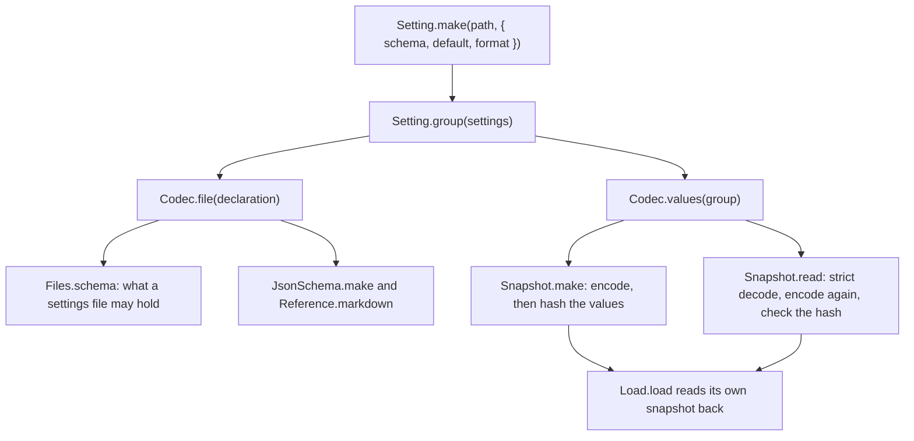

# One settings declaration gives both encodings



```ts
// next/packages/libfabrika/src/settings/Codec.ts:10 and :33
export const file = <A>(declaration: Setting.Setting<A>) => {
  const codec =
    declaration.format === "text"
      ? Schema.toCodecStringTree(declaration.schema)
      : Schema.toCodecJson(declaration.schema);
  return codec.pipe(
    Schema.annotateEncoded({
      description: declaration.doc,
      default: Schema.encodeSync(codec)(declaration.default),
    }),
  );
};

export const values = <A, R extends Record<string, Setting.Setting<any>>>(group: Setting.Group<A, R>) =>
  Schema.Struct(Struct.map(group.settings, json));
```

This is `next/`. A setting is declared once, with one schema. Two encodings come from that schema,
and nobody writes either by hand.

- **The file encoding** is `Codec.file` (`next/packages/libfabrika/src/settings/Codec.ts:10`). It is
  what a person types in a settings file. A declaration's `format` picks it
  (`next/packages/libfabrika/src/settings/Setting.ts:16`): `"json"` keeps native values, and `"text"`
  uses Effect's StringTree codec, so a byte size is written with its unit. `Setting.make` fills in
  `"json"` when a declaration says nothing (`next/packages/libfabrika/src/settings/Setting.ts:55`).
- **The recorded encoding** is `Codec.values` (`next/packages/libfabrika/src/settings/Codec.ts:33`).
  It is one Struct of JSON values, keyed by the name each value has in the group. It adds no
  defaults: a missing value fails.

Each reader goes through one of the two:

- A file's Struct takes each leaf from `Codec.file`
  (`next/packages/libfabrika/src/settings/Files.ts:92`). The editor schema is made from that same
  Struct, so it gets the same words and the same default.
- The reference page prints the recorded default, and for a `"text"` setting the file default too
  (`next/packages/libfabrika/src/settings/Reference.ts:75`).
- `Snapshot.make` encodes with `Codec.values`
  (`next/packages/libfabrika/src/settings/Snapshot.ts:36`).
- `Snapshot.read` decodes strictly, encodes again and checks the hash
  (`next/packages/libfabrika/src/settings/Snapshot.ts:51`). Every declared path must be there, in
  `values` and in `origins`, and no other key may be (`:55` to `:61`). The hash is taken from the
  encoded-again values, so two spellings of one value give one hash (`:71` to `:79`).
- `Load.load` makes the snapshot and reads it back before it returns
  (`next/packages/libfabrika/src/node/settings/Load.ts:75`), so nothing starts on values that were
  not checked.

A group keeps the type of each member. `Setting.group` returns `Group<Values<R>, R>`
(`next/packages/libfabrika/src/settings/Setting.ts:100`), and `Group.settings` is `R`
(`next/packages/libfabrika/src/settings/Setting.ts:63`). That is why `Codec.values(group)` has the
decoded type of each setting, with no cast.

The laws that hold this:

- Types follow the declaration record: `next/packages/libfabrika/src/settings/Codec.test.ts:33` and
  `next/packages/libfabrika/src/settings/Setting.test.ts:231`. The typecheck runs them, not Vitest.
- A file byte size needs a unit and decodes exactly:
  `next/packages/libfabrika/src/settings/Codec.test.ts:64`.
- A round trip keeps exact values, past the safe-integer limit too:
  `next/packages/libfabrika/src/settings/Snapshot.test.ts:121`.
- A missing, extra or renamed key fails: `next/packages/libfabrika/src/settings/Snapshot.test.ts:141`.
- The hash depends on the values alone, and a changed value or hash fails:
  `next/packages/libfabrika/src/settings/Snapshot.test.ts:188`.
- A refused value stays out of every output:
  `next/packages/libfabrika/src/settings/Snapshot.test.ts:447`.

## Where it applies

`next/packages/libfabrika/src/settings/` and `next/packages/libfabrika/src/node/settings/`. A new
setting is one `Setting.make` call. It gets its file check, its editor schema, its reference entry
and its place in the snapshot from that call.

It stops at the Worker. No Worker reads a snapshot yet, and no process start saves one. The two
registered settings, the port and the minimum version, are both `"json"`. Only tests declare a
`"text"` setting today.

## Why it is not obvious

A reader would write a second schema for the saved snapshot, or decode a file value and save it as
it came. Then the file and the snapshot drift apart, and a byte size past 2^53 loses digits on its
way through a JSON number. A reader would also fill a missing saved value from its default, which
hides a snapshot that was cut short.

The reason for one declaration is in [0086](../.decisions/0086-settings-are-declared-once.md) and
[the settings note](../docs/direction/settings.md).

> Derived from `effect@4.1.2`; re-verify on pin bump.
