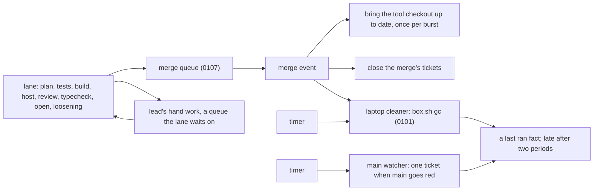

# Lane, queue or scheduled job: where each piece of work in a change lives

**Decided 2026-11-11.** The owner decided the rule, the tie-breaker and the picture after a walk of
[experiment 260](../../experiments/260-lane-queue-or-scheduled-job.md), and corrected two of its
guesses. The binding part is
[0108](../../.decisions/0108-a-job-lives-in-a-lane-a-queue-or-a-scheduled-job.md). A scheduled job
is the repo's existing word:
[a program on the host that listens to the clock](./scheduled-jobs-on-the-host.md).
The unclear cases in [The families of work](#the-families-of-work) marked "the lead's lean, not
ruled on" were heard without objection and stay leans. Both versions: the rule holds for today's lead tooling now
and for `next/`'s pipeline when it runs lanes. Each piece is built in the owner's standing order:
first it works, then better, then secure.

```ts
// A sketch, not built. Two questions, one tie-breaker, three homes.
type Work = {
  judges: "this change" | "shared"; // shared: main, the laptop, the tracker
  neededNext: boolean; // must its answer exist before the next step starts?
  stopsLastingHarm: boolean; // a leak, lost work, a builder changing its own exam
  ourEventMovesIt: boolean; // shared state that only our own event changes: main moves on our merge
};

const home = (work: Work): "lane" | "queue" | "scheduled job" => {
  if (work.stopsLastingHarm) return "lane"; // the tie-breaker: it never leaves the lane
  if (work.judges === "this change" && work.neededNext) return "lane";
  // compares "should be" with "is"
  if (work.judges === "shared" && !work.ourEventMovesIt) return "scheduled job";
  return "queue"; // one piece of work per event, done once, can wait its turn
};

home({ judges: "shared", neededNext: false, stopsLastingHarm: false, ourEventMovesIt: false });
// "scheduled job": the laptop cleaner. Disk fills from many causes, and no one event says so.
home({ judges: "shared", neededNext: false, stopsLastingHarm: false, ourEventMovesIt: true });
// "queue": bring the tool checkout up to date. Main moves only on a merge, so it hangs on the merge.
```

## The picture



- **A thin lane.** Plan, tests, build, host, one review, typecheck, open, loosening, then into the
  merge queue. Every piece of work in it judges this change and is needed by the next step.
- **One merge queue.** fabrika provides it as its own primitive, in its official pipeline pack
  ([0107](../../.decisions/0107-fabrika-provides-the-merge-queue.md)). What it runs before a merge
  is 0107's and, until its first stage, [0146](../../.decisions/0146-a-pull-request-lands-only-on-ci-that-saw-main.md)'s:
  every check on a head that holds main.
- **Work on the merge event.** The merge queue raises it. Bringing the tool checkout up to date
  hangs here, and so does a cleanup run ([0101](../../.decisions/0101-box-cleanup-runs-on-a-timer.md)).
- **Two scheduled jobs.** The laptop cleaner (0101) and a main watcher that files one ticket when
  main goes red. The hourly mutation run keeps its own schedule
  ([0066](../../.decisions/0066-mutation-runs-on-a-schedule.md), as amended).

## The rule

Ask two questions of a piece of work:

1. **What does it judge:** this one change, or something shared (main, the laptop, the tracker)?
2. **Must its answer exist before the next step starts?**

| The answers | Home | What the home is |
|---|---|---|
| Judges this change, and the next step needs it | the lane | a step, or part of one, in every lane |
| One piece of work per event, done once, can wait its turn | a queue | a worker takes each item in order |
| About shared state, safe to run twice | a scheduled job, on a timer | compares "should be" with "is" and fixes the gap |

**A scheduled job is for state that drifts from many causes, which no event of ours reports.** The
laptop's disk fills from steps, boxes and Docker; main's CI result comes from GitHub, outside. A shared fact
that only our own event changes hangs on that event instead: main moves only on a merge, and the
merge queue does the merge. A scheduled job that asks "did it change?" is the wrong home for it.
This is the reading of the owner's correction on the tool checkout (below), applied to each case it
fits.

This is the known way. Google runs "only fast, reliable" tests before submit and the rest after
([Software Engineering at Google, ch. 23](https://abseil.io/resources/swe-book/html/ch23.html));
Prow has presubmit, postsubmit and periodic jobs ([job types](https://docs.prow.k8s.io/docs/jobs/));
a Kubernetes [controller](https://kubernetes.io/docs/concepts/architecture/controller/) is a loop
that moves what is toward what should be, and its garbage collection runs on its own clock, apart
from any pod start ([GC](https://kubernetes.io/docs/concepts/architecture/garbage-collection/)).

## The tie-breaker

**A check that stops lasting harm never leaves the lane,** whatever it costs. Lasting means it
cannot be undone by a revert: a secret on a public repo, work thrown away, a builder that changed
its own exam. So the leak grep, `loosening.sh`, the plan approval's hash and the merge's pin to its
head stay in every lane. This matches the never-moves list in
[the fast check note](./fast-and-daily-mutation.md#which-checks-fall-where): if one of them outgrows
the budget, the check gets faster.

## Every scheduled job says when it last ran

- **A scheduled job writes one "last ran" fact each run:** when it started, when it ended, what it
  found or fixed, and whether it failed. A reader can always answer "when did it last run?".
- **A scheduled job is shown late once its last run is older than two periods.** One that died
  quietly then looks like a stuck lane, not like silence. 0101 set this for the cleaner; here it
  holds for every scheduled job.
- **Two runs never overlap.** A run that finds one going ends at once (0101), as OTP warns that
  `apply_interval` starts a new run "irrespective of whether a previously spawned process has
  finished" ([timer](https://www.erlang.org/doc/apps/stdlib/timer.html)).
- **In `next/`, a scheduled job on Cloudflare is an alarm that sets the next alarm.** The object
  works inside a wake and sleeps; it never stays awake with a timer of its own
  ([0105](../../.decisions/0105-a-durable-object-never-stays-awake-on-its-own.md),
  [scheduled jobs run on the host's alarms](./scheduled-jobs-on-the-host.md)).
- **A scheduled job piece for `next/` is planned in three stages** under tracker ticket 762: first
  it works, then better, then secure.

```ts
// A sketch, not built. The fact a scheduled job writes each run, and when it reads as late.
type LastRan = {
  name: "laptop_cleaner" | "main_watcher";
  startedAt: number; // the scheduled job's own clock
  endedAt: number;
  found: number; // boxes removed, reds filed
  failed: boolean;
};
const late = (last: LastRan, period: number, now: number) => now - last.startedAt > 2 * period;
```

## The families of work

Lead tooling today. Where a home is a lean, it says so.

- **Plan.** The plan check, the approval line and an "already merged?" check judge this change and
  are needed first: the lane. The plan writer is one per ticket and can wait its turn: a queue with
  more than one worker, once the `redact.sh` lock is fixed (the research's lean, not ruled on).
- **Steps.** The free-disk check, box setup, the agent steps, the host step, the judgment on an ask
  or a stuck, the budget, and the field run row each step writes: the lane. A field row is written
  once, by the step; a scheduled job cannot rebuild a lost fact.
- **Checks on this change.** The leak grep, `loosening.sh`, push, PR CI and `commits`: the lane.
  **Tests stay on the pull request, and its checks finish in five minutes at most**
  ([0106](../../.decisions/0106-a-pull-requests-checks-finish-in-five-minutes.md)).
- **Typecheck twice.** The lane typechecks the head merged with main, and CI typechecks again. Both
  stay: cheap insurance against a 40-minute CI round (the lead's lean, not ruled on).
- **The lead's hand work.** The hand check of loosening hits, signing a refused commit, amending a
  plan, restarting a stopped lane. They are needed before the lane goes on, but the lead is one
  shared worker, so they are a queue the lane waits on (the lead's lean, not ruled on).
- **A stopped lane wakes the lead at once,** on its ask, its stuck or its budget stop, in place of
  the 20-minute check (the lead's lean, not ruled on). Last night that check cost 6 lane-hours over
  33 parks.
- **Merging.** Lint on the true merge, the squash, a retry after an outside fault, a conflict sent
  back to the lane: the merge queue (0107).
- **On the merge event.** Bring the tool checkout up to date, once for a burst of merges, at a
  moment when no step is starting (decided). Close the tickets the merge finished, with a scheduled
  job as the backstop for a close the event missed (the lead's lean, not ruled on). A cleanup run
  (0101).
- **The laptop.** Box cleanup, stale processes, Docker health: the laptop cleaner, a scheduled job
  (0101).
- **Main.** The full suite still runs on every push to main. The main watcher, a scheduled job, reads its
  result and files one ticket when main goes red, so "fix it the same turn" has an owner (0097 relied
  on it; 0146 superseded 0097 and catches a clash before the merge). Hourly mutation stays as 0066 and
  [0067](../../.decisions/0067-hourly-mutation-runs-in-ci.md) have it.

## The guesses the owner corrected

- **Wrong: the tool checkout on a scheduled job.** The research proposed a scheduled job in the
  tooling that fast-forwards the checkout the tools run from whenever no step is starting. Main
  moves only on a merge, so that is an event. Decided: the merge queue does it after it merges, once for a burst of merges, at a
  moment when no step is starting.
- **Wrong: about 12 minutes of checks is fine.** The research took the 12.5-minute median of a
  pull request's checks as an acceptable price for keeping tests on it. Decided: tests stay, and the
  checks finish in five minutes at most (0106).

## What it costs

- **One more process to keep alive per scheduled job,** and a dead one is silent unless its "last
  ran" fact is read. That is why the fact and the late mark are part of the rule, not extras.
- **A chore can lag one period.** The disk can grow between cleaner runs; main can sit red until the
  watcher's next tick.
- **A merge made outside the merge queue raises no merge event,** so the checkout is not brought up
  to date after it. The next queue merge does it.
- **The five-minute cap moves work into CI** (sharding, splitting slow files, caching); 0106 holds
  that work.
- **A new timer is the owner's call**
  ([0096](../../.decisions/0096-the-lead-fixes-forward-while-the-owner-is-away.md) lists a new
  cron). The two scheduled jobs here are that call; any third one needs its own.

What it undoes: nothing settled. The never-moves list stands. AGENTS.md's line that `drive.ts` runs
`box.sh gc` itself on start was already replaced by 0101.

## What it cannot tell us

- How often main goes red after a lint-only landing (0097). The main watcher's tickets will count
  it; if it is common, the merge queue may need tests on the true merge (0107's call).
- Whether a scheduled job on the laptop stays alive through sleep. The late mark shows it within
  two periods.
- Whether the main watcher would be better hung on the "main's CI finished" event. It is a
  scheduled job because the result comes from GitHub, outside, and a level read catches a missed
  event at the next tick. A watcher that listens could come later, with the scheduled job as its
  backstop.
- How long the merge queue's own steps take, so how big a "burst" is. The lander never logged when
  a pull request joined the line.
