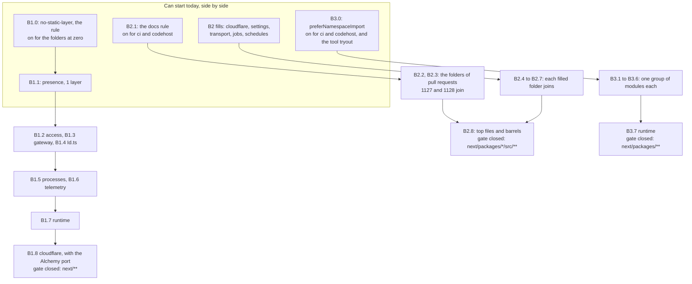

Approved by the lead agent, builds effect-code-guidelines.md (0168); the owner answered its open questions on 2026-11-13; body ba9914c45546
Plancheck-Version: 3

# Plan B: the three big Effect rules, each closed folder by folder

Everything here is about `next/` and the repo's lint and type-check config. Today's version is not
changed. Nothing is built. Plan A, [the six small rules](./effect-rules-small.md), is its sibling.



## The answer first

- **Three rules, none with a list file.** No list of known breaks and no `debt:` line is written
  (decision 0168, [pull request 1137](https://github.com/kamp-us/tea-fabrika/pull/1137)).
- **Each rule is on from its first pull request, for the folders that are at zero.** New code in
  those folders is held that day. Each later slice fixes one folder and adds it to the rule's list
  in the same pull request. The last slice replaces the list with the whole tree.
- **Why per folder and not `debt:` lines.** 0168 lets a rule's first pull request write `debt:`
  lines where the fix is too much for one pull request. Here that would be 27, about 830 and 387
  comment lines. A folder list writes none, and the gate still closes a piece at a time. For the
  import rule there is a second reason: it is Effect's check, not oxlint's, so an oxlint ignore
  comment does not reach it.
- **This is not a folder-wide ignore.** 0168 forbids an ignore that stands in for a `debt:` line.
  A folder not yet on the list has no ignore: the rule has not reached it, which is how 0120 already
  orders the sweeps ("each turning its check to `error` when it lands").

| Rule | Today, on `origin/main` at `9276a9606` | Whose check | Codemod | Gate closes when |
|---|---|---|---|---|
| B1 `no-static-layer` | 19 static layers on 15 classes, in 7 modules | ours, new | none: helpers move them by hand | the Alchemy port lands |
| B2 docs | 333 of 645 exports with no block, 114 of 133 files with no module block | ours, with Effect's block grammar copied | none: prose is written by helper agents | the barrels become namespace re-exports |
| B3 `preferNamespaceImport` | 387 import statements, 1,353 names, in 299 files of `next/packages` | Effect's | maybe: Effect's own fix, to be tried first | `runtime/` lands |

How sure: 85% on the counts for B1 and B3. 70% for B2, whose count today is a grep; the real rule
counts again. 65% on the order across the three, since they meet in the same files.

## How the counts were made

```sh
# B1: every static member in next/ product code, read by hand against its class.
nice -n 19 git grep -n -E '^[[:space:]]+static ' -- next \
  ':!*.test.ts' ':!*.test.tsx' ':!*Test.ts' ':!*.test-support.ts'

# B3: Effect's own check, on for one run through an inline config.
nice -n 19 pnpm exec effect-tsgo diagnostics --format json \
  --project "$PWD/next/packages/libfabrika/tsconfig.json" \
  --lspconfig '{"name":"@effect/language-service","namespaceImportPackages":["effect"],"diagnosticSeverity":{"preferNamespaceImport":"error"}}'

# B3, the same grep experiment 282 used, for comparison.
nice -n 19 git grep -n -E '^import (type )?\{[^}]*\} from "effect";|^\} from "effect";' -- next/packages
```

B2's count is experiment 282's narrow one, run again: a line that starts with `export class`,
`const`, `function`, `interface`, `type` or `namespace` in a public file of libfabrika, with no
line ending in `*/` right above it. No model, no key, no network: $0.

## B1: `no-static-layer`

E5 and [0095](../../.decisions/0095-a-service-file-holds-only-its-contract.md): a service file holds
only its contract, and each layer is a sibling file.

### The count

All 19 static layers, under `next/packages/libfabrika/src/`, with the lines that call each one:

| Module | Static layers | Callers in `next/` |
|---|---|---|
| top | `Id.ts:153` | 37 lines in 33 files |
| `access` | `SessionManager.ts:102` | 9 lines in 8 files |
| `gateway` | `Gateway.ts:1696` | 29 lines in 8 files |
| `presence` | `Connections.ts:40` | 5 lines in 3 files |
| `processes` | `Mailbox.ts:126`, `ProcessIdGenerator.ts:11`, `ProcessManager.ts:76` | 131 lines in about 50 files |
| `runtime` | `Entry.ts:80`, `Entry.ts:169`, `ProcessStore.ts:92`, `RecoveryStore.ts:193`, `Runner.ts:280`, `Runner.ts:290` | about 140 lines in about 35 files |
| `telemetry` | `Archive.ts:40`, `Archive.ts:53`, `Records.ts:420`, `Records.ts:424`, `Records.ts:429`, `Sink.ts:246` | 152 lines in about 30 files |

Experiment 282 counted 19 on 15 classes. The count is the same today. About nine in ten caller
files are tests.

Eight more static members sit on service classes and hold code, not a layer:

- `cloudflare/platform.ts:67`, `:188`, `:237`, `:258`, `:274`, `:305`: six `static make`.
- `runtime/Execution.ts:192`: `static make`.
- `access/SessionManager.ts:63`: `static sign`.

### Whose check, and the tools looked at

Ours, new: `fabrika/no-static-layer`, in the lint plugin folder. 0095 owes it by name.

| Tool | Used? | Why |
|---|---|---|
| Effect's checker, [`@effect/tsgo`](https://github.com/Effect-TS/tsgo) 0.63.0 | no | Its schema has no check on a service class's static members. `strictEffectProvide` is about where `provide` is called, and experiment 262 found it right in 3 of 5 hits |
| oxlint's [`no-restricted-syntax`](https://eslint.org/docs/latest/rules/no-restricted-syntax) | no | oxlint 1.90.0 does not have it (`oxlint-plugins/README.md`, the `next-ledger.json` section) |
| oxlint's [`typescript/no-extraneous-class`](https://oxc.rs/docs/guide/usage/linter/rules/typescript/no-extraneous-class) | no | It refuses a class with only static members. A service class extends `Context.Service`, so it never matches |

**The rule refuses every static member on a class that extends `Context.Service`.** Not only one
that returns a Layer. Why: a syntax rule cannot read a member's type, so "returns a Layer" would be
a guess from names and annotations, and a guess has misses. 0095 also says the service file holds
"no code that runs". The cost: the eight members above count too, so 27 sites, and `cloudflare/`
closes only with the Alchemy port. This widens 0095's own words, and the owner said yes to it on
2026-11-13 ([Open questions](#open-questions)).

Edge cases, each with a test:

1. `static readonly layer = ...`, `static layer = ...`, a static method, a static getter and a
   `static {}` block all fire.
2. A class whose `extends` is `Context.Service<...>()(...)` is a service class, through a named, a
   namespace or a renamed import of `Context`. `match.ts` resolves these for `service-id` already.
3. A class that extends `Schema.TaggedError`, `Schema.Opaque` or nothing passes:
   `processes/Process.ts:204`, `:205`, `:221` and `runtime/State.ts:32` stay.
4. An instance member passes. So does a `declare` field with no value.
5. A class expression, `const X = class extends Context.Service...`, is read too.
6. A static member added from outside, `Ledger.layer = ...`, is not seen. The type check refuses it,
   since the class has no such property.
7. Tests, shared suites and test support are left out, as `effect-functions` leaves them out: a
   test may build a stand-in service any way it likes.

### The fix, shown once

Before, `next/packages/libfabrika/src/telemetry/Sink.ts:242-251`:

```ts
>()("@kampus/libfabrika/telemetry/Sink.SpanSink") {
  /** Provides `Tracer.Tracer` and `SpanSink` over this object's `Sql`. Building it touches nothing:
   *  the tables come with the first span. */
  static readonly layer = (sql: Sql, options: { readonly object: string }): Layer.Layer<SpanSink> =>
    Layer.unwrap(
      Effect.sync(() => {
        const { tracer, sink } = make(sql, options);
        return Layer.merge(Layer.succeed(SpanSink, sink), Layer.succeed(Tracer.Tracer, tracer));
      }),
    );
```

After: the class ends at `{}`, and the body moves unchanged to a sibling that exports `layer`. The
tree already has one, `next/packages/libfabrika/src/ledger/LedgerSql.ts:12-23`:

```ts
export const layer = (sql: Sql, caller: { readonly reader: string }): Layer.Layer<Ledger, never, Doorbell> =>
  Layer.effect(
    Ledger,
    Effect.gen(function* () {
      const referee = yield* Referee;
      return {
        append: referee.append,
        read: (stream, after) => pages(after, (from) => referee.read(stream, from, caller.reader)),
        wait: (stream, after) => referee.wait(stream, after, caller.reader),
      };
    }),
  ).pipe(Layer.provide(RefereeSql.layer(sql)));
```

A caller changes one name and gains one import: `SpanSink.layer(sql, options)` becomes
`SinkSql.layer(sql, options)`. The sibling's name is the service and the variant, as 0095 says.
Each slice lists its new file names in its first step.

### Codemod

None. No shipped tool moves a class's static member to a new module and rewrites its callers.
TypeScript's "move to a new file" works on top-level statements, in an editor only.
[ast-grep](https://ast-grep.github.io/guide/rewrite-code.html) could rename the calls but would not
add the import. So helpers do it by hand, one module a slice. The proof that no caller was missed
is the type check: a leftover `SpanSink.layer` no longer exists on the class.

### The slices, and the gate

The config is one block whose `files` list grows. A sketch:

```jsonc
// .oxlintrc.json. E5 (0095): on where the count is zero. A slice adds its folder when it lands.
{
  "files": [
    "next/apps/**",
    "next/programs/**",
    "next/packages/libfabrika/src/ci/**",
    "next/packages/libfabrika/src/codehost/**",
    "next/packages/libfabrika/src/jobs/**",
    "next/packages/libfabrika/src/ledger/**"
    // ...and node, packs, repositories, schedules, settings, transport
  ],
  "rules": { "fabrika/no-static-layer": "error" }
}
```

1. **B1.0, the rule.** The rule, its laws, and the list above: 12 folders at zero. No product file
   changes. Can start today.
2. **B1.1, `presence`.** 1 layer, 3 caller files. The small first move, so the shape is tried once.
3. **B1.2, `access`.** 1 layer and `static sign`, 8 caller files.
4. **B1.3, `gateway`.** 1 layer, 8 caller files. After Plan A's A2: 0095 asks for the written
   service type before the layer moves.
5. **B1.4, `Id.ts`.** 1 layer, 33 caller files.
6. **B1.5, `processes`.** 3 layers, about 50 caller files.
7. **B1.6, `telemetry`.** 6 layers, about 30 caller files.
8. **B1.7, `runtime`.** 6 layers and `Execution`'s `static make`, about 35 caller files. Last of the
   moves: `Runner.ts` is the file every other plan also changes.
9. **B1.8, `cloudflare`.** The six `static make` leave with the Alchemy port
   ([0041](../../.decisions/0041-object-classes-are-effect-objects.md), ticket 502), which deletes
   `cloudflare/platform.ts`. The port's pull request adds `cloudflare/` and the list becomes
   `next/**`.

The moves run one at a time. They share caller files: the same test files provide `SpanSink`,
`Mailbox` and `ProcessManager` together. Smallest first, as 0120 orders the sweeps.

- **Cost:** about 20 new sibling files, about 600 lines moved (0120's number, not measured again),
  and about 500 caller lines renamed. **How sure:** 75%. The doubt: a layer that builds its own
  dependencies in its body, as `Runner.ts` does, is E5's other half. Moving it does not fix it, and
  no grep counts it. That stays review work until the runner is split.

## B2: the docs rule

E6: a public export has a doc, and a comment says why. A draft plan exists:
`docs/plan/ticket-900-docs-lint.md`, on the branch of
[pull request 1131](https://github.com/kamp-us/tea-fabrika/pull/1131). It was written before 0168.
This section replaces its start. The rest of it stands.

### What stands from the draft, and what goes

- **Stands:** the tools it looked at, the rule's shape (`fabrika/jsdocs`, with about 650 lines of
  Effect's block grammar copied from Effect's own checker at the pinned tag), its 31 edge cases, its
  laws 1 to 9, and its false-alarm proof: 0 in 9,536 exports of Effect's own source.
- **Goes:** every use of `next-ledger.json`. The 833 first-day entries, the file's row in the files
  table, steps 4 and 5 of its trace, its question 1, and its finding about list files that can grow
  unseen. 0168 deletes the file.
- **Changes:** the order. The draft turned the rule on first and filled after. Now the blocks are
  written first, module by module, and the rule turns on for a folder when that folder is at zero.

### The count

The draft's measured count, with a prototype of the real rule on `14f96d9a3`: 472 exports with no
block, 242 with a block in the wrong shape, 119 files with no module block.

Today, by the narrow grep on `9276a9606`:

| Tree | Exports with no block | Module blocks missing, in files |
|---|---|---|
| `origin/main` | 333 of 645 | 114 of 133 |
| after [pull request 1127](https://github.com/kamp-us/tea-fabrika/pull/1127) (telemetry, node, packs, ledger, repositories) | 263 | 81 |
| after [pull request 1128](https://github.com/kamp-us/tea-fabrika/pull/1128) too (runtime, processes) | 179 | 51 |

The two fill pull requests are open, and together they add about 2,700 lines of comments. What is
left after them, by the same grep: `cloudflare` 61, `settings` 29, top files 25, `access` 24,
`transport` 20, `jobs` 11, `gateway` 4, `schedules` 4, `presence` 1. The grep does not see a name
in an `export { a, b }` list (139 by the draft's count, 124 of them in the three barrel files) or a
block in the wrong shape.

### Whose check

Ours, `fabrika/jsdocs`, judging each block with Effect's own grammar. The draft's table names the
four tools it tried first (Effect's checker, oxlint's `jsdoc` rules, `eslint-plugin-jsdoc`, TypeDoc
and API Extractor) and why none can run here or hold the shape. That table stands.

### The fix, shown once

Before, `next/packages/libfabrika/src/packs/RepositoryTrust.ts:1-9` on main:

```ts
import { Context, Schema } from "effect";
import type { Effect } from "effect";
import * as Id from "../Id.ts";
import type { Line } from "../ledger/Log.ts";
import { Hash, ObjectId, Branch } from "../repositories/Repositories.ts";
import { Rev } from "../Rev.ts";
import { Snapshot } from "../settings/Snapshot.ts";

export const RepositoryId = Id.make("repository");
```

After, the same lines on pull request 1127's branch:

```ts
/**
 * Repository trust: a person's saved answer on whether to open one clone, and the events that
 * record an opening. This file is the contract only (0095).
 *
 * @stability unstable
 */
import { Context, Schema } from "effect";
// ...the same imports

/**
 * Schema for a repository's id, `repository_<26 chars>`: made at a clone's first selection by one
 * person, and carried by every later event in that history.
 *
 * @stability unstable
 * @category schemas
 */
export const RepositoryId = Id.make("repository");
```

### Codemod

None. A doc block says what a thing is for, and that is read from the code, not derived from it.
Helper agents write the blocks module by module, as the two open pull requests did. Two checks
keep a fill honest: the lead confirms each changed file parses to the same tree with comments left
out, and the review reads each description against the code, which no rule can do.

### The slices, and the gate

```jsonc
// .oxlintrc.json. E6 (0023, 0120): on where the count is zero.
{
  "files": ["next/packages/libfabrika/src/ci/**", "next/packages/libfabrika/src/codehost/**"],
  "rules": { "fabrika/jsdocs": ["error", { "since": "absent" }] }
},
{
  // Not public: internal/, tests, test support, shared suites, fixtures, declaration files.
  "files": ["<the six kinds, as globs>"],
  "rules": { "fabrika/jsdocs": "off" }
}
```

1. **B2.1, the rule.** The rule, the copied grammar, laws 1 to 9, and the list with `ci` and
   `codehost`: the draft's prototype found 9 of 9 and 12 of 12 exports passing there. No product
   file changes, so it does not wait on any fill. Can start today.
2. **B2.2, the folders of pull request 1127 join:** telemetry, node, packs, ledger, repositories.
   That pull request was written with no rule to judge it. This slice replays the rule on its
   folders, fixes what is left in shape, and adds them to the list.
3. **B2.3, the folders of pull request 1128 join:** runtime, processes. The same.
4. **B2.4, fill and join: presence, schedules, gateway, jobs.** 20 exports, 8 module blocks.
5. **B2.5, fill and join: transport, access.** 44 exports, 13 module blocks.
6. **B2.6, fill and join: settings.** 29 exports, 10 module blocks.
7. **B2.7, fill and join: cloudflare,** without its barrel. 61 exports, 15 module blocks.
8. **B2.8, the top files and the three barrels.** 0023 says a library's barrel becomes
   `export * as Name from`, each with a tag-only block. That change removes the 124 barrel names
   rather than documenting them. Then the list becomes `next/packages/*/src/**`: gate closed.
9. **Later, the plan-code rule,** with its own short plan, as the draft says. Most plan codes sit in
   the `//` file headers that the module blocks replace, so it is counted again after the fills.

A fill that lands after B2.1 adds its own folder to the list in the same pull request, and the rule
is then its judge. Slices 4 to 7 share no file and can run side by side.

- **Cost:** about 870 lines of tooling, 650 of them copied, and about 4,500 lines of comments in
  all, of which about 2,700 are in the two open pull requests. **How sure:** 75%. The doubt: how
  many blocks from the two open pull requests the real rule finds in the wrong shape.

## B3: `preferNamespaceImport` for `next/packages/**`

E7 and [0023](../../.decisions/0023-next-follows-effects-code-style.md): a library imports each
Effect module by its path. Apps keep the barrel.

### The count

- **By Effect's check:** 1,353 names imported by name, in 299 files. 125 are product files and 174
  are tests.
- **By experiment 282's grep:** 318 statements from the `effect` root today, against its 321. 137
  are in product files.
- **69 more statements** import by name from a folder of Effect, such as `effect/testing` (32),
  `effect/crypto` (19), `effect/encoding` (9), `effect/process` (7) and `effect/cli` (2). The check
  flags these too, and 0023's row says "by module path", so they are in.
- **Every name is a module.** `Schema`, `Effect` and `Layer` lead, and the checker's message names
  the module path for each. No file imports a bare function such as `pipe`. So every fix has the
  same form.
- 20 files already have a namespace import.

By module, names and statements from the root:

| Module | Names | Statements | Module | Names | Statements |
|---|---|---|---|---|---|
| `node` | 309 | 53 | `gateway` | 47 | 9 |
| `runtime` | 287 | 66 | top files | 32 | 9 |
| `processes` | 129 | 30 | `packs` | 28 | 10 |
| `cloudflare` | 119 | 28 | `jobs` | 20 | 8 |
| `settings` | 92 | 25 | `presence` | 8 | 2 |
| `ledger` | 85 | 22 | `repositories` | 6 | 3 |
| `telemetry` | 72 | 18 | `schedules` | 6 | 2 |
| `access` | 52 | 15 | `ci` | 5 | 1 |
| `transport` | 51 | 16 | `codehost` | 5 | 1 |

### Whose check

Effect's own: `preferNamespaceImport` in `@effect/tsgo` 0.63.0, off by default
(`node_modules/@effect/tsgo/schema.json:2802`). It reads one option, `namespaceImportPackages`, a
list of package names, and both the severity and that list can be set in a per-file override
(`schema.json:3353`, and the checker's README, "can also be set per file in `overrides`").

### The fix, shown once

Before, `next/packages/libfabrika/src/transport/Answer.ts:1`:

```ts
import { Cause, Effect, Exit, Result, Schema } from "effect";
```

After, in the form `next/packages/libfabrika/src/ci/Ci.ts:6-10` already has:

```ts
import * as Cause from "effect/Cause";
import * as Effect from "effect/Effect";
import * as Exit from "effect/Exit";
import * as Result from "effect/Result";
import * as Schema from "effect/Schema";
```

A type-only import becomes `import type * as Effect from "effect/Effect"`, as `Ci.ts:8` has it.
`pnpm format` sorts the new lines.

### Codemod

Maybe one, and it is tried first.

| Tool | State |
|---|---|
| Effect's own fix. The check also ships as an oxlint rule, `effecttsgo/prefer-namespace-import` (`node_modules/@effect/tsgo/oxlint-presets/style.json`), run by `effect-tsgo oxlint --type-aware` | Tried today on one file: "Failed to find tsgolint executable". It needs [`oxlint-tsgolint`](https://github.com/oxc-project/tsgolint), which the lockfile does not hold. Whether the rule carries a `--fix` was not seen |
| The same check's quick fix in an editor | One import at a time, with no command line |
| [ast-grep](https://ast-grep.github.io/guide/rewrite-code.html) or [jscodeshift](https://github.com/facebook/jscodeshift) | Either could write the regular form. Neither is in the lockfile, and AGENTS.md asks for editor-style edits, not a script run over the tree |

**The call:** B3.0 tries Effect's fix on `ci` and `codehost`, with `oxlint-tsgolint` at an exact
version in a throwaway change. If `--fix` writes the lines, it is the tool: a tool's own fix, as the
blank-line sweep ran through `pnpm format`. If not, helper agents do it by hand, one group of
modules a slice. Either way the check itself is the proof: the folder's override goes on in the
same pull request. How sure that the fix exists on the command line: 60%.

### The slices, and the gate

```jsonc
// tsconfig.base.json, one more override. E7 (0023): on where the count is zero.
{
  "include": [
    "next/packages/libfabrika/src/ci/**/*.ts",
    "next/packages/libfabrika/src/codehost/**/*.ts"
  ],
  "options": {
    "namespaceImportPackages": ["effect"],
    "diagnosticSeverity": { "preferNamespaceImport": "error" }
  }
}
```

Tried today through the inline config, with `schedules/` as the one folder: 6 hits, all in its two
files, and none anywhere else. So a folder list works as the config says.

1. **B3.0, the config and the tryout.** The override above, the two test files of `ci` and
   `codehost` fixed (10 names), and the codemod tryout written up in the pull request. Can start
   today.
2. **B3.1: schedules, presence, repositories, jobs, packs, gateway.** 115 names.
3. **B3.2: transport, access, settings.** 195 names.
4. **B3.3: ledger, telemetry, top files.** 189 names.
5. **B3.4: cloudflare.** 119 names.
6. **B3.5: processes.** 129 names.
7. **B3.6: node.** 309 names.
8. **B3.7: runtime.** 287 names. Then the `include` becomes `next/packages/**/*.ts` and
   `next/packages/**/*.tsx`: gate closed.

Each slice holds a module's product files and its tests, since the override reads a folder.

- **Cost:** 387 statements become about 1,350 lines, in 299 files. **How sure:** 80% on the size.
  The doubt is only the tool.

## How the three meet

They change the same files, so one rule keeps them apart: **one open sweep per folder.**

- **A docs fill and an import sweep** both change the top lines of a product file. In one folder
  they run one after the other.
- **A static-layer move** changes caller files in many folders, most of them tests. The moves run
  one at a time, and an import slice that meets one rebases and runs its tool again. That is cheap:
  an import slice is mechanical.
- **The order in a folder is docs, then the static move, then imports.** Docs are in flight already.
  Imports last, as 0120 has them, so that a moved layer's new file is written once in the final
  import style.
- **The three rule slices, B1.0, B2.1 and B3.0, go first and together.** They touch no product
  file. B1.0 and B2.1 each add a block to `.oxlintrc.json` and a row to `oxlint-plugins/index.ts`,
  so the second to merge rebases a small conflict.
- **0120 says the import and docs sweeps do not run beside the splits** of the three long files.
  That stands: `runtime/`, `gateway/` and `cloudflare/` finish here before a split starts, or the
  split's pull request carries the blocks and imports for what it moves.

## One value traced through

A new service file, written by an agent in `next/packages/libfabrika/src/jobs/Retries.ts`, after
B1.0, B2.4 and B3.1 have landed:

```ts
import { Context, Effect, Layer } from "effect";

export class Retries extends Context.Service<Retries, { readonly next: Effect.Effect<number> }>()(
  "@kampus/libfabrika/jobs/Retries",
) {
  static readonly layer = Layer.succeed(Retries, { next: Effect.succeed(0) });
}
```

1. `pnpm lint`: the path is under `jobs/`, which is on all three lists.
2. `fabrika/jsdocs` reports twice: the file has no module block, and `Retries` has no doc block.
3. `fabrika/no-static-layer` reports once, at `static readonly layer`.
4. `pnpm lint` exits 1. No list file names the three findings, and none has an ignore comment.
5. `pnpm typecheck`: the file matches the import override. `preferNamespaceImport` reports three
   names on line 1, and `tsc` fails.
6. The agent adds the two blocks, moves the layer to `RetriesMemory.ts`, and writes three namespace
   imports. 0 findings.

The same file written in `runtime/` before B1.7: the docs rule and the import rule may hold it,
and the static-layer rule does not yet. That is the gap a folder list leaves, and it closes slice
by slice.

## Laws

Each rule is a check on the shape of code, so the product law is lint or type. The docs rule's own
nine laws are in the draft and are not repeated here.

| Law | Lint, type or test | Generator | Plant |
|---|---|---|---|
| 1. A service class in a listed folder has no static member | lint | lint | add `static readonly layer` to a passing service |
| 2. For any generated class, `no-static-layer` fires exactly on the static members of a class that extends `Context.Service`, as B1's cases 1 to 5 say | test | fc.record: a superclass kind, an import spelling and a member list of static and instance forms; 100 runs, seed 119120 | read only members named `layer` |
| 3. The real config turns `no-static-layer` on for each listed folder and off in tests | test | scenario: one real lint run over one planted file per listed folder and per left-out kind, since only the real config holds the list | drop one folder from the list |
| 4. A public export in a listed folder has an Effect-shaped doc block, and its file a module block | lint | lint | delete one block in a listed folder |
| 5. A named import from `effect` in a listed folder fails the type check | type | type | write `import { Effect } from "effect"` in a listed folder |
| 6. Each of the three lists only grows until it is replaced by the whole tree | test | pinned: the folders listed on the day a slice lands, kept as a saved list, since a folder dropped in a merge is silent | remove a listed folder |
| 7. After a static-layer move, every law that ran before still passes with only the provider's name changed | test | scenario: the module's existing suites, which are the behavior's own answer sheet | change one moved layer's body |

As [0093](../../.decisions/0093-laws-walk-plants-run-once.md) has it, each plant is run once and
recorded, not kept as a test.

## Is it a setting?

A setting is a value in `fabrika.toml`
([0069](../../.decisions/0069-choices-are-settings.md)). None of these is one. Which folders a rule
holds is the repo's own exam, in the lint and type-check config, as every other rule's files are.
The folder lists are config that exists to be deleted: each ends as one glob.

## Files and ownership

The lint plugin folder, the lint config, the type-check config and every test are exam paths, so
the tests step writes them. Moves and doc blocks in product files are the build step's.

| Path | Owner | Slice | Product lines expected | What changes |
|---|---|---|---|---|
| `oxlint-plugins/no-static-layer.ts` | tests | B1.0 | 70 | new: the rule |
| `oxlint-plugins/no-static-layer.test.ts` | tests | B1.0 | tests | new: laws 2, 3 and 6 |
| `oxlint-plugins/jsdocs.ts` `oxlint-plugins/effect-jsdocs.ts` | tests | B2.1 | 870 | new: the rule and the copied grammar, as the draft has them |
| `oxlint-plugins/jsdocs.test.ts` | tests | B2.1 | tests | new: the draft's laws 3 to 9 |
| `oxlint-plugins/index.ts` | tests | B1.0, B2.1 | 4 | lists the two rules |
| `oxlint-plugins/README.md` | tests | B1.0, B2.1, B3.0 | docs | each rule, the tools looked at, the count by module, the folder list and how it closes |
| `.oxlintrc.json` | tests | every B1 and B2 slice | 30 | the two blocks, then one folder a slice, then one glob each |
| `tsconfig.base.json` | tests | every B3 slice | 12 | the override, then one folder a slice, then one glob |
| `next/packages/libfabrika/src/presence/` `next/packages/libfabrika/src/access/` `next/packages/libfabrika/src/gateway/` `next/packages/libfabrika/src/Id.ts` `next/packages/libfabrika/src/processes/` `next/packages/libfabrika/src/telemetry/` `next/packages/libfabrika/src/runtime/` | build | B1.1 to B1.7 | 600 | product files: each static layer moves to a sibling file, and product callers take the new name |
| `next/packages/libfabrika/src/**/*.test.ts` `next/packages/libfabrika/src/**/*Test.ts` `next/apps/fabrika/src/**/*.test.ts` | tests | B1.1 to B1.7 | tests | the test files that call a moved layer: about 450 caller lines take the new name and one import each |
| `next/packages/libfabrika/src/cloudflare/platform.ts` | build | B1.8 | 0 | deleted by the Alchemy port, ticket 502 |
| `next/packages/libfabrika/src/` | build | B2.2 to B2.8 | 1800 | doc blocks only, in the folders each slice names |
| `next/packages/libfabrika/src/index.ts` `next/packages/libfabrika/src/cloudflare/index.ts` `next/packages/libfabrika/src/coordination/index.ts` | build | B2.8 | 130 | each barrel becomes namespace re-exports with tag-only blocks |
| `next/packages/libfabrika/src/` | build | B3.1 to B3.7 | 480 | each module's product files, import lines only |
| `next/packages/libfabrika/src/**/*.test.ts` `next/packages/libfabrika/src/**/*Test.ts` `next/packages/libfabrika/src/**/*.test-support.ts` | tests | B3.0 to B3.7 | tests | each module's test files, import lines only |
| `.patterns/doc-comments.md` `.patterns/effect-services-and-layers.md` `docs/direction/effect-code-guidelines.md` | build | B1.0, B2.1 | docs | "what can hold it" becomes what holds it, and the measured counts stand beside the guesses |

No screenshots: no window changes.

## What this records

Nothing at run time: a lint rule keeps no data. Four facts are written down the day they exist.

- **Each rule's first-day count by module,** in `oxlint-plugins/README.md`, as every rule there
  has.
- **Each folder list as it stands,** in the config itself. The list is the record of how far the
  gate has closed, and `git log` on those lines is its history.
- **Which lines of Effect's checker were copied, and from which tag,** in the head of the copied
  file, so a later Effect bump can diff them. The draft says the same.
- **The codemod tryout's result,** in B3.0's pull request, a failure included.

What is lost if not recorded now: nothing that a later count cannot rebuild. The counts by module in
this plan are today's, and each slice counts again.

## Size

Sized in files and lines. 70% sure of the line counts: a fill's size depends on how much each
description needs, and a move's on how many callers a module has.

1. **B1.0, the static-layer rule.** About 70 lines of rule, its tests, one config block.
2. **B1.1 to B1.7, seven moves.** About 600 lines moved into about 20 new files, and about 500
   caller lines.
3. **B1.8, cloudflare.** 0 lines here: it rides the Alchemy port.
4. **B2.1, the docs rule.** About 870 lines of tooling, 650 copied, and its tests.
5. **B2.2 and B2.3, the two open fills join.** About 100 lines of shape fixes, a guess.
6. **B2.4 to B2.7, four fills.** About 1,100 lines of comments in about 46 files.
7. **B2.8, top files and barrels.** About 700 lines of comments and 130 lines of barrel.
8. **B3.0, the import config and tryout.** About 20 lines.
9. **B3.1 to B3.7, seven import sweeps.** About 1,350 lines in 297 files.

The budget is for all 24 slices that are built here. Nine static-layer and rule slices take tests,
build and review, with four send-backs between them. Seven fills take build and review. Eight import
slices take tests, build and review. Priced from the list-price medians in `field/runs.jsonl` since
2026-11-09 (tests $1.14, build $1.24, review $1.15).

Estimate: 69 steps, $85

## What this cannot tell us

- **How many blocks the real docs rule refuses.** Today's count is a grep that asks only "is there
  a block". The draft's prototype found 242 blocks in the wrong shape on an older tree.
- **Whether Effect's import fix runs from the command line.** It was not seen to. B3.0 finds out.
- **False alarms of `no-static-layer`.** The rule does not exist yet. B1.0 replays it on the whole
  tree and reads every fire. The hand count here says 27.
- **How many layers build their own dependencies in their body.** E5's other half. No grep counts
  it, and no slice here fixes it.
- **Whether oxlint's `files` list stays readable at 18 folders.** If not, the list is written as
  the whole tree with the folders not yet at zero in a second block that turns the rule off. That
  is the same gate, written the other way round.
- **What the fills cost in review.** A wrong description passes lint.
- **When the Alchemy port lands.** B1's gate does not fully close until then.

## Open questions

None.

Two questions were put to the owner and answered on 2026-11-13.

A type that directly follows its same-name schema shares the schema's doc block, as
`export const Sent = ...` then `export type Sent = typeof Sent.Type;`. The pair is one thing to a
reader, and a second block would repeat the first. The docs rule reads the pair as one declaration,
which is one more edge case for B2.1. It is a kept difference from Effect's doc comments, so B2.1
adds it to 0023's list with this reason. It takes about 65 blocks out of the count.

`no-static-layer` refuses every static member on a service class, and not only one that returns a
Layer. A syntax rule cannot read a return type, so the narrow form would guess and miss. That makes
27 sites, `cloudflare/` closes only with the Alchemy port, and B1.0 amends 0095's rule line to say
"any static member".
