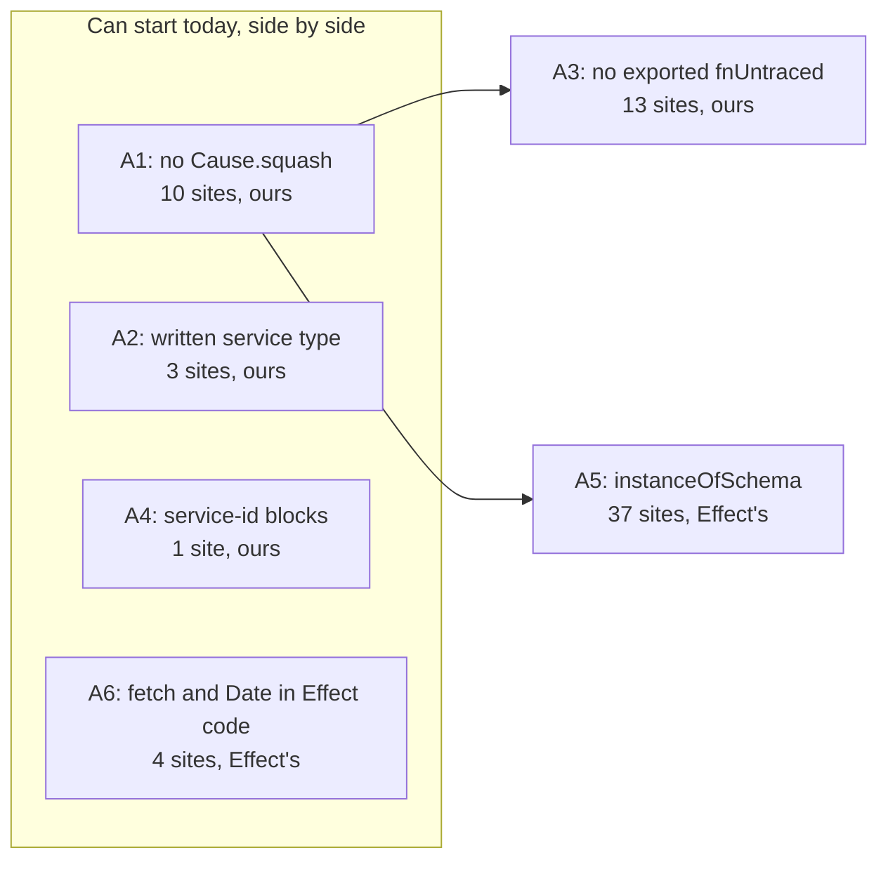

Approved by the lead agent, builds effect-code-guidelines.md (0168); the owner answered its open question on 2026-11-13; body 85334000b907
Plancheck-Version: 3

# Plan A: six small Effect rules, each turned on at zero

Everything here is about `next/` and the repo's lint and type-check config. Today's version is not
changed. Nothing is built. Plan B, [the three big rules](./effect-rules-big.md), is its sibling.



## The answer first

- **Six slices, one per rule.** Each slice is one pull request that fixes every break and turns the
  rule on, so the rule starts at zero. No list file and no `debt:` line is written
  (decision 0168, [pull request 1137](https://github.com/kamp-us/tea-fabrika/pull/1137)).
- **Four can start today:** A1, A2, A4 and A6. They share no product file.
- **Two wait for A1:** A3 and A5. A1 and A5 change the same lines of `runtime/Runner.ts`, and A1 and
  A3 change the same statement of `cloudflare/tail.ts`. After A1 merges, A3 and A5 run side by side.
- **Whose check.** Three are Effect's own, one line each in `tsconfig.base.json`:
  `instanceOfSchema`, `globalFetchInEffect`, `globalDateInEffect`. Four are ours, in
  the lint plugin folder: `no-cause-squash`, `written-service-type`, the exported `fnUntraced` case of
  `effect-functions`, and `service-id`, which exists and only stops being advice.
- **`effectFnOpportunity` and 0252.** The config wins and stays as it is. 0252's line is out of
  date and A3 amends it. The reading is in [A3](#a3-an-exported-effectfnuntraced-is-an-error).

How sure: 85% on the counts, which were made again today on `origin/main` at `9276a9606`. Effect's
three were counted by Effect's own checker, not by grep. 75% on the slice order.

## How the counts were made

```sh
# Ours: one grep each, product files only.
nice -n 19 git grep -n -E '<pattern>' -- next \
  ':!*.test.ts' ':!*.test.tsx' ':!*Test.ts' ':!*.test-support.ts'

# Effect's: its checker, with only the candidate rules on, once per next/ project.
nice -n 19 pnpm exec effect-tsgo diagnostics --format json \
  --project "$PWD/next/packages/libfabrika/tsconfig.json" \
  --lspconfig '{"name":"@effect/language-service","diagnosticSeverity":{"instanceOfSchema":"error","globalFetchInEffect":"error","globalDateInEffect":"error"}}'
```

The checker run takes about 6 seconds a project. It ran on all seven `next/` projects. No model, no
key, no network: $0.

| Slice | Rule | Experiment 282 said | Today | Whose check |
|---|---|---|---|---|
| A1 | no `Cause.squash` | 10 | 10 in 8 product files | ours, new |
| A2 | `written-service-type` | 3 | 3 in 2 product files | ours, new |
| A3 | exported `Effect.fnUntraced` | 13 | 13 in 9 product files | ours, an existing rule extended |
| A4 | `service-id` blocks | 1 | 1 | ours, exists |
| A5 | `instanceOfSchema` | 33 `instanceof` lines | 24 in 11 product files, 13 in 6 test files | Effect's |
| A6 | `globalFetchInEffect`, `globalDateInEffect` | 7 bare `fetch(`, not counted for Date | 3 and 1, in 2 product files | Effect's |

Experiment 282's 33 was a grep for any `instanceof` line. Ten of those lines are `instanceof Error`
or a class from another package, which Effect's check does not flag.

## How others do it

Existing tools first ([0040](../../.decisions/0040-existing-tools-before-hand-written.md)).

| Rule | Tool looked at | Used? | Why, with proof |
|---|---|---|---|
| `instanceOfSchema`, `globalFetchInEffect`, `globalDateInEffect` | [`@effect/tsgo`](https://github.com/Effect-TS/tsgo) 0.63.0, installed | yes | They are its own checks, off by default (`node_modules/@effect/tsgo/schema.json:2627`, `:2602`, `:2582`). Each takes a severity and no other option |
| no `Cause.squash` | oxlint's [`no-restricted-properties`](https://oxc.rs/docs/guide/usage/linter/rules/eslint/no-restricted-properties) | no | The lint runner decides advice by rule code, and this rule's code is already advice for `JSON.parse` (`oxlint-plugins/lint.ts:16`). A second entry would only advise. It also misses `import { squash } from "effect/Cause"`. *2026-11-13: since ticket 930 the runner reads severity, not the rule code, so the first reason no longer holds (0523).* |
| no `Cause.squash` | oxlint's [`no-restricted-imports`](https://oxc.rs/docs/guide/usage/linter/rules/eslint/no-restricted-imports) | no | It can ban a named import, not a member read on a namespace, and all 10 sites read `Cause.squash` |
| `written-service-type` | Effect's checker | no | Its schema has no check for a service type built from `ReturnType`, `Effect.Success` or `typeof`. `serviceNotAsClass` and `leakingRequirements` are on and all three sites pass both |
| exported `fnUntraced` | Effect's `effectFnOpportunity` | no | It is on at `error` and the 13 sites pass. It suggests `Effect.fn` for a plain function. It does not read a function that is already `fnUntraced` |
| `service-id` | Effect's `deterministicKeys` | no | Already settled when the rule was written: it cannot compare an id with its file's path as our rule does (`oxlint-plugins/README.md`, "Decode and service-ID advice") |

oxlint 1.90.0 has no `no-restricted-syntax`, so no selector can stand in for the three rules of ours
(`oxlint-plugins/README.md`, the `next-ledger.json` section).

## The shape

No stored type changes. The shape is config. A sketch, to be checked against oxlint 1.90.0 and
`@effect/tsgo` 0.63.0 before it is built.

```jsonc
// .oxlintrc.json, the existing product block for next/ (the one that holds effect-functions)
"fabrika/no-cause-squash": "error",       // A1
"fabrika/written-service-type": "error",  // A2
"fabrika/effect-functions": "error",      // A3: unchanged line, the rule itself learns one case

// .oxlintrc.json, the ticket 737 block. A4: "warn" becomes "error".
"fabrika/service-id": ["error", { "package": "@kampus/libfabrika", "src": "next/packages/libfabrika/src" }]
```

```jsonc
// tsconfig.base.json, the plugin's overrides
{
  // All of next/, tests too.
  "include": ["next/**/*.ts", "next/**/*.tsx"],
  "options": { "diagnosticSeverity": { "instanceOfSchema": "error" } }             // A5
},
{
  // next/ product code. Tests are left out, as no-wall-clock leaves them out.
  "include": ["next/**/*.ts", "next/**/*.tsx"],
  "exclude": ["<the two test globs, as the block at :97 has them>"],
  "options": { "diagnosticSeverity": { "globalFetchInEffect": "error", "globalDateInEffect": "error" } } // A6
}
```

Both override blocks exist today (`tsconfig.base.json:73` and `:96`). Each slice adds its line to
one of them.

## A1: no `Cause.squash`

E2: a failure is a typed value. `Cause.squash` turns a typed cause into one unknown value, and the
next line then asks what it is.

All 10 sites, under `next/packages/libfabrika/src/`:

- `cloudflare/connection.ts:150`
- `cloudflare/runtime.ts:346`
- `cloudflare/tail.ts:57`
- `cloudflare/tail.ts:82`
- `ledger/internal/ledgerStore.ts:273`
- `runtime/Runner.ts:789`
- `runtime/Runner.ts:1768`
- `telemetry/Sink.ts:157`
- `transport/Answer.ts:62`
- `transport/Connection.ts:178`

The fix, shown once. Before, `next/packages/libfabrika/src/transport/Answer.ts:61-64`:

```ts
if (Exit.isFailure(exit)) {
  if (Schema.is(RateCountFailure)(Cause.squash(exit.cause))) {
    yield* Effect.annotateCurrentSpan(REFUSED, "rate_limited");
  }
```

After, a sketch. `Exit.findErrorOption` is in `node_modules/effect/dist/Exit.d.ts:1294`:

```ts
if (Exit.isFailure(exit)) {
  if (Option.exists(Exit.findErrorOption(exit), Schema.is(RateCountFailure))) {
    yield* Effect.annotateCurrentSpan(REFUSED, "rate_limited");
  }
```

The 10 sites are three kinds:

- **Four ask "is this the rate limit failure":** `connection.ts:150`, `runtime.ts:346`,
  `Answer.ts:62`, `Connection.ts:178`. Each takes the fix above.
- **Four name the class of whatever failed, for a span's `error.type`:** `tail.ts:57`, `tail.ts:82`,
  `ledgerStore.ts:273`, `Sink.ts:157`. A thrown value counts here too, so squash is the right tool.
  They become one helper beside `errorClass` in `telemetry/Trace.ts`, which holds the one call under
  `// oxlint-disable-next-line fabrika/no-cause-squash -- edge: <why>`. Four sites become one edge.
- **Two in the runner:** `Runner.ts:789` reads the typed `ProgramDown` with `Cause.findErrorOption`
  and a thrown value with `Cause.findDefect`. `Runner.ts:1768` takes the first fix with
  `LedgerError`.

The rule's edge cases, each with a test:

1. `Cause.squash(x)` on the `Cause` named import from `effect` fires.
2. The same call on `import * as Cause from "effect/Cause"` fires.
3. `import { squash } from "effect/Cause"` fires at the import.
4. A renamed import, `import { Cause as C } from "effect"`, then `C.squash(x)`, fires.
5. A reference with no call, `xs.map(Cause.squash)`, fires.
6. `Cause["squash"](x)` fires.
7. Another object's `squash`, and a local named `Cause` that is not Effect's, pass.
8. A comment, a string and a type position pass.
9. A line under the edge comment passes, and an edge comment over a line with no squash fails
   through `reportUnusedDisableDirectives`, as it does today.
10. Tests, shared suites and test support are left out: a test reads a failed `Exit` to assert on
    it. 27 uses in 19 test files stay.

What it cannot see: an alias made at run time, such as `const c = Cause; c.squash(x)`.

- **Why ours:** the table above. **Cost:** about 60 lines of rule, its tests, and about 40 changed
  product lines in 9 files. **How sure:** 80%. The doubt is `Runner.ts:789`: its block also handles
  a thrown value, and the builder must keep that path. The runner's existing laws hold it.

## A2: `written-service-type`

E3 and 0095: a service's type is written out, never inferred from its implementation.

All 3 sites:

- `next/packages/libfabrika/src/cloudflare/runtime.ts:928`
- `next/packages/libfabrika/src/cloudflare/runtime.ts:1114`
- `next/packages/libfabrika/src/gateway/Gateway.ts:1693`

The fix, shown once. Before, `next/packages/libfabrika/src/gateway/Gateway.ts:1693-1695`:

```ts
export class Gateway extends Context.Service<Gateway, Effect.Success<ReturnType<typeof make>>>()(
  "@kampus/libfabrika/gateway/Gateway",
) {
```

After, in the shape `next/packages/libfabrika/src/runtime/Runner.ts:262-277` already has. A sketch:
the members are the keys `make` returns at `Gateway.ts:1688-1690` and above, with their types
written out.

```ts
export class Gateway extends Context.Service<
  Gateway,
  {
    readonly append: (input: AppendInput) => Effect.Effect<Appended, GatewayFailure>;
    readonly accept: (input: AcceptInput) => Effect.Effect<Accepted, GatewayFailure>;
    // ...one line per member
  }
>()("@kampus/libfabrika/gateway/Gateway") {
```

The rule's edge cases, each with a test:

1. A second type argument that is, or holds anywhere inside it, `ReturnType<...>`,
   `Effect.Success<...>` or a `typeof` query fires.
2. A written object type, an interface name and a type alias name pass.
3. `Context.Service` reached by a named import, a namespace import and a renamed import are all
   read. `match.ts` already resolves these for `service-id`.
4. A type alias declared in the same file whose body is one of the three fires too, so the break
   cannot hide one line up.
5. An alias imported from another file passes. The rule reads one file.
6. `typeof X.Type` on a schema, the type of a schema's value, passes when it sits inside a member's
   signature. It fires only as the whole service type or as a spread of an implementation.
7. A `Context.Reference` is not read.
8. Tests are left out. Two test-only services in the app's worker usage test infer their type from
   a local value, and a test's stand-in is not a contract file.

- **Why ours:** no shipped check reads this. **Cost:** about 70 lines of rule, its tests, and about
  120 product lines of written types in 2 files. **How sure:** 80%. The doubt: the written type of
  the two Cloudflare services is long, about 45 members between them, and a member typed wrong fails
  `pnpm typecheck`, not lint.
- 0095 already asks for this fix: "`Gateway` and the Cloudflare services get an explicit service
  interface before their layers move." So A2 comes before Plan B's static-layer slice for `gateway/`.

## A3: an exported `Effect.fnUntraced` is an error

0252: an exported function that returns an Effect is `Effect.fn("<piece>.<verb>")`.

All 13 sites, under `next/packages/libfabrika/src/`:

- `cloudflare/platform.ts:16`
- `cloudflare/runtime.ts:301`
- `cloudflare/tail.ts:32`
- `cloudflare/tail.ts:47`
- `cloudflare/tail.ts:75`
- `node/settings/Load.ts:20`
- `processes/Mailbox.ts:96`
- `runtime/IsolateUsage.ts:59`
- `settings/Files.ts:164`
- `settings/Files.ts:184`
- `settings/Snapshot.ts:32`
- `settings/Snapshot.ts:51`
- `settings/Sources.ts:68`

The fix, shown once. Before, `next/packages/libfabrika/src/settings/Files.ts:163-164`:

```ts
/** Refuse a repo that needs a newer fabrika, before anything else in either file is read. */
export const supported = Effect.fnUntraced(function* (repo: Place, version: string) {
```

After. The span name follows 0252: the glossary's word for the piece, then the verb as the function
spells it.

```ts
/** Refuse a repo that needs a newer fabrika, before anything else in either file is read. */
export const supported = Effect.fn("settings.supported")(function* (repo: Place, version: string) {
```

A site with a trailing combinator, `cloudflare/tail.ts:75-83`, keeps it as `Effect.fn`'s second
argument, which is where Effect's own guide puts it (`node_modules/effect/AGENTS.md:80-82`).

**`effectFnOpportunity` against 0252's text.** Read both, and the note behind them:

- 0252 says the check "stays off: its first count on `next/` found 65% false alarms".
- `tsconfig.base.json:80` has it at `error` for all of `next/`, from pull request 958.
- [The tracing note](../direction/effect-fn-for-traced-functions.md) holds the count, and it has two
  runs. With the check's default option, `effectFn: ["span"]`, it found **0 findings**: it speaks
  only for an `Effect.gen` that already ends in `Effect.withSpan`. With the wider options
  `inferred-span` and `suggested-span` it found 17, of which 11 were false: the 65%.
- The note also says the check "becomes an error for `next/` once its false alarms are counted and
  found to be about 0%". 0120's fix order, step 1, then turned on every shipped check with 0 hits.
- Today's run agrees: on, default option, 0 findings in all seven projects.

**So the config wins.** What is on is the narrow default, at 0 hits and 0 false alarms. What 0252
refused is the wide option set, and that stays off. A3 amends 0252's one bullet to say so, and fixes
the same stale line at the end of `oxlint-plugins/README.md`. No new decision: the note and 0120
already decided it. How sure: 90%.

The rule: `fabrika/effect-functions` learns one more case. Its edge cases, each with a test:

1. `export const f = Effect.fnUntraced(...)` fires.
2. `const f = Effect.fnUntraced(...)` with a later `export { f }` or `export { f as g }` fires.
3. `export default Effect.fnUntraced(...)` fires.
4. A member of an exported object literal, `export const api = { f: Effect.fnUntraced(...) }`,
   fires.
5. `Effect.fnUntracedEager` is read the same way.
6. A helper that is not exported passes. So does a function made inside a body and returned as a
   service method: 0252 keeps `fnUntraced` for a per-item function.
7. A named, namespace or renamed import of `Effect` is resolved, as the rule does today.
8. An export in an `internal/` file is held too. 0252 says "exported" and names no folder, and no
   `internal/` file has a hit today.
9. An exported `Effect.fn(function* ...)` with no name passes this rule. Whether that form is
   allowed outside the span sink is 0252's exception and stays review work.
10. Tests stay out, as they are for this rule today.

- **Why ours:** the table above. **Cost:** about 40 lines added to the rule, the new plants in the
  exam's test of it, 13 one-line product changes, and 3 doc lines. One new span per call of 13
  functions; what that costs at run time is not measured (0252 says the same).
  **How sure:** 80%. The doubt was the four usage exports, and the owner answered it: they take a
  named span too ([Open questions](#open-questions)).

## A4: `service-id` blocks

E7: a service id carries its package and its file's path.

The one site: `next/packages/libfabrika/src/runtime/Runner.ts:278`.

Before:

```ts
>()("@kampus/libfabrika/ProgramRunner") {
```

After, the id the rule itself asks for in today's run:

```ts
>()("@kampus/libfabrika/runtime/Runner.ProgramRunner") {
```

The promotion needs a fresh replay with about 0% false alarms (`oxlint-plugins/README.md`, "Decode
and service-ID advice"). Today's replay, `node oxlint-plugins/lint.ts next/packages/libfabrika/src`:
**1 fire, 1 true, 0 false alarms.** The id is a key in memory. It is not saved or sent: a search of
the repo finds the old string only in this file and in three docs.

What changes:

- `Runner.ts:278`, one line.
- `.oxlintrc.json`: `"warn"` becomes `"error"`.
- `oxlint-plugins/lint.ts:17`: `fabrika(service-id)` leaves the advice set.
- `oxlint-plugins/service-id.ts`: the message drops "Advice, does not block".
- `oxlint-plugins/service-id.test.ts:210`: the replay scenario expects 0 fires.
- `oxlint-plugins/decode-guards.test.ts`: its law that a report of only the two advice rules passes
  now holds for `JSON.parse` alone, and a planted bad id must exit 1.

The rule's own edge cases are tested already. A4 adds no case.

- **Cost:** about 10 lines in 6 files. **How sure:** 90%.

## A5: `instanceOfSchema`

E2: a failure is caught by its tag, never by `instanceof`.

All 24 product hits, on 23 lines, under `next/packages/libfabrika/src/`:

- `Id.ts:200`
- `cloudflare/platform.ts:55`
- `cloudflare/runtime.ts:160`, `:164`, `:183`, `:222`, `:977`
- `ledger/internal/ledgerStore.ts:182`
- `processes/ChildrenLedger.ts:156`, `:195`
- `processes/ProgramMailLedger.ts:121`
- `runtime/Execution.ts:101`
- `runtime/Program.ts:419`
- `runtime/RecoveryStore.ts:67`
- `runtime/RepliesSql.ts:71`
- `runtime/Runner.ts:791`, `:798`, `:800`, `:807`, `:1299` (twice), `:1302`, `:1768`, `:1908`

All 13 test hits, under the same folder:

- `cloudflare/error-cause.test.ts:283`
- `node/settings/Load.test.ts:100`
- `processes/ChildrenTest.ts:464`, `:1298`, `:1392`
- `runtime/NemesisTest.ts:111`
- `settings/Files.test.ts:56`, `:132`, `:138`, `:262`, `:337`, `:338`
- `settings/Snapshot.test.ts:431`

The fix, shown once. Before, `next/packages/libfabrika/src/runtime/Runner.ts:1296-1305`:

```ts
const answer = yield* attempt.pipe(
  Effect.map((placed): Result.Result<Appended, string> => Result.succeed(placed)),
  Effect.catchIf(
    (e): e is SigningRefused | NotGranted => e instanceof SigningRefused || e instanceof NotGranted,
    (e) =>
      Effect.succeed<Result.Result<Appended, string>>(
        Result.fail(e instanceof SigningRefused ? e.reason : "not_granted"),
      ),
  ),
);
```

After, the sketch E2's note already gives for these lines:

```ts
const answer = yield* attempt.pipe(
  Effect.map((placed): Result.Result<Appended, string> => Result.succeed(placed)),
  Effect.catchTags({
    SigningRefused: (e) => Effect.succeed(Result.fail(e.reason)),
    NotGranted: () => Effect.succeed(Result.fail("not_granted")),
  }),
);
```

Three kinds of fix cover all 37:

- **Inside `catchIf` or a `while:` on a typed failure:** `catchTags`, `catchTag`, or a `_tag` read.
- **On an unknown value,** as in a `catch:` callback (`Execution.ts:101`, `RepliesSql.ts:71`):
  `Schema.is(ProgramDown)(cause)`, which is what the check's own message asks for.
- **In a test's assertion:** `Schema.is(X)(value)` or a `_tag` read.

The ten `instanceof Error` and outside-class lines stay. The check does not flag them, and E2's note calls an
`instanceof Error` on an unknown value a legal edge.

**Tests are held too.** E2 says "never" and names no exemption, and one override block with no
carve-out is the simpler thing for an agent to copy.

- **Cost:** about 50 changed lines in 17 files, and one config line. **How sure:** 80%. The doubt:
  `Runner.ts:791-807` is rewritten by A1 first, so A5's count there may be lower when it starts.

## A6: `globalFetchInEffect` and `globalDateInEffect`

E1: use what Effect ships. `HttpClient` for a request, `DateTime` and `Clock` for time.

Counted first, as asked. All product hits:

- `globalFetchInEffect`, 3: `next/apps/fabrika/grant.ts:56`, `next/apps/fabrika/grant.ts:107`,
  `next/packages/libfabrika/src/node/dev/dev.ts:134`.
- `globalDateInEffect`, 1: `next/apps/fabrika/grant.ts:82`.

In tests, which stay out: 2 and 9. Experiment 282's "7 bare `fetch(`" counted three methods named
`fetch` and one call of a local function in the app's worker file. None calls the global.

The fix, shown once. Before, `next/apps/fabrika/grant.ts:55-56` and `:82`:

```ts
// oxlint-disable-next-line fabrika/no-promises -- edge: the grant command reads a public target over HTTP
const response = yield* Effect.tryPromise({ try: () => fetch(targetUrl), catch: unreachable });

sentAt: new Date().toISOString(),
```

After, a sketch. `HttpClient` and `FetchHttpClient` are in `effect/http`
(`node_modules/effect/package.json:43`), and `DateTime.now` and `DateTime.formatIso` are in
`node_modules/effect/dist/DateTime.d.ts:842` and `:4254`:

```ts
const client = yield* HttpClient.HttpClient;
const response = yield* client.get(targetUrl).pipe(Effect.mapError(unreachable));

sentAt: DateTime.formatIso(yield* DateTime.now),
```

The command's entry provides `FetchHttpClient.layer` once. Two things leave with the fix: the
`no-promises` edge comment on each `fetch` line, and the last `no-wall-clock` entry for `next/`,
which is `grant.ts:82`.

Two neighbors stay off, with their counts:

- **`globalDate`,** the same check outside a generator: 3 product hits, all `new Date(at)`, which
  formats a time it was given. `no-wall-clock` passes that on purpose.
- **`globalFetch`:** 0 product hits and 11 in tests, which call a real local instance.

One risk to know. `globalDateInEffect` also flags `new Date(at)` inside a generator. No product line
does that today. The fix, when one does, is `DateTime.formatIso(DateTime.makeUnsafe(at))`.

- **Cost:** about 30 changed lines in 2 files, and two config lines. **How sure:** 75%. The doubt:
  `unreachable` and `fail` drop the cause today, and `HttpClient`'s error should ride along as the
  cause. That is E2's `keep-cause` work, and the builder keeps it in this slice only if it is one
  line.

## One value traced through

A new file with a break, after A1 lands. An agent writes this in
`next/packages/libfabrika/src/jobs/Retry.ts`:

```ts
const failure = Cause.squash(exit.cause);
```

1. `pnpm lint` runs oxlint once. The path is `next/` product code, so `fabrika/no-cause-squash` is
   on.
2. The rule resolves `Cause` to Effect's module through the file's imports and sees the member
   `squash`.
3. It reports at the call: use `Cause.findErrorOption`, or mark an edge with its reason.
4. No list file can waive it, and the line has no edge comment. `pnpm lint` exits 1.
5. The agent writes `Exit.findErrorOption(exit)` and matches on the tag. 0 findings.

The same file with `error instanceof LedgerError`, after A5:

1. `pnpm typecheck` runs `tsc` with Effect's plugin patched in.
2. The file matches the `next/**/*.ts` override, where `instanceOfSchema` is `error`.
3. `tsc` fails with the check's message, and CI's `typecheck` job is red.

## Laws

Each rule is a check on the shape of code, so the product law is lint or type. The rule's own laws
are tests of the rule, on generated code through oxlint's `RuleTester`, as the other rules' tests
are.

| Law | Lint, type or test | Generator | Plant |
|---|---|---|---|
| 1. `next/` product code calls `Cause.squash` only under an edge comment | lint | lint | add one call to a passing product file |
| 2. For any generated file, `no-cause-squash` reports exactly the uses of Effect's `squash`, in every spelling of A1's cases 1 to 8 | test | fc.record: an import spelling, a use form and a neighbor that must pass; 100 runs, seed 119120 | resolve only the named import |
| 3. `no-cause-squash` passes a line under its edge comment and is off in tests | test | scenario: one real lint run over one planted file per path kind, since only the real config holds the list | drop the test override |
| 4. A service in `next/` product code has a written type | lint | lint | change one written type to `Effect.Success<typeof make>` |
| 5. For any generated service class, `written-service-type` fires exactly when the type holds one of the three forms, as A2's cases 1 to 7 say | test | fc.record: a service spelling and a type form drawn from passing and failing kinds; 100 runs, seed 119120 | read only the outermost type |
| 6. An exported function in `next/` product code is never `Effect.fnUntraced` | lint | lint | change one exported `Effect.fn` to `fnUntraced` |
| 7. For any generated file, `effect-functions` reports exactly the exported `fnUntraced` functions, in every export form of A3's cases 1 to 8 | test | fc.record: an export form, an import spelling and a private helper beside it; 100 runs, seed 119120 | read only `export const` |
| 8. A wrong service id in libfabrika fails `pnpm lint` | lint | lint | plant a service with a bare id in a libfabrika file |
| 9. Replayed over libfabrika's source, `service-id` finds nothing | test | scenario: the rule over the real tree, which no generator can stand in for | restore the old runner id |
| 10. The lint runner exits 1 on a `service-id` fire and 0 on the remaining advice alone | test | scenario: two real runs of the lint runner over one planted file each | leave the rule in the advice set |
| 11. `instanceof` on a schema class fails the type check anywhere in `next/` | type | type | write `e instanceof LedgerError` in a product file and in a test |
| 12. The global `fetch`, `Date.now()` and `new Date()` inside Effect code fail the type check in `next/` product code | type | type | write each inside an `Effect.gen` in a product file |
| 13. The three Effect checks are set at `error` under the `next/` overrides | test | pinned: the config's own lines, read as JSON, since a rule lost in a merge is silent | delete one of the three lines |

As [0093](../../.decisions/0093-laws-walk-plants-run-once.md) has it, each plant is run once and
recorded, not kept as a test.

## Is it a setting?

A setting is a value in `fabrika.toml`
([0069](../../.decisions/0069-choices-are-settings.md)). None of these is one. They are the repo's
own exam, not a choice a person makes when running fabrika. Each is a line of lint or type-check
config, as every other rule is.

## Files and ownership

The lint plugin folder, the lint config, the type-check config and every test are exam paths, so
the tests step writes them. Product fixes are the build step's.

| Path | Owner | Slice | Product lines expected | What changes |
|---|---|---|---|---|
| `oxlint-plugins/no-cause-squash.ts` | tests | A1 | 60 | new: the rule |
| `oxlint-plugins/no-cause-squash.test.ts` | tests | A1 | tests | new: laws 2 and 3 |
| `oxlint-plugins/written-service-type.ts` | tests | A2 | 70 | new: the rule |
| `oxlint-plugins/written-service-type.test.ts` | tests | A2 | tests | new: law 5 |
| `oxlint-plugins/effect-functions.ts` | tests | A3 | 40 | the exported `fnUntraced` case |
| `next/apps/fabrika/src/exam/effect-functions.test.ts` | tests | A3 | tests | law 7's plants |
| `oxlint-plugins/service-id.ts` `oxlint-plugins/lint.ts` | tests | A4 | 3 | the rule leaves the advice set, and its message says so |
| `oxlint-plugins/service-id.test.ts` `oxlint-plugins/decode-guards.test.ts` | tests | A4 | tests | laws 9 and 10 |
| `oxlint-plugins/index.ts` | tests | A1, A2 | 4 | lists the two new rules |
| `oxlint-plugins/README.md` | tests | A1 to A4 | docs | each rule, the tools looked at, its first-day count; the stale `effectFnOpportunity` line |
| `.oxlintrc.json` | tests | A1, A2, A4 | 3 | the lines in The shape |
| `tsconfig.base.json` | tests | A5, A6 | 3 | the lines in The shape |
| `next/packages/libfabrika/src/cloudflare/error-cause.test.ts` `next/packages/libfabrika/src/node/settings/Load.test.ts` `next/packages/libfabrika/src/processes/ChildrenTest.ts` `next/packages/libfabrika/src/runtime/NemesisTest.ts` `next/packages/libfabrika/src/settings/Files.test.ts` `next/packages/libfabrika/src/settings/Snapshot.test.ts` | tests | A5 | tests | 13 `instanceof` checks become `Schema.is` or a tag read |
| `next/packages/libfabrika/src/telemetry/Trace.ts` `next/packages/libfabrika/src/telemetry/Sink.ts` `next/packages/libfabrika/src/transport/Answer.ts` `next/packages/libfabrika/src/transport/Connection.ts` `next/packages/libfabrika/src/cloudflare/connection.ts` | build | A1 | 20 | squash fixes and the one edge helper |
| `next/packages/libfabrika/src/cloudflare/tail.ts` | build | A1, then A3 | 10 | 2 squash fixes, then 3 exports |
| `next/packages/libfabrika/src/cloudflare/runtime.ts` | build | A1, A2, A3, A5 | 90 | 1 squash fix, 2 written types, 1 export, 5 `instanceof` |
| `next/packages/libfabrika/src/ledger/internal/ledgerStore.ts` | build | A1, then A5 | 4 | 1 squash fix, 1 `instanceof` |
| `next/packages/libfabrika/src/runtime/Runner.ts` | build | A1, A4, then A5 | 30 | 2 squash fixes, the id, 9 `instanceof` |
| `next/packages/libfabrika/src/gateway/Gateway.ts` | build | A2 | 40 | the written service type |
| `next/packages/libfabrika/src/cloudflare/platform.ts` | build | A3, A5 | 3 | 1 export, 1 `instanceof` |
| `next/packages/libfabrika/src/node/settings/Load.ts` `next/packages/libfabrika/src/processes/Mailbox.ts` `next/packages/libfabrika/src/runtime/IsolateUsage.ts` `next/packages/libfabrika/src/settings/Files.ts` `next/packages/libfabrika/src/settings/Snapshot.ts` `next/packages/libfabrika/src/settings/Sources.ts` | build | A3 | 8 | 8 exports become `Effect.fn` |
| `next/packages/libfabrika/src/Id.ts` `next/packages/libfabrika/src/processes/ChildrenLedger.ts` `next/packages/libfabrika/src/processes/ProgramMailLedger.ts` `next/packages/libfabrika/src/runtime/Execution.ts` `next/packages/libfabrika/src/runtime/Program.ts` `next/packages/libfabrika/src/runtime/RecoveryStore.ts` `next/packages/libfabrika/src/runtime/RepliesSql.ts` | build | A5 | 12 | 8 `instanceof` fixes |
| `next/apps/fabrika/grant.ts` `next/packages/libfabrika/src/node/dev/dev.ts` | build | A6 | 30 | `HttpClient` and `DateTime` |
| `.decisions/0252-effect-fn-for-exported-effects.md` `docs/direction/effect-fn-for-traced-functions.md` | build | A3 | docs | the `effectFnOpportunity` line: on with its default option, the wide options stay off |
| `docs/direction/effect-code-guidelines.md` `docs/plan/tier-1-detail.md` | build | A4 | docs | the runner's id in three code blocks |

No screenshots: no window changes.

## Slice order

- **Today, side by side: A1, A2, A4, A6.** They share no product file except these, at far lines:
  `cloudflare/runtime.ts` (A1 at `:346`, A2 at `:928` and `:1114`) and `runtime/Runner.ts` (A1 at
  `:789` and `:1768`, A4 at `:278`). Git merges those without help.
- **Shared config, one line each.** A1, A2 and A4 each add or change a line in `.oxlintrc.json`, and
  A1 and A2 a row in `oxlint-plugins/index.ts`. The second to merge rebases a one-line conflict.
  That is the price of side by side, and it is small.
- **After A1: A3 and A5, side by side.** A3 needs A1 for `cloudflare/tail.ts:75-83`, one statement
  both change. A5 needs A1 for `runtime/Runner.ts:789-807` and `:1768`, the same lines. A3 and A5
  meet only at far lines of `cloudflare/platform.ts` and `cloudflare/runtime.ts`, and A5 and A6 at
  one line each of `tsconfig.base.json`.
- **A2 before Plan B's `gateway/` static-layer slice,** as 0095 asks.

## What this records

Nothing at run time: a lint rule keeps no data. Three facts are written down the day they exist.

- **Each rule's first-day count and its false alarms,** in `oxlint-plugins/README.md`, as every
  rule there has. For the three Effect checks, the count goes in the pull request.
- **The plants' results,** in each slice's tests field row (0093).
- **Why `effectFnOpportunity` is on,** in 0252 and its note, so the next reader does not find a
  config that seems to contradict a decision.

What is lost if not recorded now: the test hits A6 left out (2 and 9). If tests are held later, that
count is the starting point, so it is in this plan.

## Size

Sized in files and lines. 75% sure of the line counts.

1. **A1, no `Cause.squash`.** 10 sites, 9 product files, about 100 lines with the rule.
2. **A2, `written-service-type`.** 3 sites, 2 product files, about 190 lines with the rule.
3. **A3, exported `fnUntraced`.** 13 sites, 9 product files, about 55 lines with the rule.
4. **A4, `service-id` blocks.** 1 site, about 10 lines.
5. **A5, `instanceOfSchema`.** 37 sites, 17 files, about 50 lines.
6. **A6, fetch and Date.** 4 sites, 2 files, about 30 lines.

The budget is for all six slices: tests, build and review for each, plus one send-back for each of
A1, A2, A3 and A5. Priced from the list-price medians in `field/runs.jsonl` since 2026-11-09
(tests $1.14, build $1.24, review $1.15).

Estimate: 22 steps, $28

## What this cannot tell us

- **False alarms of the three new rules of ours.** They do not exist yet. Each tests step replays
  its rule on the whole tree and reads every fire before the rule blocks.
- **Whether `HttpClient` fits `dev.ts`'s private runtime socket.** The call is plain HTTP today.
  The builder checks it, and if it does not fit, that line becomes a marked edge with its reason.
- **What 13 new spans cost at run time.** 0252 leaves this unmeasured too.
- **Whether the counts hold on the day a slice starts.** Agents add code daily. Each slice counts
  again first, with the commands above.
- **Whether a function with a signature on several lines returns an Effect with no `fn` at all.**
  `effectFnOpportunity` at its default option does not look, and A3 does not either.

## Open questions

None.

One question was put to the owner and answered on 2026-11-13.

`cloudflare/tail.ts`'s three exports and `runtime/IsolateUsage.ts`'s `record` get a named span like
every other export. They carry usage rows toward the span store, but none of them is the sink, and a
span per tail batch is cheap. 0252's span sink exception stays as narrow as it is written, so A3
widens nothing there.
