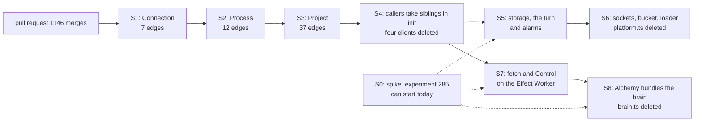

Approved by the lead agent, builds 0041 and 0042; the owner answered its open question on 2026-11-13; the lead amended its files table on 2026-11-13, twice; body 655541285be2
Plancheck-Version: 3

# Ticket 502: the rest of the Alchemy port

Everything here is about `next/`. Today's version is not changed. Nothing is built. This plan
builds [0041](../../.decisions/0041-object-classes-are-effect-objects.md), with its amendments, and
the rows of [0042](../../.decisions/0042-platform-pieces-go-through-alchemy.md) that move with it.
[0181](../../.decisions/0181-the-alchemy-port-keeps-a-slot.md) gives it a slot.



## The answer first

- **Two of 0041's eight pull requests are done.** PR 1, the laws first
  ([pull request 746](https://github.com/kamp-us/tea-fabrika/pull/746)), and PR 2, the host Worker
  and `RecordPart` ([pull request 763](https://github.com/kamp-us/tea-fabrika/pull/763)).
  [Pull request 738](https://github.com/kamp-us/tea-fabrika/pull/738) only amended 0041 and 0042.
- **Six are left, cut here into nine slices.** One spike and eight product slices. The old PR 7
  becomes S7 and S8, and S6 is new: the three small bindings 0042 lists that no object slice owns.
- **One can start today: S0, the spike.** It lives on its own branch and meets nobody.
- **The eight product slices start when pull request 1146 merges.** It changes or adds 33 files
  where the port works, `brain.ts` and `cloudflare/runtime.ts` among them. It is finished work waiting on one
  check run, so it lands first and S1 starts from the main it leaves.
- **What is left on main today,** at `5c7240025`: four plain classes and one plain default `fetch`
  in `brain.ts` with 58 edge lines, 60 Promise edges in `cloudflare/platform.ts`, 62 lines that
  name a raw platform type in 9 files, and `bundle: false` in the stack.
- **The object slices change the shell only.** Each service keeps its code and its laws, as
  `RecordPart` did. The storage turn and the raw state move later, in S5 and S6.
- **The one question for the owner is answered.** Both instances keep the same bytes from one
  build; the answer is in [Decided here](#decided-here). It holds only the last slice.

How sure: 90% on the counts, made today with the commands below. 75% on the slice order. 55% that
S8 lands as 0041 wrote it; the owner's answer under [Decided here](#decided-here) says what lands
if it cannot.

## What is done and what is left

0041 names "PR 7 and PR 8" and no full list. The first plan for this ticket was a file in a
step's working folder and is not in git (see [Findings](#findings)). This list is rebuilt from the
three pull requests, 0041, 0042 and [experiment 248](../../experiments/248-effect-object-spike.md).

| 0041's pull request | What it is | State | Here |
|---|---|---|---|
| PR 1 | The recovery laws drive the services, not the classes | merged 2026-11-10, pull request 746 | done |
| PR 2 | `Brain` as an Effect Worker, `RecordPart` through the bridge, `reach` | merged 2026-11-11, pull request 763 | done |
| PR 3 | The connection object, then named `Gateway` | not started | S1 |
| PR 4 and PR 5 | `Process` and `Project` | not started | S2, S3 |
| PR 6 | Callers use typed stubs through `reach`; the hand-written clients go | not started | S4 |
| PR 7 | The default `fetch` and `Control` move; then the stack drops `bundle: false` | not started | S7, S8 |
| PR 8 | Storage through Alchemy's `state.storage`, a plain step inside | not started | S5 |
| none | Sockets, the bucket and the loader's caller side, from 0042's table | not started | S6 |

## How the counts were made

On `origin/main` at `5c7240025`, product files only. No model, no key, no network: $0.

```sh
P=':!*.test.ts :!*.test.tsx :!*Test.ts :!*.test-support.ts'
# Plain classes, direct imports, edges and static members.
nice -n 19 git grep -n -E 'extends (DurableObject<|WorkerEntrypoint)' -- next $P
nice -n 19 git grep -n -E 'from "cloudflare:' -- next $P
nice -n 19 git grep -c 'fabrika/no-effect-run-outside-edge' -- next $P
nice -n 19 git grep -c 'fabrika/no-promises' -- next $P
nice -n 19 git grep -n 'static make' -- next $P
# Lines that name a raw platform type. Comments and strings count, so read each hit.
nice -n 19 rg -c -w -e 'DurableObjectState|DurableObjectStorage|DurableObjectNamespace|R2Bucket|R2Object|WorkerLoader|WebSocketPair|WebSocketRequestResponsePair|DurableObjectBranded|WorkerEntrypointBranded|WebSocket' \
  next/apps/fabrika/src next/packages/libfabrika/src/cloudflare \
  -g '*.ts' -g '!*.test.ts' -g '!*Test.ts' -g '!*.test-support.ts' -g '!**/exam/**'
```

What is left, object by object. Paths are under `next/`: `app/` is `apps/fabrika/src/` and `lib/`
is `packages/libfabrika/src/cloudflare/`.

| Piece | Where | Edge lines | Its client in `lib/platform.ts` | Slice |
|---|---|---|---|---|
| `Project`, a plain class | `app/brain.ts:27` | 37 | `ProjectClient`, `:67`, 37 Promise edges | S3, S4 |
| `Process`, a plain class | `app/brain.ts:218` | 12, the `alarm` at `:261` and the `abort` at `:281` among them | `ProcessClient`, `:188`, 11 | S2, S4 |
| `Connection`, a plain class | `app/brain.ts:286` | 7, three of them socket events | `GatewayClient`, `:237`, 4 | S1, S4 |
| `Control`, a plain entrypoint class | `app/brain.ts:343` | 1 | none | S7 |
| The Worker's default `fetch` | `app/brain.ts:351` | 1 | none | S7 |
| `RecordPart` on raw state | `lib/record.ts:89` | 0 | `RecordClient`, `:258`, 0 | S5 |
| The storage turn, `transactionSync` | `lib/CloudflareSql.ts:5` | 0 | `StorageClient`, `:274`, 6 | S5 |
| Sockets: `WebSocketPair` and the auto-response pair | `lib/connection.ts:245`, `:248` | 0 | none | S6 |
| The bucket | `lib/runtime.ts:97`, `:302`, `:320`, `:325` | 0 | `BucketClient`, `:305`, 2 | S6 |
| The loader, caller side | `lib/index.ts:10` to `:24`, `:51` | 1, and 7 in `runtime/Execution.ts` | none | S6 |
| The `cloudflare:workers` import and the bridge lines | `app/brain.ts:20`, `:325` to `:341` | 0 | none | S8 |
| `bundle: false` | `apps/fabrika/alchemy.run.ts:40` | 0 | none | S8 |

More counts, so a slice can check itself:

- **Raw type lines, 62 in 9 files:** `lib/runtime.ts` 17, `lib/connection.ts` 13, `lib/record.ts`
  7, `app/brain.ts` 6, `lib/index.ts` 6, `lib/platform.ts` 6, `lib/bindings.ts` 4,
  `app/runtime.ts` 2, `lib/CloudflareSql.ts` 1.
- **Namespace lookups, 7 lines:** `lib/runtime.ts:141`, `:145`, `:148`, `:420`, `:586`, `:621` and
  `lib/fetch.ts:57`.
- **Not in this plan:** `ProgramBox` at `lib/box.ts:47` with its import at `:1` and its 8 edges.
  0041 says it keeps its own ticket. Seven test files mock `cloudflare:workers` only because they
  load `box.ts`; they go with it.
- **Not in this plan:** 0042's three gaps on the laptop side (the memory sample by `ps`, the tests
  that kill the runtime, the control socket's plain `fetch`). Each keeps 0042's rule.

## How others do it

- **Alchemy, the maker.** The installed `@alchemy.run/cloudflare` is 2.0.0-beta.85. Its
  `src/Workers/DurableObject.ts` documents the modular form ("Modular Durable Objects"), the sibling
  rule ("Using `.from(Self)` Inside the Host", the form 0041's amendment took), the three socket
  slots ("WebSocket Hibernation"), the alarm slot and `state.abort` ("Aborting a Durable Object").
  `src/Workers/Worker.ts` documents an Effect `fetch` ("Effect Workers", "Worker Layer"),
  `yield* ctx.props` ("Self Entrypoints & ctx.props") and build plugins: "Input plugins run before
  Alchemy's plugins" (`Worker.ts:972`). Read, not run, unless a line below says ran.
- **Alchemy's own decisions and patterns:** none found in the installed package, which ships
  `src/`, `lib/` and a README. The local source checkout is at beta.77, older than the installed
  one, so nothing here is taken from it.
- **phoenix,** which moved first: its decisions 0028 and 0032 and its pattern doc, all linked from
  0041. Its per-call sibling rule failed when run here and is replaced (0041, Amendments).
- **OTP.** A `gen_server` keeps its callback module, the shell, apart from the logic it calls.
  That is the thin class of [an object class stays thin](../direction/object-classes-stay-thin.md).
- **Effect.** A service is a contract and a Layer in sibling files
  ([0095](../../.decisions/0095-a-service-file-holds-only-its-contract.md)). An object's Layer
  follows it: `ConnectionObject.layer(...)`, read through its module.

Existing tools first ([0040](../../.decisions/0040-existing-tools-before-hand-written.md)). The
first plan asked for a hand-written lint rule against a bare sibling lookup in a method. It is not
needed: the type checker already refuses it. A method that yields a sibling needs that sibling,
and a contract whose methods need nothing does not accept it (experiment 248, question 5). So that
law is a type law, and no rule is written. The import ban is oxlint's own
[`no-restricted-imports`](https://oxc.rs/docs/guide/usage/linter/rules/eslint/no-restricted-imports).

## The shape

The fix, shown once. Before, `next/apps/fabrika/src/brain.ts:286-323`, cut to three of its seven
methods:

```ts
export class Connection extends DurableObject<Env> {
  readonly runtime = connectionRuntime(this.ctx, this.env);

  fetch(request: Request) {
    // oxlint-disable-next-line fabrika/no-effect-run-outside-edge -- edge: a Worker fetch returns a Promise
    return this.runtime.runPromise(ConnectionService.use((g) => g.fetch(request)));
  }

  webSocketMessage(ws: WebSocket, text: string | ArrayBuffer) {
    // oxlint-disable-next-line fabrika/no-effect-run-outside-edge -- edge: the WebSocket event enters Effect
    return this.runtime.runPromise(ConnectionService.use((g) => g.message(ws, text)));
  }

  ring(stream: string, rev: number) {
    // oxlint-disable-next-line fabrika/no-effect-run-outside-edge -- edge: Durable Object RPC returns a Promise
    return this.runtime.runPromise(ConnectionService.use((g) => g.ring(stream, rev)));
  }
}
```

After. The shape is the one `RecordPart` has on main at
`next/packages/libfabrika/src/cloudflare/record.ts:73-98`. A sketch for `Connection`, not built and
not type checked:

```ts
// cloudflare/objects.ts: the contract, written out. Today it is the Promise type ConnectionBinding.
export type ConnectionShape = {
  readonly fetch: HttpEffect<ObjectState | RuntimeContext>; // Alchemy's request slot
  readonly webSocketMessage: (socket: Cloudflare.WebSocket, text: string | ArrayBuffer) => Effect.Effect<void>;
  readonly webSocketClose: (socket: Cloudflare.WebSocket) => Effect.Effect<void>;
  readonly webSocketError: (socket: Cloudflare.WebSocket) => Effect.Effect<void>;
  readonly ring: (stream: string, rev: number) => Effect.Effect<void, LedgerError>;
  readonly notify: (client: string, news: unknown) => Effect.Effect<void, LedgerError>;
  readonly probe: (session: string) => Effect.Effect<number | null, LedgerError>;
};

// cloudflare/ConnectionObject.ts: the Layer, a sibling file (0095). It decides nothing.
export const layer = (options: ConnectionOptions) =>
  Connection.make(
    Effect.gen(function* () {
      const state = yield* ObjectState; // outer: what the platform gives
      const env = yield* WorkerEnvironment;
      // oxlint-disable-next-line fabrika/no-type-assertions -- edge: raw state until S5 and S6; not reported, 0042 amendment 2026-11-09
      const raw = state.raw as unknown as DurableObjectState;
      // Built once for this instance, on first use. A bad INSTANCE fails each call, as on main.
      const service = yield* Effect.cached(serviceOf(connectionLayer, raw, env, options));

      return Effect.succeed({
        fetch: handed(service, (g) => g.fetch), // S0 runs this line first: raw Request in, raw Response out
        webSocketMessage: (socket, text) => service.pipe(Effect.flatMap((g) => g.message(socket.ws, text))),
        webSocketClose: (socket) => service.pipe(Effect.flatMap((g) => g.close(socket.ws))),
        webSocketError: (socket) => service.pipe(Effect.flatMap((g) => g.close(socket.ws))),
        ring: (stream, rev) => service.pipe(Effect.flatMap((g) => g.ring(stream, rev))),
        notify: (client, news) => service.pipe(Effect.flatMap((g) => g.notify(client, news))),
        probe: (session) => service.pipe(Effect.flatMap((g) => g.probe(session))),
      } satisfies ConnectionShape);
    }),
  );

// apps/fabrika/src/brain.ts: one line, until S8 deletes the file.
export class Connection extends Bridge("Connection") {}
```

`serviceOf` and `handed` are sketch names for two small plain helpers, checked against the
glossary in S1. `socket.ws` is the raw socket inside Alchemy's wrapper (`Workers/WebSocket.ts:25`),
so the service's map keyed by socket keeps working when each event brings a new wrapper.

What each slice changes in that picture:

- **S1 to S3, one object each.** The plain class goes. The contract is written out as Effects. The
  Layer is a new sibling file. `brain.ts` exports one bridge line. The stack binds the class under
  its own name, because Alchemy finds a hosted class at `env[<class name>]`
  (`Workers/DurableObject.ts:1412`); the old upper-case binding stays until S4. The `Brain`
  contract at `cloudflare/objects.ts:28` names the object. The object's client in `platform.ts`
  keeps its name and loses its edges: each method becomes a call on `makeRpcStub`, wrapped in
  `reach`, the way `recordStub` is built at `cloudflare/runtime.ts:148`.
- **S4, callers.** An object takes each sibling once, in its Layer's init, with
  `Sibling.from(Brain)`. The four object clients and the Promise types in `cloudflare/bindings.ts`
  go. The upper-case object bindings leave the stack.
- **S5, storage.** One change of contract: the turn in `Sql.ts` returns an Effect.

  ```ts
  // cloudflare/CloudflareSql.ts today
  transaction: (step) => storage.transactionSync(step),
  // after, a sketch: the step stays a plain function (0050), and no raw handle is needed
  transaction: (step) => storage.transaction(Effect.sync(step)),
  ```

  Its 19 call sites in 12 product files take a `yield*`. The key and alarm calls move to Alchemy's
  `state.storage`, so `StorageClient` goes. `record.ts` loses its raw state at `:89`.
- **S6, the last raw types.** The connection service accepts a socket with `Cloudflare.upgrade()`
  and reads sockets from Alchemy's state. The bucket and the loader are taken in init as Alchemy's
  services. The `Env` interface at `cloudflare/runtime.ts:91` and `platform.ts` are deleted.
- **S7, the Worker.** `fetch` is an Effect that `Brain.make` returns, and `Control` is a branch of
  it (see [Decided here](#decided-here)). `brain.ts` reaches it through `makeWorkerBridge`, as it
  already reaches the tail listener at `:341`. The stack still runs our built file.
- **S8, the bundle.** The stack drops `bundle: false`, Alchemy bundles `objects.ts` with our
  plugins handed in as build input, and `brain.ts` is deleted.

## Decided here

Each is a choice a decided note already answers, so it is not a question. The first is the
owner's own answer.

- **Both instances still get the same bytes from one build, once Alchemy bundles the brain (the
  owner's answer of 2026-11-13).** 0041's amendment has Alchemy bundle the brain at the end, while
  the Tier 1 detail serves the brain "byte for byte on both instances" and a law holds "no
  rebundle" today. The build's hash is in every door hello and every loaded
  program's id, so two bundles of one source would be two builds. S8 lands only if S0 shows one
  Alchemy bundle that both instances take. If it cannot, `bundle: false` stays as one marked edge,
  and the rest of S8 still lands. The cost: 0041's end state may be one line short. S0's third
  question settles which way it goes.

- **`Control` and the default `fetch` move, in this port.** 0041's second amendment and 0042's
  amendment of 2026-11-10 decide it. 0181 asked this plan to bring it to the owner only if no note
  answered it; these two do.
- **`Control` is a branch of the one Effect `fetch`, if S0's run shows the rule below.** 0041 says
  the plan picks between a branch and a small Worker of its own, after a spike of both. The rule
  for picking, written before the run: the branch is taken only when no request from outside can
  carry `props`, shown by a run. If any can, `Control` is its own Worker, which workerd never
  routes a public request to. The branch keeps both gates it has today: a token in `ctx.props`,
  and the same token as the bearer. How sure the branch wins: 70%. The doubt is that nobody here
  has run `ctx.props` on an Effect Worker; S0 settles it.
- **Calls between objects use the plain typed stub, with `reach`.** Not `Cloudflare.RpcDurableObject`
  with a schema. 0041's first amendment ran the plain stub, and `reach` with its laws is on main
  from pull request 763: a typed failure crosses as it is, and only `RpcCallError` becomes
  `unreachable`, with its cause kept.
- **No object is merged into another.** The four objects are the ones
  [the five layers](../direction/a-local-first-sync-engine.md) names. phoenix merged its objects
  later for its own reasons; nothing here asks for it.
- **The refusal unions stay data.** `SigningReply`, `CommitReply`, `ProcessReplies`, `ChildReplies`
  and `MailReplies` in `cloudflare/bindings.ts` carry a refusal as reply data. A Schema class
  instance does not cross a stub (experiment 248), and the control socket reads the same JSON. So
  they stay, and no wire shape changes in this port.
- **No patch is planned.** Each form above exists in the installed source. If a run finds a real
  gap, the slice patches it locally and files the issue that day, after the read
  [0054](../../.decisions/0054-read-upstream-before-patching-it.md) asks for. The auto-response
  pair in S6 is one of 0042's six listed gaps: it stays one marked edge line, with no issue.
- **An object's Layer is a sibling file read through its module** (0095): `ConnectionObject.layer`,
  `ProcessObject.layer`, `ProjectObject.layer`. `RecordPartLive` takes the same form in S5, which
  rewrites that file anyway.
- **States** ([0037](../../.decisions/0037-implicit-state-machines-made-explicit.md)): the shells
  add none. A shell builds its service once and hands calls to it. The saved wake and the alarm
  stay in the Process service, untouched.
- **Sleep** ([0105](../../.decisions/0105-a-durable-object-never-stays-awake-on-its-own.md)): a
  Layer starts no timer and no fiber that waits. The alarm slot's type has no failure, so a failed
  alarm dies as a defect and the platform retries it, as a rejected Promise does today.
- **Scope** ([0061](../../.decisions/0061-resources-are-acquired-in-a-scope.md)): the service is
  built in the instance's scope. The `ManagedRuntime` each class holds today goes with the class.
- **A browser as a client:** not touched. These are calls inside the brain.
- **S5 changes the turn for every store in one pull request.** 0050 decides the route, and
  [0099](../../.decisions/0099-no-number-caps-a-pull-request.md) decides the size: a slice is cut by
  what works on its own, never to fit a count. The `Sql` contract has one turn, and two shapes of
  it side by side would be a port inside the port. The cost is the widest diff of the nine, across
  six modules that primitives lanes also change, so the lead counts the open lanes in those files
  on the day and holds merges to them for S5's last check run.
- **`ProgramBox` stays out of this port.** 0041 leaves it out with its own ticket, and 0042 says
  Alchemy has no form for a named entrypoint class. A loaded program is built by our program build
  and runs with no Alchemy stack, so it needs its own design. The cost: when S8 lands, "no plain
  platform class in the brain" is true and "none in `next/`" is not. One `cloudflare:workers`
  import, 8 edges and 7 test mocks stay until that ticket.

## What 0041's unknowns still owe

| 0041's unknown | Answer today | Who settles what is left |
|---|---|---|
| Can Alchemy's bundler carry our compiler plugin and program table | not run; the build input takes plugins, read at `Worker.ts:972` | S0, then S8 |
| A per-call sibling lookup | answered: it fails; `.from(Host)` in init ran | done |
| Our alarm use beside the bridge's own alarm pass | ran on a probe object only | S2, on the real `Process` |
| The hibernation laws with a new wrapper per event | ran on a probe object only | S1, on the real `Connection` |
| `RpcCallError` in the stub's type | answered: hidden; `reach` adds it | done |
| The local instance and the exam twin | ran, pass; the twin now checks class-name bindings | done |
| A real deploy, where the host binds its own objects | not run | the cloud deploy's own row, not this plan |
| A type check of the `.from(Host)` shape | passes on the probe objects on main | S4, on the real objects |
| An Effect `fetch` and `ctx.props` | not run | S0 |
| The ledger's laws on the Effect `transaction` | 8 object laws and the interleave law ran (experiment 249) | S0 for the rest, then S5 |

## One value traced through

A new entry rings a waiting client. Today:

1. `Project`'s service calls `GatewayClient.make(env.CONNECTION.getByName(to)).ring(stream, rev)`
   (`cloudflare/runtime.ts:420`).
2. The client wraps a Promise: `Effect.tryPromise({ try: () => stub.ring(...), catch: unreachable })`.
   Any failure becomes `LedgerError` `unreachable`.
3. workerd calls `Connection.ring` in `brain.ts:309`, which runs the service's Effect as a Promise
   under an edge comment.

After S1, with `Project` still plain:

1. The same line in `runtime.ts` runs. `GatewayClient.ring` is now `makeRpcStub(stub).ring(...)`
   inside `reach`.
2. workerd calls the bridge class. Alchemy's bridge finds `ConnectionObject.layer`'s method and
   runs its Effect. This is the one place a Promise is made.
3. A typed `LedgerError` from the service crosses as itself. A lost object comes back as
   `RpcCallError`, and `reach` turns it into `unreachable` with that error as its cause.

After S4:

1. `ProjectObject.layer`'s init holds `const connections = yield* Connection.from(Brain)`.
2. The service calls `connections.getByName(to).ring(stream, rev)`. No client class, no `env`.
3. Steps 2 and 3 above, unchanged.

## Laws

Ask of each: lint, type or test? A law that needs the real local runtime is host-only
([0178](../../.decisions/0178-host-only-laws-run-first.md)). Laws 2, 4, 5, 9, 10, 12 and 13 are:
they start workerd through Alchemy, so they run outside a step's box, before the first review. On
the owner's Mac they wait for the lead's read of every line that signals a process and for the
owner's yes. The scenarios that stop the runtime by its process id are in the app's `brain-life`
and instance tests today; no slice adds one.

Ported first, in each slice's tests step, before the object changes shape: the exam entry in the
app's instance-records test. It subclasses `Project`, `Process`, `Connection` and `Control` from
the built file to look inside them and to hold a `msg`. The tests step rewrites the part for the
slice's object so it holds for the plain class and for the bridge class alike.

| Law | Lint, type or test | Generator | Plant |
|---|---|---|---|
| 1. An object's Layer returns every method of its contract, and no method needs a service | type | type | delete one method; yield a sibling inside a method |
| 2. Every wire scenario that reaches the object passes unchanged on the bridge class | test | scenario: the real local instance, since only workerd runs a bridge class | S1: drop the `webSocketClose` slot. S2: drop the `alarm` slot. S3: hand `processExit` to `exit` |
| 3. For any bad instance setting, the helper that builds a shell's service fails each call with its typed error, never dies at construction and never falls back | test | fc.oneof: broken JSON, a missing field and an extra field; 100 runs, seed 119120 | build the service eagerly in the outer Effect |
| 4. An idle ported object sleeps and wakes as a new instance with its saved state | test | scenario: the sleep scenario in the instance-records test, since only the platform evicts | fork a fiber that sleeps in the Layer |
| 5. A home written by the build before a slice opens under the build after it, with the same entries, process table and waits | test | vector: one saved home from a real run of main's build, since only an older build can write one | bind the class under another class name |
| 6. For any call between two objects and any failure the callee lists, the caller sees that failure; a transport failure is `unreachable` with its cause | test | fc.record: a method, a listed failure and a transport failure; 100 runs, seed 119120 | map every failure to `unreachable` |
| 7. A sibling is taken in init: no service in `cloudflare/` reads a namespace from `env` | type | type | read `env.CONNECTION` in a service after S6 deleted `Env` |
| 8. A ledger step that returns an Effect is refused by `transaction` | type | type | return `Effect.succeed(1)` from a step |
| 9. The ledger's and the stores' shared suites pass on the object's turn, six turns at once included | test | scenario: the suites' own drivers in the real local instance, since a quiet object hides the hang experiment 249 found | pass an Effect body with a timer to the turn |
| 10. A saved alarm fires once, a deleted one never, and a failed one is retried | test | scenario: the alarm laws and the scheduled-job scenario on the real `Process`, since only the platform fires an alarm | catch the alarm's failure and answer done |
| 11. For any request with no `props`, no control method is reached, whatever its bearer and path | test | fc.record: a method, a path, headers and a body; 100 runs, seed 119120 | read the token from the bearer alone |
| 12. A request through a binding that carries the token reaches control, and one from the instance's public port never does | test | scenario: two real requests to the local instance, since only workerd attaches `props` | drop the bearer check |
| 13. The stack's brain is the bundle Alchemy makes, one file, and two builds of one source give the same bytes | test | scenario: two real builds, since only the real bundler can differ | add a build time to the bundle |
| 14. No product file in the app's `src/` imports `cloudflare:*` | lint | lint | import `DurableObject` from `cloudflare:workers` in a product file |
| 15. The twin still finds every object the stack binds, by its class name | test | fc.record: binding names, a repeated key and a spread, as the twin's laws have them; default runs | skip a binding whose key is the class name |

As [0093](../../.decisions/0093-laws-walk-plants-run-once.md) has it, each plant is run once and
recorded, not kept as a test. Law 3 runs on Node: the helper is plain code, so the mutation run
reaches it. Law 11 runs on Node too, on the plain `control` function with `props` passed in.

## Is it a setting?

A setting is a value in `fabrika.toml` ([0069](../../.decisions/0069-choices-are-settings.md)).
Each new choice was asked:

- **`Control` as a branch or its own Worker:** no. It is how the brain is built, not a choice a
  person makes when running fabrika.
- **Who bundles the brain:** no. 0041 decides it.
- **The order of objects:** no. It is this plan's.
- **The record cap and the instance's other limits:** already settings, read as before.

So the port adds no setting.

## What this records

No ledger entry, span or stored row changes shape. Four facts exist only now, so they are written
down now.

- **What a call through the bridge costs.** Today a plain class and a bridge class run side by
  side, so both can be timed in one run. After S3 no plain object is left to compare with.
  Experiment 248 measured start time only. S0 times 1,000 calls each way and writes the medians
  in its write-up.
- **The built file's size and the instance's start time, before and after each slice.** Experiment
  248 saw 1.50 MB go to 3.0 MB in two files. Pull request 763 kept one file. Each slice's pull
  request gives both numbers, three runs each.
- **Which failure crossed.** Today `unreachable` keeps the thrown class only inside a message
  string (`platform.ts:45`). After S1, `reach` keeps the error itself as `cause`. S4 deletes
  `rejected`, the helper that parses the string back, only once a span's error class is read from
  the cause. A class dropped here is gone from every later span.
- **That stored objects survived.** Law 5 writes down that a home from before a slice opens after
  it. A class or binding name changed by mistake loses every saved ledger on that laptop, and
  nothing else would say so.

What is lost if not recorded now: the first fact. The others can be made again from git.

## Files and ownership

Tests, shared suites, test support, the exam folder, the lint config and saved fixtures are exam
paths, so the tests step writes them. Product files are the build step's. S0 writes only its
write-up to main; its code stays on its branch
([0027](../../.decisions/0027-experiment-results-live-in-a-private-archive.md)).

| Path | Owner | Slice | Product lines expected | What changes |
|---|---|---|---|---|
| `experiments/285-alchemy-port-spike.md` `experiments/README.md` | build | S0 | docs | the write-up and its index row |
| `next/apps/fabrika/src/instance-records.test.ts` | tests | S1, S2, S3, S7 | tests | the exam entry for the slice's object, ported first; laws 2 and 4 |
| `next/apps/fabrika/src/instance-wire.test.ts` | tests | S1, S7 | tests | law 2, unchanged cases; law 12 |
| `next/apps/fabrika/src/port-home.laws.test.ts` `fixtures/next/port-home` | tests | S1, then S2, S3, S5, S8 | tests | new: law 5 and its saved home |
| `next/apps/fabrika/src/port-home.test-support.ts` `next/apps/fabrika/src/port-home-guard.test.ts` | tests | S1 | tests | new: the writer of law 5's home refuses a home that holds an absolute path under the person's home folder, the temp folder or the repo root, sqlite cells included, and its law (the lead's amendment of 2026-11-13) |
| `next/packages/libfabrika/src/telemetry/Sink.test.ts` `next/packages/libfabrika/src/node/dev/supervision-spans.test.ts` | tests | S1 | tests | [0186](../../.decisions/0186-stored-stack-frames-name-no-folder.md)'s laws: no stored frame names a folder, nothing else is lost, and the supervision law reads each frame by its name, file name, line and column (the lead's amendment of 2026-11-13; the same laws as pull request 1012) |
| `next/packages/libfabrika/src/cloudflare/ObjectService.test.ts` | tests | S1 | tests | new: law 3 |
| `next/packages/libfabrika/src/cloudflare/connection.test.ts` | tests | S1, S6 | tests | its fake state follows the service in S6 |
| `next/packages/libfabrika/src/cloudflare/alarm.laws.test.ts` `next/apps/fabrika/src/scheduled-job-alarm.test.ts` `next/apps/fabrika/src/worker-supervision.test.ts` | tests | S2, S5 | tests | law 10 on the real `Process` |
| `next/packages/libfabrika/src/cloudflare/platform.test.ts` `next/packages/libfabrika/src/cloudflare/error-cause.test.ts` | tests | S1 to S4, S6 | tests | the clients' cases follow each client; both end with the file. S1: a law that no call through `GatewayClient` makes a span that keeps a letter's text |
| `next/packages/libfabrika/src/cloudflare/reach.laws.test.ts` `next/apps/fabrika/src/sibling.laws.test.ts` | tests | S4 | tests | law 6 over the real contracts; the probe pair stays |
| `next/packages/libfabrika/src/cloudflare/ObjectTurnTest.ts` `next/apps/fabrika/src/record.laws.test.ts` | tests | S5 | tests | new: law 9 as a suite; the record laws take the new turn |
| `next/packages/libfabrika/src/Sql.types.test.ts` | tests | S5 | tests | new: law 8 |
| `next/packages/libfabrika/src/cloudflare/fetch.test.ts` `next/packages/libfabrika/src/cloudflare/control.test.ts` | tests | S7 | tests | the Effect `fetch`; new: law 11 |
| `next/packages/libfabrika/src/cloudflare/index.test.ts` | tests | S6 | tests | the loader through Alchemy's service |
| `next/apps/fabrika/src/exam/twin.ts` `next/apps/fabrika/src/exam/twin.test.ts` | tests | S4, S8 | tests | law 15: bindings by class name only, then a bundled Worker |
| `next/apps/fabrika/src/instance-one-file.test.ts` `next/apps/fabrika/src/build.test.ts` `next/apps/fabrika/src/exam/bytes.test.ts` | tests | S8 | tests | law 13; the "no rebundle" case changes to "Alchemy bundles once" |
| `.oxlintrc.json` | tests | S8 | 12 | law 14: one `no-restricted-imports` block, on at zero |
| `next/packages/libfabrika/src/cloudflare/objects.ts` | build | S1, S2, S3 | 110 | three contracts written out as Effects; `Brain` names each object |
| `next/packages/libfabrika/src/cloudflare/ObjectService.ts` | build | S1 | 30 | new: the two plain helpers every shell uses |
| `next/packages/libfabrika/src/cloudflare/ConnectionObject.ts` | build | S1 | 45 | new: the Layer |
| `next/packages/libfabrika/src/cloudflare/ProcessObject.ts` | build | S2 | 70 | new: the Layer, with the `alarm` slot and `abort` |
| `next/packages/libfabrika/src/cloudflare/ProjectObject.ts` | build | S3 | 110 | new: the Layer, 37 methods |
| `next/apps/fabrika/src/brain.ts` | build | S1, S2, S3, S7, S8 | 20 | a class becomes one bridge line each slice; deleted in S8 |
| `next/apps/fabrika/src/objects.ts` `next/apps/fabrika/src/runtime.ts` | build | S1, S2, S3, S7 | 60 | provides each Layer with the app's options; returns `fetch` in S7 |
| `next/apps/fabrika/alchemy.run.ts` | build | S1, S2, S3, S4, S8 | 15 | a binding per class name; the old ones go in S4; `bundle: false` goes in S8 |
| `next/packages/libfabrika/src/cloudflare/platform.ts` | build | S1 to S6 | 60 | clients lose their edges, then go; deleted in S6 |
| `next/packages/libfabrika/src/cloudflare/reach.ts` | build | S1 | 2 | `reach` is `Effect.fnUntraced`, so a call through it opens no span that keeps a letter's text (the lead's amendment of 2026-11-13); S2 then drops its `Effect.withTracerEnabled(false)` around its own calls |
| `next/packages/libfabrika/package.json` | build | S1, S2, S3 | 3 | one `./workers/<Name>Object` export for each object's Layer (the lead's amendment of 2026-11-13) |
| `next/packages/libfabrika/src/telemetry/Sink.ts` | build | S1 | 20 | stored error content cuts the folder out of each stack frame, as 0186 decides; main had no cut, so law 5's saved home kept a worktree path (the lead's amendment of 2026-11-13; the same lines as pull request 1012) |
| `next/packages/libfabrika/src/cloudflare/bindings.ts` | build | S4 | 10 | the Promise binding types go; the reply unions stay |
| `next/packages/libfabrika/src/cloudflare/runtime.ts` `next/packages/libfabrika/src/cloudflare/connection.ts` `next/packages/libfabrika/src/cloudflare/fetch.ts` `next/packages/libfabrika/src/cloudflare/control.ts` `next/packages/libfabrika/src/cloudflare/mail.ts` `next/packages/libfabrika/src/cloudflare/tail.ts` | build | S4, S5, S6, S7 | 260 | 33 client uses take a sibling from init; storage and sockets through Alchemy; `fetch` reads Alchemy's request |
| `next/packages/libfabrika/src/Sql.ts` `next/packages/libfabrika/src/cloudflare/CloudflareSql.ts` `next/packages/libfabrika/src/ledger/NodeSqlite.ts` `next/packages/libfabrika/src/cloudflare/record.ts` | build | S5 | 60 | the turn returns an Effect, on both drivers; `RecordPartObject.layer` |
| `next/packages/libfabrika/src/gateway/` `next/packages/libfabrika/src/telemetry/` `next/packages/libfabrika/src/presence/` `next/packages/libfabrika/src/runtime/` `next/packages/libfabrika/src/access/` `next/packages/libfabrika/src/ledger/internal/` | build | S5 | 60 | the turn's 19 call sites in 12 files take a `yield*` |
| `next/packages/libfabrika/src/cloudflare/index.ts` `next/packages/libfabrika/src/runtime/Execution.ts` | build | S6 | 40 | the loader's caller side through `Cloudflare.WorkerLoader`; 8 edges go |
| `next/packages/libfabrika/src/node/dev/dev.ts` `next/packages/libfabrika/src/node/dev/dev-recording.ts` | build | S4, S7 | 30 | the Node doubles follow the Effect contracts; the control binding names no entrypoint |
| `next/packages/libfabrika/src/node/build/build.ts` `next/apps/fabrika/src/build.ts` | build | S8 | 80 | the brain phase hands its plugins to Alchemy's bundler |
| `node-kinds.json` | build | S1, S2, S3, S8 | 4 | names each bridge export; the row goes with `brain.ts` |
| `.glossary/TERMS.md` `.patterns/effect-services-and-layers.md` `.patterns/durable-objects-sleep.md` `docs/direction/object-classes-stay-thin.md` `docs/direction/no-promises.md` `docs/plan/README.md` `.decisions/0041-object-classes-are-effect-objects.md` `.decisions/0042-platform-pieces-go-through-alchemy.md` | build | each slice | docs | the words and patterns as built; "where we are now"; a dated pointer in 0041 and 0042 when S8 lands |

No screenshots: no window changes.

## Slice order

- **Today: S0 only.** An experiment on its own branch. It needs the local runtime, so it is
  host-only work and follows 0178.
- **Pull request 1146 lands before S1.** Of its files, 33 are where the port works: `brain.ts`,
  the app's `runtime.ts`, `alchemy.run.ts` and 30 under `cloudflare/`, 11 of them new. It adds two methods to `Project` and
  three to `ProgramBox`. S1 counts again on the main it leaves.
- **S1, S2, S3 in one lane, in that order.** Smallest first, so the shape is tried once on 7
  methods before it is repeated on 37. S1 settles the hibernation unknown and S2 the alarm one.
  With a second free slot, S1 and S2 can run side by side: they meet in three single lines (the
  bridge export in `brain.ts`, the `provide` line in the app's `objects.ts`, the `Brain` contract).
  S3 waits for both, since `Project` calls both.
- **S4 after S3.** It deletes what S1 to S3 left standing for plain callers.
- **S5 and S7 side by side, after S4.** They share no product file. S5 is the widest slice: 12
  files outside `cloudflare/`.
- **S6 after S5,** since both end in `platform.ts`. **S8 after S7.**
- **With the primitives lanes.** They meet the port in `brain.ts`, `cloudflare/runtime.ts` and
  `cloudflare/platform.ts`. As 0181 asks, the rule: the primitives lane lands first and the port
  rebases. A port slice changes shell lines only, so its rebase is one line a method. A primitives
  lane that needs a new object method writes it in the form the object has on main that day.
  S5 is the exception: it touches 12 files across six modules, so it runs in one sitting and the
  lead holds merges to those files for its last check run.
- **With Plan A,** [the six small rules](./effect-rules-small.md). A2 writes out the service types
  at `cloudflare/runtime.ts:928` and `:1114`, and S2 and S3 write the same methods out as the
  objects' contracts. A2 goes first if it is ready, and the contract reuses its type; else S2 and
  S3 write it and A2 finds it done. A1, A3 and A5 change single lines in `cloudflare/runtime.ts`,
  `tail.ts`, `connection.ts` and `platform.ts`; whichever lands second rebases.
- **With Plan B,** [the three big rules](./effect-rules-big.md). Its B1.8 closes when S6 deletes
  `platform.ts`. S4 takes four of the six static members out, S5 the fifth, S6 the last. B1.7
  moves `runtime/`'s layers and renames calls in `cloudflare/runtime.ts`; it and S4 land one after
  the other, either way round.
- **The version bump.** A worktree holds an unfinished bump to beta.86, not committed, on a main
  one day old. It drops one of our two Alchemy patches, shrinks the other from 295 lines to 168,
  and moves the bundler too. In beta.86 the files this port writes against changed a lot:
  `DurableObjectStorage.ts`, `DurableObjectBridge.ts`, `WorkerBridge.ts`, `DurableObject.ts`. The
  port does not need the bump: every form above is in beta.85. But S0 should run on the version
  S5, S7 and S8 will ship on. So: if the bump is green before S0 starts, S0 runs on it. If not, S0
  runs on beta.85 and the bump's own pull request reruns S0's five probes.

## Size

Sized in files and lines of product code, tests apart. 65% sure of the line counts: S3 and S4 are
mechanical and steady, S5 and S8 are not.

1. **S0, the spike.** Five questions, each a run on the local runtime: an Effect `fetch` through
   the Worker bridge; `Control` as a branch and as its own Worker; Alchemy's bundler with our two
   plugins, one file out, the same bytes twice; the ledger's and stores' suites on
   `transaction(Effect.sync(step))`; the cost of a call through the bridge. About 300 lines on its
   branch, 0 lines on main.
2. **S1, `Connection`.** 7 methods, 6 product files, about 130 lines.
3. **S2, `Process`.** 15 methods, 6 product files, about 190 lines.
4. **S3, `Project`.** 37 methods, 6 product files, about 330 lines.
5. **S4, callers.** 33 client uses, 9 product files, about 300 lines, most of them deleted.
6. **S5, storage.** 19 turn call sites and 12 key and alarm calls, 18 product files, about 220
   lines.
7. **S6, sockets, bucket, loader.** 5 product files, about 120 lines; `platform.ts` deleted.
8. **S7, `fetch` and `Control`.** 6 product files, about 150 lines.
9. **S8, the bundle.** 5 product files, about 120 lines; `brain.ts`, 356 lines today, deleted.

The budget: tests, build and review for each of the eight product slices, one send-back for each
of S1, S2, S3, S5, S7 and S8, and one hand step for S0. Priced at $1.79 a step, the mean of this
ticket's own 60 priced rows in `field/runs.jsonl` ($107.60). The medians of all steps there since
2026-11-09 are lower: tests $0.97, build $1.15, review $1.18. Pull request 763 took 56 step runs
for one object, half of them lost to a box that would not start; this budget assumes that is
fixed.

Estimate: 31 steps, $56

## What this cannot tell us

- **Whether any of it works on Cloudflare.** Nothing is deployed, here or in the spikes. Alchemy's
  source says `props` on a service binding are dropped on a real deploy for now
  (`Workers/Worker.ts:1831`). The control socket is local only today, so nothing breaks; a cloud
  control path would.
- **Whether beta.86 changes an answer.** It was read only as a diff.
- **Whether the exam entry can hold a `msg` on a bridge class.** It overrides `msg` and calls
  `super.msg`. A bridge class may not have that method on its prototype. S2's tests step finds out
  first; if it cannot, the hold moves into a fixture program.
- **Whether a saved home is a fair vector for law 5.** A home is a folder of SQLite files written
  by workerd. If its layout is tied to a machine, the law builds main's brain in the test instead,
  which is slower.
- **How the mutation run sees the shells.** It cannot reach code that runs only in workerd. The
  shells are thin on purpose; law 3's helper is the only shell code on Node.
- **What S5 costs at run time.** 0050 measured about 95 microseconds more a turn, on one laptop.
- **Whether the counts hold on the day a slice starts.** Pull request 1146 alone moves them. Each
  slice counts again first, with the commands above.
- **The `ProgramBox` ticket's number.** 0041 says it has one; it was not found by reading the repo.

## Open questions

None.

The one question this plan had, whether both instances still get the same bytes once Alchemy bundles the brain, was answered by the owner on 2026-11-13, and the answer is the first item under [Decided here](#decided-here).

## Findings

```json
{"_tag":"finding","id":"2026-11-13-t502-first-plan-is-not-in-git","date":"2026-11-13","by":"plan","model":"claude-fable-5-2","rule":"doc_drift","location":{"path":".decisions/0041-object-classes-are-effect-objects.md","line":221},"says":"0041 folds two tickets into the port as \"PR 7 and PR 8\" of a plan whose list of pull requests, and whose amendments A1 to A10, are in no file in git.","proof":"`git log --all --oneline --diff-filter=A --name-only -- 'docs/plan/*502*' '*t502*plan*'` prints nothing. Pull request 763's body cites \"the signed T502 plan, amendments A1 to A10\", and tracker ticket 502 says the plan is a file in a step's working folder.","cost":"A reader cannot tell which of the eight pull requests are done, or what the ten amendments decided, without rebuilding it from three pull requests.","head":"5c72400255ffdd8f9e4478b1647cba224bdddda3","ticket":"kamp-us/tea-fabrika#502","pr":null}
```
