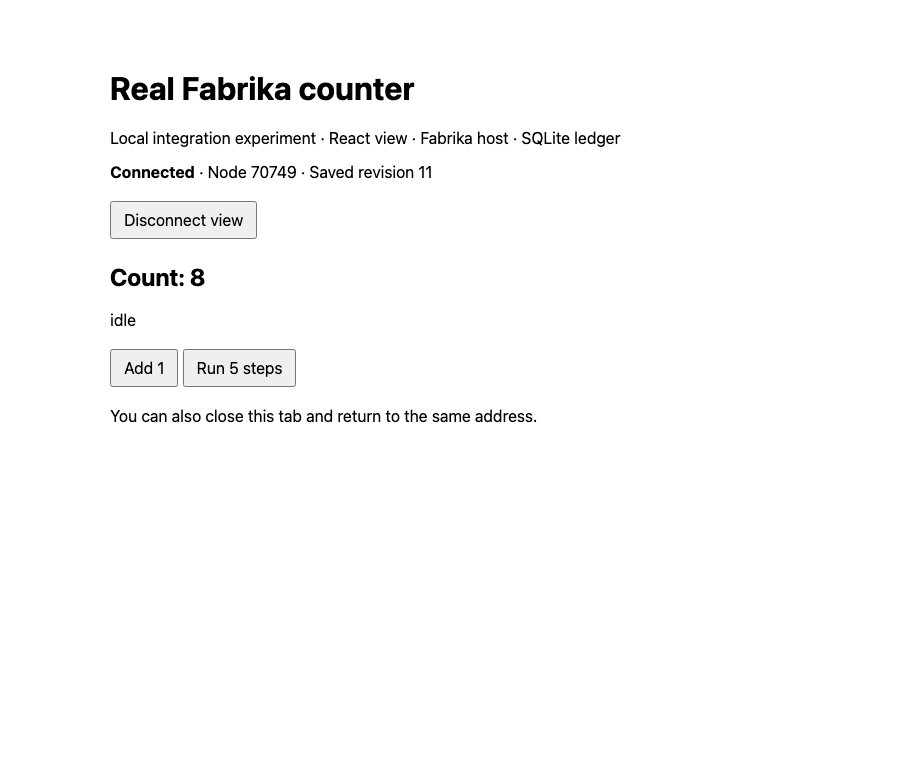

# A React window over a real Fabrika program

```ts
// The connection exercised by this experiment, not a new GUI SDK.
// Browser: send({ type: "increment" })
// Bridge: validate message -> cast(name, id, body, "browser")
// Program: durable inbox -> TEA update -> SQLite checkpoint
// Bridge: getState(name, CounterState) -> view(state) -> browser
```

The local connection worked. The counter advanced with every browser closed.
After an abrupt Node exit, a replacement process restored its saved count and
the already-open browser reconnected without a reload.

This tests the browser/host boundary in the
[local-page direction](https://github.com/usirin/tea-fabrika/blob/bf3e370d623a214635186d9c20b096a2ad1a825b/docs/direction/the-gui-is-a-local-web-page-first.md).
It does not run the earlier Tuval kernel or its desktop.

## Setup

Run on 2026-10-22 with Node 26.2.0. The isolated source copy was pinned to
`bf3e370d623a214635186d9c20b096a2ad1a825b`, with TEA 0.21.0 and Effect 4.0.0.
The source package was unchanged. The primary working checkout was not used
as the runtime.

The prototype used the real `@kampus/fabrika` program, host and SQLite exports:
`defineProgram`, `Self.run`, `serve`, `cast`, `getState`, `whereis`, and
`layerSqlite`. A small HTTP/WebSocket bridge served one statically bundled
React window on loopback. Browser input and outgoing views had Effect schemas.
The socket checked the exact Origin and a token generated at each Node start.

The counter's TEA state included the count, inbox cursor, and a tagged job
state: idle, running or done. Its running state held a job ID and target.
An Effect inside the program sent one timer message each second through the
durable inbox. React held connection status and the last received view.

```ts
// Excerpts from the actual prototype.
const handle = yield* self.run(
  counter,
  { schema: CounterState, cursor: (state) => state.cursor },
  { ctx: undefined },
);

// Pure projection; neither this function nor the program imports React.
const view = (state: CounterState) => ({
  count: state.count,
  phase: state.work.kind,
  remaining: state.work.kind === "running" ? state.work.target - state.count : 0,
  notice: state.notice,
});

// The separate React component receives view data and a send function.
<button onClick={() => send({ type: "increment" })}>Add 1</button>;
```

This is application glue over existing public exports. The GUI direction's
`Program.make` and `WindowProps` examples remain sketches; this experiment did
not add those APIs or package-window discovery.

No provider was called. Model spend was $0. No Cloudflare deployment, GitHub
mutation, or account authentication was performed.

## Observations

Playwright drove the actual page and Node process. These were not simulated
browser and server panels inside one page.

| Case | Observed result |
|---|---|
| Click Add 1 | Saved count changed from 0 to 1. |
| Send malformed JSON and an undeclared reset action | Both were refused; the count stayed 1. |
| Send the same message ID twice | Count changed once, to 2. |
| Start five steps, then close the entire test browser | With zero sockets connected, count advanced from 2 to 3, then finished at 7. |
| Open a fresh browser, then reload | Both showed saved count 7. |
| Keep a browser open, SIGKILL Node, then start a new process on the same SQLite file | The new process restored count 7; the open page reconnected and displayed the new process ID. |
| Missing token, token from the previous process, or foreign Origin | Socket upgrade returned 403. A foreign-Origin session request also returned 403. |
| Click Add 1 after recovery, then reload | Both showed saved count 8. |
| Render at 320 pixels wide | Content width was 320; no horizontal overflow. |

Neither browser verification phase reported a JavaScript page error. The
Fabrika package typecheck, prototype typecheck, browser build and prototype
source formatting check passed. This changed no library implementation.

The separate, older working checkout's required checks were also run. Its
typecheck passed. Its lint failed with 1,368 errors and 3,595 warnings across
the checkout, including earlier experiment files. Its tests had 1,077 passes
and one failure: the merge-queue case in `src/lane-replay.test.ts` returned
`diverged` instead of `same`. That source file was not changed here. These
results do not establish the cause of that failure, and the working checkout
is not ready to offer as a verified change.

The first prototype typecheck omitted strict options inherited by the source
workspace and failed inside its host types. Extending the actual source base
configuration fixed it without changing library code or disabling checks.
The dependency installer used Node 22 and printed engine warnings; the runtime
and browser build explicitly used Node 26.2.0.

Saved evidence: [observed cases](./results/129-browser-node-proof.json) and
[the recovered browser window](./results/129-browser-node-proof.png).
Runnable prototype files remain in the isolated local experiment directory;
they are not a distributed GUI package or a committed reproduction harness.



## What this cannot tell us

The kill happened after the five-step job finished. This proves saved counter
recovery, not recovery of a running job or safe retry of an external effect.
It also does not prove agent sessions, credential handling, terminal keyboard
behavior, R2 recovery, remote hosting, window package loading, pane navigation,
or isolation between installed windows.

One counter and one machine restart do not establish production reliability.
The HTTP/WebSocket bridge and React window are local experiment code, not a
shipped Fabrika GUI. The source of truth remains the program and its ledger;
this experiment establishes that a separate browser can use them.
