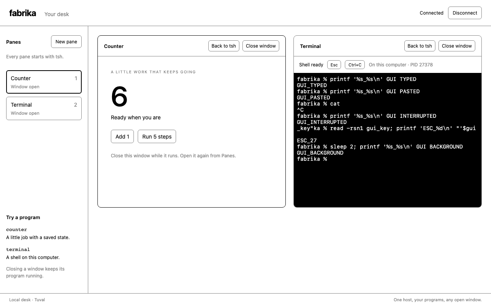

# tsh opens a program's window in the same pane

```text
Open the desk:  tsh ›
Type counter:  Counter's React window, in that pane
Back to tsh:   tsh ›
Type terminal: Bash, through a native PTY, in that pane
Close window:  the program continues; the pane list can reopen its window
```

The real tsh program can be the entrance to the GUI. The local desk starts it
in each pane. The commands `counter` and `terminal` request a view in that
same pane. Counter uses the real Fabrika host and SQLite; Terminal uses a
normal Fabrika program with a native PTY and memory storage.

This was built on `806a9c7419fc7d793e0c010829cfecb5d148bace`. The later upstream
head `49b950c15cc115b1926002c579ef8b2ade04ecd4` changed the parent-stage
direction note; this run did not update its pinned library implementation.
Node was 26.2.0. No model was called, so model spend was $0. No cloud service,
GitHub issue, PR, or remote repository was changed.

## Code and ownership

The Elm answer is a parent with explicit pane records and tagged messages.
A pane's current view is different from the set of programs it started:

```ts
// An excerpt of the stored record, with its corresponding actions.
type Pane = {
  id: string;
  kind: "tsh" | "counter" | "terminal";
  started: readonly ("tsh" | "counter" | "terminal")[];
  title: string;
  open: boolean;
};
// display changes kind and remembers the program in started.
// hide changes open. It never deletes a program from started.
// show reopens the same pane.
```

The host reconciles `started`, including programs whose window is hidden.
That record is why a counter resumes after Node restarts while its pane was
showing tsh. React does not own program lifetimes.

| Code | Owns |
|---|---|
| `apps/browser-desk/src/desk.ts` | The saved pane records and their TEA transitions. |
| `apps/browser-desk/src/tsh.ts` | The browser launcher for real `Shell.tsh`, using its typed lines and printed outputs. |
| `apps/browser-desk/src/server.ts` | Program lifetimes, SQLite, reconciliation, typed socket input, and view projection. |
| `apps/browser-desk/src/client.tsx` | Pane chrome, connection state, unsent command drafts, and rendering windows. |
| `apps/browser-desk/src/counter/` | The private recovery counter, pure view/schema, and separate React window. |
| `programs/terminal/src/` | The general Terminal program, bounded in-memory output, and separate xterm React window. |

The `counter` and `terminal` entries in tsh are small launch commands. They
write a typed display request. The host starts or finds the real program;
no terminal output is parsed to decide which window to show.

Each program exports its React component on `<package>/window` and its pure
view/schema separately. The app selects from those trusted imports at build
time. This does not add `Program.make`, a generic view SDK, or npm window
discovery to Fabrika's public library.

Terminal input uses the ephemeral program input, not the durable inbox.
Keystrokes and terminal output are not stored in SQLite. Counter actions and
pane actions use durable inboxes. Terminal output keeps a bounded tail in
memory; it is not an archival terminal log.

## Observed checks

The retained checker is `apps/browser-desk/check-browser.mjs`. It creates a fresh
host and disk, drives actual browsers, and cleans up its processes. Ten cases
passed. The cases include:

- A new desk starts tsh. `seq --to 3 | double` prints `double 2`, `double 4`,
  and `double 6`; `counter` replaces the same pane with a working React view.
- Native typing and browser clipboard paste execute in Bash. Ctrl-C ends
  foreground `cat` and leaves Bash usable. One Escape reaches native `read`
  as character 27.
- Back to tsh, then `terminal`, retains the same shell PID and output.
- With the counter window hidden and every browser closed, count advances
  from 1 toward 6. A fresh browser reopens count 6 and the original shell,
  including the output of a command that finished without a viewer.
- At 320 pixels wide the document is 320 pixels wide, with no horizontal
  overflow.
- During the next five-step job, the pane returns to tsh and Node is killed.
  The replacement host finds that hidden counter and finishes at the original
  target, 11. The open browser reconnects. Terminal gets a new shell PID.
- Missing or previous-start socket tokens, foreign Origin, malformed JSON,
  an undeclared action, and a message for the wrong program are refused.

No JavaScript page errors were reported. A separate integration check uses
the real tsh parser to reject a bad flag before a launch request can occur.

Typecheck, lint, the GUI build, and the final full suite passed. The final
suite included the new integration check: 140 files and 2,194 tests, run with
`TERM=xterm-256color` and two workers.

The strongest recovery check was also tried against a planted break in a
separate copy. That host started only the pane's current program and ignored
its other `started` entries. The first eight browser cases passed, then the
check failed at `resumed hidden job` after Node restarted while the pane was
on tsh. The active implementation was unchanged and passed the same case.

The browser bundle's input graph contained no native PTY module, platform-node,
provider SDK, GUI server, or GUI main entry. The app keeps one browser socket
for all visible panes.

Saved results and screenshots are under
[`results/130-fabrika-gui.json`](./results/130-fabrika-gui.json) and
[`results/130-fabrika-gui.png`](./results/130-fabrika-gui.png).



## Failures retained

The first install for new workspace packages could not find the repository's
pinned TEA release in registry metadata. Existing lockfiles already held its
resolution and the browser/native dependencies. Reusing those exact resolutions,
then letting pnpm normalize the lock, produced a working frozen offline install.
No existing package version was changed.

The initial sandbox suite could not open loopback listeners. A run with loopback
available had failures in existing host timing, settings-source timing, and PTY
checks. The first two passed in isolation. The PTY process inherited `TERM=dumb`.
With `TERM=xterm-256color` and two workers, all 2,193 existing tests passed.
No existing test, timeout, or library implementation was edited. The new GUI
integration check is additional to that run.

Three early browser-driver failures were checker mistakes: expecting unlabeled
tsh output, selecting xterm's inner `.terminal` as well as the outer section,
and retaining a locator from the deliberately closed browser. Those failed
results were kept locally; the final checker uses a fresh host and disk.

## What this cannot tell us

This is a local GUI slice. It does not prove Cloudflare deployment, R2 recovery,
agent sessions, Claude login, automatic repository updates, remote hosts, or a
shared ledger between people. Native terminal tests ran on macOS, not Linux.
Program windows are trusted static imports, not isolated third-party frames.
There is one counter and one Terminal per pane; typing its name again returns
to that instance. New pane creates a separate set.

The tsh command line is a small React input over real `Shell.tsh`, not the
complete readline launcher. Its Tab completion, history search and richer
keyboard experience are still to do. Closing a tab loses its unsent draft.
Terminal processes and output do not survive host death; only the pane record
does. The library/app naming change is also still upstream work.
